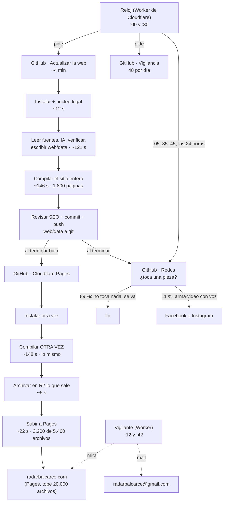
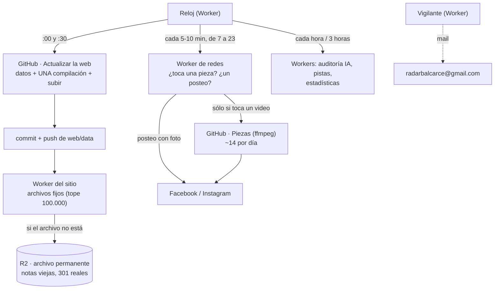
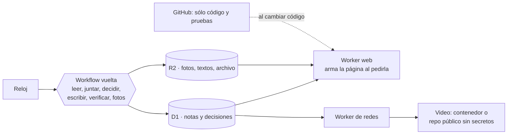

# 01 · El armado, el despliegue y la infraestructura (auditoría para Radar 2.0)

*16/10/2026, a la noche. Lo armó Claude leyendo los 36 workflows, los Workers de `infra/`, los documentos de
`docs/etapa-10-operacion/`, `docs/salud-tecnica/` y `docs/COMO-FUNCIONA-HOY.html`, y midiendo: **4.742 corridas reales de
GitHub del 2 al 16/10** (bajadas con `gh api`, de a medio día para no chocar con el tope de 1.000 por consulta), los pasos de
44 corridas sueltas, los registros de 14 despliegues (uno por día), el historial de git y el sitio publicado (con `curl`).
No se tocó código ni datos, no se commiteó nada y no se corrió nada que escriba en `web/data`.*

*Cómo leer las marcas: **[MEDIDO]** sale de las corridas, del git o del sitio; **[DOCS 16/10]** lo leí hoy en la página
oficial de Cloudflare o de GitHub; **[ESTIMADO]** es una cuenta mía; **[SIN VERIFICAR]** es algo que hay que probar antes de
apostar a eso.*

---

## Resumen en 10 líneas

1. **Sí, hoy se rearma y se recompila el sitio entero cada media hora, y además dos veces**: "Actualizar la web" compila
   (146 s de media) y "Cloudflare Pages" vuelve a compilar exactamente lo mismo (148 s) para subirlo. La segunda compilación
   no aporta nada: unir las dos ahorra **~4.000 minutos por mes** y la nota se ve **~2,5 minutos antes**.
2. **"Desplegar sólo si cambió algo" no sirve tal cual**: en 14 días, de 716 vueltas buenas, **716 cambiaron algo** (en
   promedio 1,5 notas nuevas por vuelta y, en todas, la cantidad de medios de alguna nota). Cero vueltas "sin novedades".
3. **El tope de 20.000 archivos no es el problema de hoy**: el sitio tiene **5.459 archivos** (no 15.900: ese número es la
   cuenta *con el sitio lleno* a 3.700 notas). Se llega al tope de 3.700 notas hacia el **11/12/2026**.
4. **Ese tope desaparece sin reescribir nada**: el plan Workers Paid que ya pagan permite **100.000 archivos** si el sitio
   se sirve como "Worker con archivos estáticos" en vez de Pages [DOCS 16/10]. Y el archivo permanente en R2 **ya está cargado**
   (1.163 notas, 194 MB): falta sólo ponerle la ruta.
5. **La dirección del diseño del motor (base D1 + Workflows de Cloudflare + sitio armado por un Worker) es la correcta como
   destino**, pero cambiaría el orden: como el apuro del 6/12 se resuelve barato, el sitio armado desde la base va **junto con
   el motor, no antes**. Lo primero es sacar desperdicio (1 a 3 días de trabajo).
6. **GitHub gasta hoy ~14.000 minutos reales por mes (~19.500 si GitHub redondea cada corrida al minuto)**. "Redes" corre
   **124 veces por día** y el 89 % no hace nada (pregunta "¿toca una pieza?" y se va), incluso de madrugada.
7. **Hay duplicados de disparo**: "Redes" arranca por el reloj a los :05/:35 **y** al terminar cada "Actualizar" (las dos
   cosas, casi a la misma hora); "Vigilancia" corre 48 veces por día cuando el vigilante de Cloudflare ya avisa por mail.
8. **Privado hoy costaría ~US$ 69 a 102 por mes** (US$ 0,006 el minuto, 2.000 incluidos). Con los recortes de este documento
   baja a ~US$ 35 a 45; recién **con el motor fuera de GitHub entra en lo gratis**. Atajo posible: un servidor propio chico
   (~US$ 5) como "runner", que GitHub no cobra.
9. **Lo más delicado de que el repositorio sea público no es el código: es el historial.** El texto completo de **todo lo que
   se publicó**, incluidas notas retiradas por proteger a una víctima, queda en git para siempre (lo comprobé con una nota
   retirada el 15/10: está entera en 4 versiones viejas). `retiradas.json` muestra además título, medio y motivo.
10. **Costos**: se paga Workers Paid (US$ 5) y el dominio. No conviene pagar Cloudflare Pro ni GitHub Pro. Conviene cargar la
    clave paga de voces con tope (lo detalla `04-IA-Y-MODELOS.md`) y, cuando se pase a privado, revisar si hace falta algo más.

---

## Palabras que aparecen

- **Workflow** (de GitHub): una receta de pasos que corre en una computadora prestada de GitHub (el "runner").
- **Compilar / armar el sitio**: convertir los datos en las páginas HTML que ve el lector (`npm run build`, Next.js).
- **Desplegar / subir**: mandar esas páginas a Cloudflare para que las sirva.
- **Worker**: un programa chico que vive en Cloudflare y corre cuando llega un pedido o cuando suena su reloj (cron).
- **R2**: el depósito de archivos de Cloudflare (como una carpeta en la nube). **D1**: su base de datos.
- **Pages**: el servicio de Cloudflare que hoy sirve el sitio como archivos fijos.
- **Minuto facturable**: lo que GitHub cobraría en un repositorio privado. Si redondea cada corrida al minuto, una corrida
  de 17 segundos cuenta 1 minuto (la página de GitHub de hoy no lo aclara: por eso doy los dos números).

---

## 1. Cómo se arma y se publica hoy

### 1.1 Cuánto tarda cada paso [MEDIDO]

Las 22 últimas corridas buenas de cada uno (16/10), en segundos:

| Paso | "Actualizar la web" | "Cloudflare Pages" |
|---|---|---|
| Preparar, bajar el código, instalar | 16 | 18 |
| Núcleo legal de las pruebas | 2 | — |
| **Buscar noticias y armar los datos** | **121** (p50 107, máx. 285) | — |
| **Compilar el sitio** | **146** (p50 159) | **148** (p50 155) |
| Revisar el SEO | 0,5 | — |
| Commit y push | 5 (máx. 20) | — |
| Archivar en R2 | — | 8 |
| Subir a Pages | — | 22 |
| **Total de la corrida** (14 días, 769 y 769 corridas) | **media 249, p50 233, p95 482** | **media 130, p50 146, p95 192** |

- **La mitad del tiempo de "Actualizar" es compilar**, y "Cloudflare Pages" es casi entero otra compilación igual. La caché
  de Next que se agregó el 9/10 en "Cloudflare Pages" no se nota (148 s contra 146 s sin caché).
- Desde que suena el reloj hasta que la nota se ve pasan **~6,5 minutos** (233 s + espera + 146 s).
- La compilación crece con el sitio: de 1.053 páginas (2/10) a 1.801 (16/10). Los tiempos saltan mucho de un día a otro
  (66 a 155 s), así que no sirven para proyectar fino; a ojo, con 3.700 notas compilar llevaría 2 a 3 veces más [ESTIMADO].

### 1.2 Cuántas vueltas cambian algo [MEDIDO]

- Del 2 al 16/10: **769 corridas de "Actualizar", 52 fallaron** (24 el 4/10 y 17 el 11/10, los dos congelamientos por
  pruebas), 1 cancelada, **716 buenas y 716 commits "Datos de la portada"**. O sea: **ninguna vuelta buena terminó en
  "Sin novedades"**.
- Comparé campo por campo `archivo.json` en las últimas 16 vueltas: **24 notas nuevas (1,5 por vuelta)**, 4 vueltas sin
  ninguna nota nueva pero, **en las 16, cambió la cantidad de medios de 4 a 16 notas** (eso se ve en "Fuentes (N)"), y en
  varias, fotos, cuerpos y secciones. `portada.json` cambia siempre (lleva la hora en que se armó).
- **Conclusión**: "desplegar sólo si cambió algo" ahorraría ~0. La única variante con algo de sentido sería "desplegar al
  toque sólo si hay nota nueva, corrección o retirada; lo demás, como mucho cada 2 horas": saltearía ~1 de cada 4 vueltas
  (~1.000 minutos por mes con una sola compilación). **No la recomiendo**: suma reglas para poco.

### 1.3 Cuántos archivos tiene el sitio [MEDIDO]

| Día | Páginas que arma Next | Archivos del sitio | Notas con página | Archivos que se suben en cada despliegue |
|---|---|---|---|---|
| 2/10 | 1.053 | ~2.200 | — | 1.626 |
| 10/10 | 1.353 | 4.088 | — | 2.499 |
| 15/10 | 1.645 | 4.987 | — | 3.095 |
| 16/10 (20 h) | 1.801 | **5.459 de 20.000** | **1.192 (tope 3.700)** | **3.183** |

- Sube **~230 archivos por día**. Con el tope de 3.700 notas se llega a **~15.900** (el 80 % del límite) hacia el **11/12**
  (2.508 notas que faltan ÷ 44,4 por día, el ritmo que mide el propio exportador).
- **Corrección a `CLAUDE.md`**: dice "medido el 15/10, 15.900 archivos de los 20.000". El 15/10 se midieron **5.125**; los
  15.900 son la cuenta con el sitio lleno (lo aclara bien `docs/salud-tecnica/ARCHIVO-PERMANENTE.md`).
- **En cada despliegue cambian ~3.200 de los ~5.460 archivos**, aunque haya entrado una sola nota. Es porque cada página lleva
  adentro el número de compilación de Next (`"b":"nQq-…"`, lo vi en una nota del 3/10) y el bloque "Seguí leyendo". No cuesta
  nada (la subida tarda 7 s), pero muestra que con Next exportado **no existe la compilación por partes**: se rehace todo.
- **Otro tope que nadie mira**: las redirecciones de `public/_redirects`. Pages acepta 2.000; el código se corta en 1.900.
  Van **1.419** y suben ~50 por día (800 el 2/10): se llega a 1.900 hacia el **26/10**. Desde ahí, las direcciones viejas
  `/nota/ID` de las notas más antiguas dejan de redirigir con un 301 de verdad y pasan por la página 404, que redirige con
  JavaScript (para Google es un 404). Es chico, pero es un argumento más para tener un Worker adelante (ver 2.3).

### 1.4 El archivo permanente en R2 ya está a medio camino [MEDIDO]

- La variable `R2_ARCHIVO` existe desde el 16/10 a la tarde y el paso "Archivar las notas por salir (R2)" corrió en 14 de los
  últimos 22 despliegues. `https://radar-balcarce-archivo.radarbalcarce.workers.dev/_archivo/estado` dice: **1.163 notas,
  2.229 objetos, 194 MB, ok**.
- **Falta lo que ve el lector**: la ruta `radarbalcarce.com/nota/*` hacia el Worker, y decidir las fotos.
- **Corrección**: `docs/salud-tecnica/ARCHIVO-PERMANENTE-IMPLEMENTACION.md` todavía dice arriba "no se creó el depósito…
  la variable `R2_ARCHIVO` no existe". Ya no es así (los pasos 1 y 2 de su guía están hechos).
- **Corrección de tamaño**: el diseño suponía ~40 KB por nota (0,4 GB por año). Medido: **~167 KB por nota** con su foto y
  sus tarjetas, o sea **~1,7 GB por año** a 10.000 notas. Sigue entrando años en los 10 GB gratis de R2, junto con los respaldos.

---

## 2. ¿Hace falta rearmar todo cada media hora? Las alternativas

Respuesta corta: **con Next exportado como archivos fijos, sí: cada cambio obliga a rearmar y subir el sitio entero**. Lo que
sí sobra es hacerlo dos veces. Para dejar de rearmar hay que cambiar quién arma las páginas (un Worker que las arme cuando
alguien las pide). Las opciones, de la más barata a la más grande:

| # | Alternativa | Qué gana | Qué cuesta | Riesgo | Esfuerzo |
|---|---|---|---|---|---|
| A | **Una sola compilación**: subir a Cloudflare desde "Actualizar la web", después del push, con lo que ya compiló | ~4.000 min/mes facturables (~3.100 reales); la nota se ve ~2,5 min antes; un workflow menos | Nada | Bajo-medio: es lo que publica. Se prueba con una corrida a mano; volver atrás es restaurar el `.yml` | 2 a 3 horas |
| B | Desplegar sólo si cambió algo | ~0 (ver 1.2) | — | — | **Descartar** |
| C | **Servir el sitio desde un "Worker con archivos estáticos"** (los mismos archivos de `web/out`, otro destino) **y que ese mismo Worker haga de archivo permanente** (si el archivo no está, busca la nota en R2) | Tope de **100.000 archivos** con el plan ya pago [DOCS 16/10] (el de 3.700 notas puede subir a ~20.000 o bajar, a gusto); redirecciones 301 reales sin el tope de 2.000; un solo Worker en vez de "Worker delante de Pages"; los pedidos a archivos fijos no se cobran [SIN VERIFICAR el detalle de cobro] | US$ 0 | Medio: cambia quién atiende el dominio. Se prueba en `workers.dev` antes y Pages queda de reserva (volver = apuntar el dominio a Pages, minutos) | 1 a 2 días |
| D | **Activar la ruta del archivo y bajar el tope del sitio** (`TOPE_DE_NOTAS`, por ejemplo 1.500) | Compilación chica para siempre (~1.500 notas, ~7.000 archivos); nada de lo viejo da 404 | Las páginas de sección muestran sólo las notas que siguen en el sitio; **el mapa del sitio (`sitemap.xml`) hoy sale de la compilación, así que las notas archivadas desaparecerían de él**: hace falta un `sitemap-archivo.xml` armado desde el manifiesto de R2 (no existe) | Medio en SEO si se olvida el mapa | 1 día (la ruta ya está escrita) |
| E | Compilación por partes (incremental) de Next | — | Next exportado como archivos fijos no la tiene (la "regeneración incremental" pide un servidor) | — | **Descartar** |
| F | **Páginas armadas por un Worker leyendo de D1/R2** (el diseño del motor, sección 3) | Se acaba el rearmado: una nota se ve en segundos; sin topes de notas, de archivos ni de redirecciones; GitHub deja de compilar | Reescribir las ~12 rutas, las tarjetas, el buscador; probar el espejo de las 1.200 notas | Medio-alto en SEO si cambia el HTML | 1 a 3 semanas |

### 2.1 Qué recomiendo

1. **Ya: A.** Es el desperdicio más grande que se arregla sin mudar nada.
2. **Antes de noviembre: C (y con C, D si quieren un sitio más liviano).** Saca el apuro del 11/12 y el de las redirecciones
   con el plan que ya pagan, usando el mismo armado de hoy. Si C se demora, como mínimo poner la ruta del archivo (paso 4 de
   la guía) antes de que la primera nota salga del sitio.
3. **F, recién junto con el motor.** El sitio armado desde la base tiene sentido cuando la base (D1) sea la verdad; hacerlo
   antes obliga a mantener un "puente" que copie los JSON de git a D1 cada media hora, que es justo la complejidad que se
   quiere sacar.

### 2.2 ¿Es correcta la dirección del diseño del motor (`docs/etapa-10-operacion/DISENO-MOTOR.md`)?

**Sí como destino; cambiaría tres cosas.**

- **El orden.** El diseño pone "primero el sitio (corre contra el 6/12)". Con C y el archivo en R2, esa fecha deja de correr
  por US$ 0 y en 1 a 2 días. Entonces el orden que propongo es: **(1) sacar desperdicio → (2) C → (3) redes, vigilancia,
  auditoría y pistas a Workers → (4) el motor a Cloudflare con D1 → (5) el sitio armado desde D1 → (6) repositorio privado**.
  El sitio va después del motor porque comparten la base.
- **Una alternativa que el diseño no pesó: mudar el robot "tal cual" a un contenedor de Cloudflare** (Containers: corre el
  mismo Node con sus archivos y su ffmpeg, despertado por el reloj) en vez de reescribir la capa de archivos (~70 módulos, el
  riesgo R1 del diseño). Serviría de **puente** para sacar a GitHub del medio y pasar a privado antes, y la base D1 se
  adopta después, con calma. Costo estimado: US$ 2 a 8 por mes según el tamaño de la máquina (1.600 a 6.500 minutos de
  máquina por mes contra 375 incluidos) [ESTIMADO, SIN VERIFICAR que Containers esté maduro y que una compilación de Next
  quepa con buena velocidad]. Vale una prueba de un día antes de decidir.
- **Los números de base.** El diseño habla de "5.000 archivos compilados" y "tope de 3.500 notas / 6/12": hoy son 5.459
  archivos, tope 3.700, fecha 11/12. Y el archivo en R2 pesa 4 veces lo que suponía (ver 1.4). No cambia la conclusión.

### 2.3 El armado y despliegue propuesto (después de A, C y redes a Workers)

Y más adelante (motor en Cloudflare, el diseño del motor tal cual, con el sitio al final):

---

## 3. Inventario de los workflows

Corridas del **2/10 23:00 al 16/10 23:00 UTC** (14 días) [MEDIDO]. "Fact." = minutos facturables (redondeando cada corrida).
La última corrida anterior al 2/10 sale de `COMO-FUNCIONA-HOY.html`.

### 3.1 Los que corren solos (el robot)

| Workflow | Qué hace | Quién lo dispara | Corridas 14 d (fallas) | Fact. 14 d | Veredicto |
|---|---|---|---|---|---|
| `actualizar.yml` | Lee fuentes, decide, escribe con IA, verifica, arma `web/data`, compila y commitea | Reloj :00/:30 (692) + horario propio :07/:37 (104, **sacado el 16/10 16:32**) | 796 (52) | 3.885 | **Mejorar**: sumarle la subida (alternativa A) |
| `cloudflare-deploy.yml` | Compila otra vez, archiva en R2, sube a Pages, avisa a Bing | Al terminar "Actualizar" | 795 (1; 53 salteadas) | 2.239 | **Fusionar** en "Actualizar" (dejarlo sólo a mano, de rescate) |
| `redes.yml` | Posteo de Facebook + "¿toca una pieza?" + arma y publica video | Reloj :05/:35/:45 **las 24 h** (967) + al terminar cada "Actualizar" (795) | 1.762 (26) | 2.294 | **Achicar**: sacar el disparo de `workflow_run`, reloj sólo de 7 a 23; después, la pregunta "¿toca?" y el posteo a un Worker |
| `vigilancia.yml` | Mira web, corridas, claves, piezas; estadísticas de las 9 y las 21; WhatsApp (sin cupo desde el 1/10) | Reloj :00/:30 (672) + horario cada 3 h (55) | 727 (4) | 794 | **Achicar**: cada 3 horas alcanza (los avisos urgentes ya los da el vigilante de Cloudflare); después, a Worker |
| `auditoria-ia.yml` | Relee lo publicado con Groq y avisa; corrige sola ortografía chica | Horario de GitHub :41 cada hora | 87 (1) | 130 | **Dejar**, pero dispararlo desde el reloj: GitHub cumplió sólo 87 de 336 horas (26 %). Ojo con la corrección automática (`04-IA-Y-MODELOS.md`, punto 9) |
| `pistas.yml` | Vuelve a mirar las pistas abiertas | Horario cada 3 h + botón del celular | 53 | 54 | **Dejar**; a Worker en la etapa de laterales |
| `informe-diario.yml` | Mail de las 8:15 y las 21:15 | Reloj :15 **y** :30 (reintento) + horario :45 de respaldo | 4 | 4 | **Dejar** (tres disparos para un mail, pero el Worker no repite) |
| `ilustrar-notas.yml` | Ilustración con IA para notas sin foto | Reloj :20 cada 2 h (desde el 16/10) | 4 | 10 | **Dejar** |
| `pruebas.yml` | Las ~2.500 pruebas | Cada push de código + lunes | 60 (**10 fallas el 16/10**) | 111 | **Dejar**; sumar `cancel-in-progress` para que una ráfaga de pushes no corra 10 veces. Hoy hay pruebas en rojo en `main` y el aviso le llega sólo a quien hizo el push |
| `armado-vacio.yml` | Arma el sitio con datos raros para que no se congele | Push de la web + lunes | 47 | 47 | **Dejar** (o meterlo dentro de "Pruebas") |
| `auditoria.yml` | Auditoría semanal de lo publicado y de las redes | Lunes 9:00 | 3 (1) | 18 | **Dejar** |
| `respaldo.yml` | Copia semanal del repo, datos y fotos a R2 | Domingos 3:17 | 4 | 6 | **Dejar**; falta la copia fuera de Cloudflare y GitHub, y una regla para borrar respaldos viejos (ver 5) |
| `pruebas-otra-hora.yml` | Pruebas "como si fuera otra hora" | Lunes | 3 (**2**) | 8 | **Decidir**: falla y nadie lo mira. Arreglar o borrar |
| `fijar-piezas.yml` | Arma piezas con voz para reusar 2 semanas | A mano + horario fijo `30 8 10 10 *` | 1 | 2 | **Dejar a mano**; borrar el horario (se dispararía cada 10 de octubre) |

### 3.2 Los que se corren a mano (herramientas)

| Workflow | Qué hace | Corridas 14 d | Veredicto |
|---|---|---|---|
| `panel.yml` | La IA escribe una nota pedida desde el celular | 58 (8 fallas); **ninguna desde el 8/10** | **Dejar** y probarlo: el celular dejó de usarlo (los "Hernán aprueba" de estos días entran por otro lado) |
| `reintentar.yml` | Reintenta una pieza que falló (botón del celular) | 0 | **Dejar** (rescate) |
| `piezas.yml` | Arma piezas a mano | 0 (última 1/10) | **Dejar** (rescate) |
| `crear-voces.yml` | Crea o lista voces de Gemini | 0 | **Dejar**: hace falta antes del 29/09/2027 |
| `probar-gemini.yml`, `probar-mail.yml`, `probar-restauracion.yml` | Diagnósticos | 4, 1, 2 (1 falla) | **Dejar** |
| `archivo-produccion.yml` | Carga, quita o rutea el archivo permanente | 1 | **Dejar** (es el botón de "sacar YA" de R2) |
| `vigilante-cloudflare.yml`, `reloj-cloudflare.yml`, `imagenes-cloudflare.yml` | Suben los Workers | 5, 5, 2 | **Dejar** |
| `reparar-estadisticas.yml` | Arregla días en cero | 3 | **Dejar** hasta que se arregle la medición; después, borrar |
| `archivo-staging.yml` | Ensayo del archivo | 2 | **Cortar** cuando la ruta esté puesta |
| `generar-fondos-clima.yml`, `probar-imagen-nota.yml` | Tareas de un día (16/10) | 1, 3 | **Cortar** al cerrar lo de imágenes |
| `probar-flux.yml` | Probó un modelo que no se eligió | 1 | **Cortar** |
| `sondeo-fuentes-cloudflare.yml` (+ `infra/sondeo-fuentes/`, secreto `SONDEO_TOKEN`) | Ya dio su resultado (97 de 103 feeds) | 2 (1 falla) | **Cortar**, o **reusar** como primer ladrillo del lector de feeds en Cloudflare |
| `prueba-whatsapp.yml` | WhatsApp de prueba (sin cupo) | 0 (última 25/09) | **Cortar** |
| `auditar-redes.yml`, `auditar-voz.yml` | Auditorías a mano | 0 (última 26/09) | **Cortar o archivar** (la de redes ya la hace "Auditoría") |
| `ver-facebook.yml` | Mira qué hay en Facebook | 1 (5/10) | **Dejar** (diagnóstico de 23 líneas) |
| `fotos-a-r2.yml` | Copia fotos a R2 | 0, nunca | **Decidir**: si se hace C, conviene correrlo (fotos fuera del sitio); si no, borrarlo |
| Fantasma "Sondeo de fuentes (temporal)" | El archivo ya no existe; quedan 3 corridas del 8/10 | 3 | **Borrar esas corridas** de la lista de Actions |

Coincido con `COMO-FUNCIONA-HOY.html` § 12 en casi todo. Lo que **agrego o corrijo**:

- **"Redes" tiene un disparo duplicado**: el reloj la llama a los :05/:35 y además arranca sola al terminar cada
  "Actualizar" (que termina hacia los :04/:34). Son dos corridas casi juntas, cada media hora. El `workflow_run` era un
  respaldo de cuando el reloj de GitHub era impuntual (21/09); con el Worker no hace falta. Ahorro: **~48 corridas por día**.
- **"Redes" corre de madrugada sin nada que hacer**: las piezas van de 7:00 a ~23:00 y Facebook de 8 a 22 (`redes/piezas.mjs`,
  `panel/horarios.mjs`), pero el reloj la despierta las 24 horas (`trabajosDelMinuto`). El comentario de `redes.yml` dice
  "de 7 a 23": el código no. Ahorro: **~35 corridas por día**.
- **"Vigilancia" no es sólo "el horario de respaldo que sobra"**: corre 48 veces por día, commitea ~11 veces por día
  (`vigilancia.json`, `estadisticas*.json`) y su canal de aviso (WhatsApp) está sin cupo desde el 1/10. Lo urgente ya lo
  avisa el vigilante de Cloudflare por mail. Con 8 corridas por día alcanza para lo que sólo ella hace (claves, piezas
  fijas, estadísticas).
- **El reloj dice "los triggers de la cuenta son pocos"** (`wrangler.toml`): eso era el plan gratis (5). Con Workers Paid son
  **250** [DOCS 16/10]. Se pueden separar los horarios en vez de apretarlos en una expresión.
- **El horario propio de GitHub falla mucho más de lo que se cree**: "Auditoría IA" (cada hora) corrió el 26 % de las veces.
  Todo lo que dependa de un `schedule` de GitHub conviene pasarlo al reloj.
- **"Panel del celular no corre desde el 8/10"**: confirmado (última corrida 8/10 08:24).
- **El "~92 veces por día"** de `COMO-FUNCIONA-HOY` fue sólo el 15 y 16/10 (65 y 73 corridas por día medidas). Se arregló el
  16/10 a las 16:32 (commit `85df8f2f`). En los 14 días el promedio fue 55. Ojo: el comentario nuevo de `actualizar.yml` dice
  "17/10/2026" y el commit es del 16/10.
- **La caché de Actions** tiene 846 entradas y 3,5 GB (cada vuelta guarda una copia nueva de `.cache`). El tope por
  repositorio es 10 GB; hoy no molesta, pero conviene una clave que no cambie en cada corrida.

### 3.3 Los Workers de `infra/` y los horarios del reloj

| Worker | Qué hace | Horario | Estado | Veredicto |
|---|---|---|---|---|
| `radar-balcarce-reloj` | Le pide a GitHub que corra los workflows | `0,30` (Actualizar + Vigilancia), `5,35,45` (Redes), `15 0,11` (informe), `20` cada 2 h de 10 a 2 UTC (ilustrar) | Andando; el mayor hueco entre "Actualizar" buenos fue 454 min el 11/10 (por pruebas, no por el reloj) | **Mejorar**: Redes sólo de 7 a 23; decidir él si toca una pieza antes de despertar a GitHub; disparar Auditoría IA y Pistas |
| `radar-balcarce-vigilante` | Mira la web y las corridas desde afuera, avisa por mail, KV de memoria | `12,42` | Andando | **Dejar**; es el que debería quedarse con todas las alarmas. Falta quién vigile al vigilante (un chequeo externo gratis) |
| `radar-balcarce-archivo` (+ staging) | Sirve las notas viejas desde R2 | Sin horario; sin ruta | Cargado, sin ruta | **Mejorar**: con C pasa a ser el mismo Worker del sitio |
| `radar-balcarce-imagenes` | Genera ilustraciones con Workers AI | A pedido | Andando | **Dejar** |
| `radar-balcarce-mcp` | Servidor MCP de sólo lectura | — | Escrito, no subido | **Dejar** dormido hasta después de la 1.0 |
| `radar-balcarce-sondeo-fuentes` | Prueba de feeds desde Cloudflare | — | Subido, sin uso | **Cortar** (o reusar, ver arriba) |
| cron-job.org | Reloj viejo | — | Pausado | **Cortar** (borrar la cuenta tras unos días más de reloj estable) |

---

## 4. Los minutos de GitHub y el repositorio privado

### 4.1 Cuánto se gasta [MEDIDO, proyectado a 30 días]

| | Corridas por día | Minutos reales por mes | Facturables por mes (redondeando) |
|---|---|---|---|
| 2 al 16/10 | 306 | ~14.200 | ~19.600 |
| Desde el 16/10 16:32 (sin el horario doble de "Actualizar") | ~295 | ~13.500 | ~19.000 [ESTIMADO] |

Dónde se van, por mes (facturables, ritmo de hoy): **Actualizar ~6.800 · Redes ~4.700 · Cloudflare Pages ~4.200 ·
Vigilancia ~1.700 · Auditoría IA ~1.100 · Pruebas 300 a 1.800 (depende de cuántos pushes) · el resto ~600**.

### 4.2 Cuánto costaría privado

GitHub Free incluye **2.000 minutos** en privado; Pro, **3.000** (más el precio de Pro, que la página no dice; eran US$ 4).
El minuto de Linux cuesta **US$ 0,006** [DOCS 16/10]. La página ya no dice si redondea cada corrida al minuto: dice "tiempo
total de procesamiento". Por eso doy un rango (reales → facturables).

| Escenario [ESTIMADO, sobre lo medido] | Qué cambia | Minutos por mes (reales a facturables) | Privado, plan Free |
|---|---|---|---|
| Hoy | — | 13.500 a 19.000 | **US$ 69 a 102** |
| 1 · Una sola compilación | Alternativa A | 10.400 a 15.500 | US$ 50 a 81 |
| 2 · Más "Redes" sin duplicado ni madrugada, y "Vigilancia" cada 3 h | Ver 3.2 | 9.000 a 11.700 | US$ 42 a 58 |
| 3 · Redes, vigilancia, auditoría IA y pistas a Workers | Etapa de laterales | 7.500 a 9.400 | US$ 33 a 44 |
| 4 · El motor a Cloudflare (queda video y pruebas) | Etapa del motor | 2.000 a 3.700 | **US$ 0 a 10** |
| 4b · Igual, con el video en un repositorio público aparte sin secretos | Diseño del motor, V2 | 400 a 2.000 | **US$ 0** |

En los escenarios 4 y 4b lo que más pesa son las pruebas de cada push: con `cancel-in-progress` (recomendación 12) quedan
cerca del piso.

**Atajo para pasar a privado antes**: un "runner propio" (una computadora alquilada que hace el trabajo en vez de las de
GitHub). GitHub dice que los runners propios **no se cobran** [DOCS 16/10]. Un servidor chico cuesta ~US$ 4 a 6 por mes
[ESTIMADO]. Ventajas: privado ya, sin reescribir nada, y otra IP (quizás lea medios que hoy fallan desde GitHub). Contras:
**es un servidor nuestro que alguien tiene que mantener** (actualizaciones, disco lleno, que no se caiga), justo lo que el
proyecto evitó hasta ahora, y si se cae no hay respaldo. Lo pongo como opción si el privado se vuelve urgente; si no, mejor
esperar al escenario 4.

### 4.3 Qué queda expuesto hoy por ser público [MEDIDO]

| Qué | Dónde | Qué tan grave | Qué haría |
|---|---|---|---|
| **El texto completo de todo lo que se publicó, para siempre, incluidas las notas retiradas para proteger a una víctima o a un menor** | El historial de git de `web/data/archivo.json` y `portada.json` (cada 30 minutos una versión). Lo comprobé con la nota `d1rexu`, retirada el 15/10 por "datos que podrían identificar a la víctima": está entera (118 palabras) en 4 commits | **Alta** (legal y de imagen) | Pasar a privado lo tapa hacia adelante, pero **no borra lo que alguien ya bajó**: en 14 días hubo 14.003 descargas del repositorio de 1.789 lugares distintos (la mayoría, seguramente, las propias corridas de GitHub; no se puede distinguir). La solución de fondo es que **los datos dejen de vivir en git** (la base D1 del motor). Limpiar el historial (reescribirlo) es posible pero rompe todo lo que apunta a él: sólo ante un pedido legal concreto. **[Decisión de Hernán]** |
| Título, medio y motivo de cada retirada ("caso de violencia familiar con datos que podrían identificar a la víctima") | `web/data/retiradas.json` | Media | Que el archivo público lleve sólo el id y un motivo genérico, y el detalle viaje cifrado como lo demás del celular |
| El texto de las pistas que se pegan desde el celular (sólo el informe va cifrado) y lo que se pide a la IA desde el panel | `web/data/pistas.json`; las entradas de `panel.yml` se ven en la lista pública de corridas | Media (una pista puede traer algo que todavía no se publicó o una fuente) | Cifrar el texto de la pista igual que el informe |
| Quién corrigió qué (156 correcciones con "por") y las decisiones del celular | `correcciones.json`, `celular-decisiones.json` | Baja | Nada |
| Lo que espera a una persona | `portada.json` → `pendientes`: **sin título** cuando es delicado (sólo id, sección y la palabra que frenó) | Baja (bien resuelto) | Nada |
| Lo cifrado para los celulares (borradores, pendientes, contactos, informes) | `celular-*.json`, `auditoria-ia.json` | Baja hoy (RSA-OAEP + clave por mensaje) | Nada; al pasar a privado o a D1 deja de importar |
| Los registros de las corridas (públicos) | Actions | Baja: muestran títulos de lo descartado (son de medios públicos) y sólo el id de lo amarillo | Nada |
| Claves y tokens | — | Ninguna: los 15 secretos están en GitHub Secrets; ninguno en el código | — |
| El criterio, el semáforo y el código | todo el repo | Baja | Nada |

**Recomendación concreta.** No pasar a privado ya pagando (US$ 70 a 100 por mes es 3 a 4 veces el tope de US$ 25). Hacer los
recortes de los escenarios 1 y 2 (unos días de trabajo), arreglar `retiradas.json` y `pistas.json` (horas), y **pasar a
privado cuando el motor esté fuera de GitHub** (escenario 4) o, si antes pasa algo legal, con el atajo del runner propio. Lo
que tiene que pasar para poder pasarlo: que los minutos por mes bajen de ~2.000 (o de ~3.000 con Pro), que el panel del
celular siga andando con repositorio privado (hoy usa la llave de GitHub de cada uno: con acceso de colaborador alcanza
[SIN VERIFICAR con el celular real]), y que `armado-vacio`, el vigilante y el MCP no lean nada por la vía pública de GitHub
(el vigilante de Cloudflare lee las corridas "por su API pública": en privado necesita su `GITHUB_TOKEN` opcional).

---

## 5. Costos

| Servicio | Hoy | Comentario |
|---|---|---|
| Cloudflare Workers Paid | **US$ 5 por mes** | Incluye lo que hace falta para todo el plan de este documento (250 relojes, 100.000 archivos por Worker, 10 millones de pedidos) [DOCS 16/10]. **Mantener** |
| Cloudflare Pages, DNS, Web Analytics, Email Routing, Workers AI (10.000 neuronas por día) | US$ 0 | Pages se reemplaza por C sin costo |
| Cloudflare R2 | US$ 0 | Archivo 194 MB + respaldos (~250 MB por semana, **que nunca se borran**) + piezas. Pasa los 10 GB gratis hacia mediados de 2027; desde ahí ~US$ 0,015 por GB por mes (centavos). Conviene una regla de rotación (7 diarios, 4 semanales, 12 mensuales) |
| Dominio `radarbalcarce.com` (DonWeb) | Un pago por año (el precio no está anotado) | Pasarlo a Cloudflare Registrar cobra a costo (~US$ 10 a 11 por año para un `.com`) [SIN VERIFICAR el precio actual] y centraliza; contra: más cosas en una sola cuenta. Opcional |
| GitHub | US$ 0 (público) | Ver 4.2. **No conviene GitHub Pro** salvo que se pase a privado con ~3.000 minutos |
| Gemini, Groq, Tavily, Meta, Open-Meteo, DolarApi, ESPN, Jolpica, Wikimedia | US$ 0 | La clave paga de voces (~US$ 3 a 4 por mes, con tope de gasto): ver `04-IA-Y-MODELOS.md`. Conviene |
| CallMeBot (WhatsApp) | US$ 0 | **Sin cupo desde el 1/10**: el "respaldo" no respalda nada. Cortar o reemplazar (el mail ya anda) |
| Cloudflare Pro (US$ 20 a 25 por mes) | — | Subiría Pages a 100.000 archivos [DOCS 16/10], pero C da lo mismo con lo que ya pagan. **No conviene** |
| Containers (si se usa para el robot o el video) | — | US$ 0 a 8 por mes [ESTIMADO] |

**Total hoy: US$ 5 por mes + el dominio.** Con todo lo recomendado (incluida la clave de voces): **~US$ 9 a 10 + dominio**,
lejos del tope de US$ 25. Lo caro sería el privado sin recortes; lo barato es casi todo lo demás.

---

## 6. Procesos que sobran o se duplican (completa `COMO-FUNCIONA-HOY.html` § 12)

1. **La compilación doble** (ya estaba): ~4.000 minutos por mes.
2. **"Redes" disparada dos veces cada media hora** (nuevo): reloj + `workflow_run`. ~48 corridas por día.
3. **"Redes" de madrugada** (nuevo): ~35 corridas por día sin nada que hacer.
4. **Dos vigilancias que avisan lo mismo por canales distintos** (corrijo "se complementan"): "Vigilancia" (GitHub, 48 por
   día, WhatsApp sin cupo) y el vigilante de Cloudflare (mail). Deberían quedar: el de Cloudflare para todas las alarmas y
   "Vigilancia" para lo que sólo ella sabe hacer, cada 3 horas, hasta que pase a Worker.
5. **Tres disparos para el informe diario** (reloj :15, reloj :30, horario :45). No duplica el mail porque el Worker
   reconoce la clave; está bien así mientras el disparo de los :15 no sea confiable (el 16/10 no despertó).
6. **Dos lugares que guardan "lo que se publicó"**: git (cada 30 minutos, ~107 commits por día, 196 MB de historial) y R2
   (el archivo). Con el motor, la verdad pasa a D1 y git queda para el código.
7. **Una medición que nadie mira**: `estadisticas-piezas.json` (132 KB) se reescribe en cada vigilancia (ya estaba).
8. **El `_redirects` de Pages y la página 404 que redirige con JavaScript** hacen lo que un Worker haría con un 301 (nuevo).
9. **El paso "Revisar que el SEO siga en pie" y "Armado con datos vacíos"** corren bien y baratos: **dejar**.

---

## 7. Recomendaciones, ordenadas por impacto y esfuerzo

Etapas: **Ya** (esta semana) · **E-A** limpieza (1-2 semanas) · **E-B** sitio en Worker con archivo (antes de noviembre) ·
**E-C** redes y laterales a Workers (E4 del diseño del motor) · **E-D** motor a Cloudflare (E5-E7) · **E-E** sitio desde D1 y
repositorio privado (E9).

| # | Qué | Tipo | Impacto | Esfuerzo | Riesgo | Etapa |
|---|---|---|---|---|---|---|
| 1 | Subir el sitio desde "Actualizar la web" con lo ya compilado; "Cloudflare Pages" queda sólo a mano | **Cortar** | ~4.000 min/mes; nota visible 2,5 min antes | 2-3 h | Bajo-medio (probar con una corrida a mano; subir sólo si el push salió) | Ya |
| 2 | Sacar el `workflow_run` de "Redes" | **Cortar** | ~1.400 min/mes, 48 corridas/día | 10 min | Bajo (el reloj ya la llama a los :05/:35) | Ya |
| 3 | Reloj de "Redes" sólo de 7 a 23 (`trabajosDelMinuto`) | **Achicar** | ~1.000 min/mes, 35 corridas/día | 30 min + su prueba | Bajo (revisar que ninguna pieza caiga antes de las 7) | Ya |
| 4 | "Vigilancia" cada 3 horas en vez de cada media hora | **Achicar** | ~1.400 min/mes, ~10 commits menos por día | 15 min | Bajo (lo urgente lo avisa el vigilante de Cloudflare cada 30 min) | Ya |
| 5 | Poner la ruta del archivo permanente (paso 4 de la guía) y decidir las fotos | **Mejorar** | Ningún enlace viejo da 404 | 1 h + decisión | Medio (se saca en un minuto) | Ya / E-A |
| 6 | `retiradas.json` público sólo con id y motivo genérico; texto de las pistas cifrado | **Mejorar** | Saca lo más sensible de lo que se ve hoy | Horas | Bajo | E-A **[Hernán]** |
| 7 | Borrar `prueba-whatsapp`, `probar-flux`, `sondeo-fuentes-cloudflare` (+ Worker y secreto), `auditar-redes`, `auditar-voz`, las corridas del fantasma y el horario de `fijar-piezas`; decidir `pruebas-otra-hora` y `fotos-a-r2` | **Cortar** | Orden; menos cosas que entender | 1 h | Ninguno (algunas pruebas los nombran: van juntas) | E-A |
| 8 | Disparar "Auditoría IA" y "Pistas" desde el reloj (no desde el horario de GitHub) | **Mejorar** | Que corran de verdad (hoy 26 %) | 30 min | Bajo | E-A |
| 9 | Pasar el sitio de Pages a un Worker con archivos estáticos, que también sea el archivo permanente | **Mejorar** | Tope de 100.000 archivos; 301 reales; sin el apuro del 11/12 ni del 26/10 | 1-2 días | Medio (Pages queda de reserva) | E-B |
| 10 | `sitemap-archivo.xml` desde el manifiesto de R2 (si se baja el tope del sitio) | **Mejorar** | Google no pierde las notas viejas | Medio día | Bajo | E-B |
| 11 | Rotación de respaldos en R2 y copia fuera de Cloudflare y GitHub con restauración probada | **Mejorar** | Que perder una cuenta no sea perder todo | 1 día | Bajo | E-A |
| 12 | "Pruebas" con `cancel-in-progress` y aviso por el mismo mail de los demás | **Mejorar** | Menos corridas por ráfaga; alguien se entera de las pruebas en rojo | 30 min | Bajo | E-A |
| 13 | El reloj decide "¿toca una pieza?" y publica los posteos de Facebook; GitHub sólo para armar video | **Achicar** | ~700 min/mes más; redes sin GitHub en el medio salvo el video | 3-5 días | Medio (publicar doble: un interruptor por lado) | E-C |
| 14 | Vigilancia, auditoría IA, pistas y estadísticas como Workers | **Achicar** | ~1.600 min/mes; un vigilante en vez de dos | 1 semana | Medio | E-C |
| 15 | Probar un día el robot "tal cual" en un contenedor de Cloudflare antes de decidir la reescritura | **Mejorar** | Podría adelantar el privado y bajar el riesgo de reescribir ~70 módulos | 1 día de prueba | Bajo (es una prueba) | E-C |
| 16 | El motor a Cloudflare (D1 + Workflows), como dice el diseño | **Mejorar** | Se acaban los minutos grandes y los commits de datos; los datos dejan de estar en git público | 4-6 semanas | Alto (mitigado por etapas) | E-D |
| 17 | El sitio armado por un Worker desde D1 | **Mejorar** | Sin rearmado, sin topes, nota visible en segundos | 1-3 semanas | Medio-alto en SEO (prueba de espejo) | E-E |
| 18 | Repositorio privado | **Mejorar** | Fin de la exposición hacia adelante | 1 día | Bajo si los minutos ya bajaron | E-E (o antes con runner propio) |
| — | Desplegar sólo si cambió algo; compilación incremental; Cloudflare Pro; GitHub Pro | **Dejar de lado** | ~0 o caro | — | — | — |
| — | Reloj, vigilante de Cloudflare, informe diario, ilustrar, "Armado con datos vacíos", "Revisar SEO", respaldo, Workers Paid | **Dejar** | Andan y son baratos | — | — | — |

---

## 8. De dónde sale cada número

- Corridas: `gh api repos/radarbalcarce/radar-balcarce/actions/runs?created=…` de a medio día, del 2 al 16/10 (4.742
  corridas). Minutos reales = fin − comienzo de cada corrida; facturables = lo mismo redondeado al minuto por corrida.
- Pasos: `gh api …/runs/<id>/jobs` de las 22 últimas corridas buenas de "Actualizar" y de "Cloudflare Pages".
- Archivos, páginas y redirecciones: `gh run view --log` de un despliegue por día (líneas "Generating static pages",
  "Archivos del sitio", "Uploaded … files", "… redirecciones").
- Vueltas sin novedades: `git log --grep="Datos de la portada"` (716 commits en la ventana) y comparación campo por campo de
  `archivo.json` en 16 commits.
- Archivo en R2: `/_archivo/estado` del Worker y el registro del paso "Archivar".
- Exposición: `git log -S'"id":"d1rexu"'` y `git show` de esa versión; `gh api …/traffic/clones`.
- Límites y precios: páginas oficiales de Cloudflare (Workers y Pages, límites) y de GitHub (facturación de Actions),
  leídas el 16/10.

*Este documento no cambia ninguna regla de `CLAUDE.md`. Lo marcado **[Hernán]** toca lo legal o lo editorial y es decisión
suya.*
