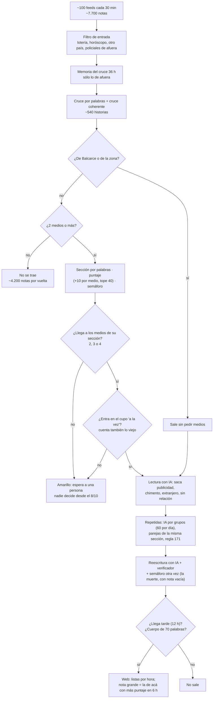
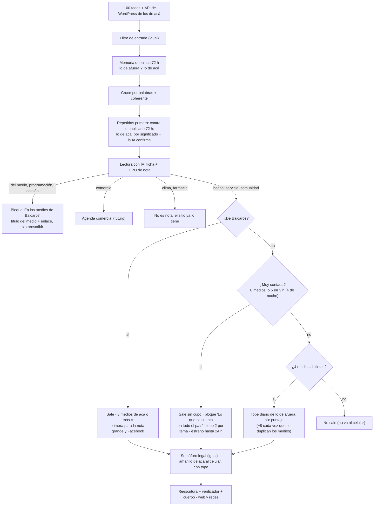

# 02 · Cómo llegan las notas y cómo se eligen: fuentes, criterio y repetidas (auditoría para Radar 2.0)

*16/10/2026. Hecho leyendo el código y los datos del repositorio de ese día (`web/data/` del commit "Auditoría IA · 16/10 23:00"),
las dos lecturas guardadas en `.cache/` (`informe-del-dia-202610161143.json` y `…1200.json`, con las 540 historias y las 7.646
notas crudas de esa vuelta) y la memoria del cruce de la PC (`.cache/cruce-memoria.json`: 6.458 notas de afuera del 15/10 a las
8 al 16/10 a las 20). Sin gastar cupo de IA y sin tocar nada: se corrieron `npm run auditar` y `node ingesta/auditar-fuentes.mjs`
(sólo leen; `git status` quedó limpio) y scripts de medición propios fuera del repositorio. Si el código cambia, manda el código.
La revisión de fuentes de `docs/etapa-1-fuentes/` y la de `docs/etapa-2-5/ANALISIS.md` no se repiten: acá se las usa y se
suma lo nuevo. Cómo se midió, al final.*

## Resumen en 10 líneas

1. **Fuentes:** 103 feeds de 71 medios. Lo de Balcarce sigue siendo lo único que nadie más trae (en 7 días La Vanguardia fue la única fuente de 26 notas, Radio Gabal de 17). Del país, 188 de 203 notas de afuera publicadas en la semana habrían llegado igual al mínimo con la lista nueva: el recorte del 15/10 no hizo daño. Hay unas 10 fuentes dormidas o vacías para revisar. RSS e índices de noticias siguen siendo la forma correcta; lo que falta es una **señal externa de popularidad**, no más feeds.
2. **La portada no ordena por cantidad de medios.** La cantidad de medios es sólo una puerta (2, 3 o 4 según la sección) y un puntaje que **deja de crecer a los 5 medios**: una historia de 34 medios suma lo mismo que una de 5. Las listas van por hora y la nota grande es siempre de Balcarce.
3. **Las grandes nacionales se quedan afuera.** El 15/10 a las 22, de las 24 historias más contadas del día salieron 9: no salieron la sesión caída de Diputados (23 medios), los incidentes en la Marcha Federal Universitaria (18) ni el financiamiento universitario (16). Ese día sí salieron "La Messi Cup define fechas" (2 medios) y una serie de Disney+ (5).
4. **Tres trabas concretas lo explican:** el **cupo** de cada sección se llena con notas de 1 a 14 días (en Economía, 10 de los 12 lugares los ocupaban notas de 28 a 56 horas); el **puntaje** se satura; y un **error** hace que cualquier título escrito por la IA con "murió" o "falleció" espere a una persona: así no salió la muerte de Fernando Confessore (30 medios) ni otras 10 notas en cuatro días.
5. **Propuesta de "muy contada":** lo de afuera con **8 medios o más**, o que junta **5 medios en 3 horas** (4 de noche), sale aunque el cupo esté lleno, va a un bloque nuevo de la tapa ("Lo que se cuenta en todo el país", hasta 3) y tiene un tope de 2 por tema. Con los datos del 15/10, subirían 8 a 11 notas por día y no baja ninguna de Balcarce.
6. **Ojo con lo que esperamos de eso:** hoy lo nacional se lee poco sin importar cuántos medios lo cuenten (0,35 a 0,74 visitas por nota). Lo de Balcarce sí: con 4 a 5 medios de acá se lee casi el doble (4,7 contra 2,6). Por eso la regla también tiene su parte local, y hay que medir dos semanas.
7. **Repetidas de Balcarce:** siguen pasando después de la regla 171. Entre el 12 y el 16/10 salieron repetidas 5 noticias de acá (Campo de Pato en semifinales, 3 veces; SUTEBA y el paro, 2; LALCEC y el mes rosa, 2; el plan de educación vial, 2; los atletas en Tamangueyú, 2 o 3). La causa principal: **la memoria del cruce no guarda lo de acá** y El Diario Balcarce publica lo mismo uno o dos días después con otras palabras.
8. **Comparar por significado (embeddings) conviene, pero sólo para lo de acá** y con una IA que confirme cada pareja: son ~40 notas por día, cuesta casi nada y ataca justo los casos que se escapan (mismo hecho, otras palabras). Para lo nacional no hace falta.
9. **Autobombo y publicidad de los medios de acá:** la lista "promocional" de hoy frenó 10 notas en la semana y **las 10 eran noticias** (Messi, la Corte, la ANMAT), mientras salió el autobombo real: "Radio Líder Balcarce Stream alcanza cifras récord", dos avisos de entrevistas de Radio Gabal (uno fue al repaso de Instagram y Facebook del 11/10), 5 pronósticos del clima y 2 cronogramas de farmacias de Radio Gabal. Propuesta: un **tipo de nota** "de los medios" que no se reescribe como noticia y va a un bloque propio, "En los medios de Balcarce", con el enlace a cada medio.
10. **Simplificar:** el amarillo de afuera no lo mira nadie (18 decisiones humanas en total, ninguna desde el 8/10, contra ~33 notas por día esperando): **que deje de ir al celular**. Y pasar de diez ventanas de tiempo a tres (12, 36 y 72 horas).

---

## Palabras que se usan (media línea cada una)

- **Feed:** la dirección que se lee de un medio (un medio puede tener varias).
- **Historia:** un hecho, con todas las notas de distintos medios que lo cuentan. Lo que publica Radar es una historia.
- **Cruce:** el paso que junta en una historia las notas de distintos medios que cuentan lo mismo (`ingesta/cruce.mjs`).
- **Medios distintos:** cuántos medios cuentan una historia; los del mismo dueño (Clarín, Olé, TN y Mitre) cuentan uno.
- **Cupo:** cuántas notas de afuera de una sección pueden estar a la vez saliendo solas (`CUPO_DE_AFUERA`).
- **Puntaje (relevancia):** número de 0 a 100 que sólo ordena (`relevancia`, `ingesta/ingesta.mjs`).
- **Amarillo:** espera a una persona en el panel del celular. **Rojo:** no sale nunca.
- **Embeddings ("huella de significado"):** un número largo que resume de qué habla un texto; dos textos que dicen lo mismo con otras palabras quedan cerca.
- **Autobombo:** cuando un medio habla de sí mismo (su aniversario, su programa, su audiencia, sus sorteos).

---

## 1. Las fuentes

### 1.1 Cuántas hay y qué aportan (lo nuevo desde la etapa 1)

La lista elegida el 15/10 (`docs/etapa-1-fuentes/LISTA-ELEGIDA.md`) está aplicada: **103 feeds activos de 71 medios** (11 de
Balcarce con 15 feeds, 10 de la zona, 50 del país), de 265 configurados. En cada vuelta se leen unas **7.600 a 8.000 notas** y
quedan **540 a 550 historias**; unas 4.200 notas de afuera contadas por un solo medio no entran (`docs/flujo/CRUCE-COHERENTE.md`).

Lo que dice `node ingesta/auditar-fuentes.mjs` (7 días, del 9 al 16/10, 309 notas publicadas):

| Medio | Publicadas | Fue la única fuente | Imprescindible (sin él no llegaba al mínimo) | Visitas |
|---|---:|---:|---:|---:|
| Diario La Vanguardia | 49 | 26 | 0 | 72 |
| Radio Gabal | 33 | 17 | 0 | 110 |
| Infórmese Primero | 28 | 5 | 0 | 49 |
| El Diario Balcarce | 21 | 8 | 0 | 54 |
| Puntonueve | 13 | 3 | 0 | 33 |
| Municipalidad | 7 | 2 | 0 | 10 |
| Infobae | 113 | 0 | 17 | 50 |
| La Nación | 87 | 0 | 9 | 32 |
| Noticias Argentinas | 86 | 0 | 9 | 39 |
| TyC Sports | 48 | 0 | 7 | 32 |

- **Con la lista nueva, 188 de 203 notas de afuera publicadas en la semana habrían llegado igual al mínimo de medios** (el 93 %).
  En 30 días, 558 de 672. El recorte de 236 a 103 feeds no dejó afuera casi nada.
- **Dormidas o vacías (para revisar o apagar):** Ahora Balcarce (7 días sin notas), Facultad de Ciencias Agrarias (lo que trae
  son cursos de posgrado y la "Semana del Estudiante": agenda, no noticias), Radio Gabal · Policiales y Radio Gabal · Agro (los dos
  feeds vienen **vacíos**, `npm run auditar`), Argenpapa (11 días), Solotc (13 días), El Diario de Tandil, Agencia CyTA y los
  ministerios de Capital Humano y de Salud (cero aporte).
- **"Nunca imprescindible"** (Diario Popular, Olé, Los Andes, Bolavip, La Gaceta, La Tecla, LU9, elDiarioAR…) no quiere decir
  inútil: si se aprueba la regla de la parte 2, esos medios son justamente los que hacen que una historia llegue a "muy contada".
  No conviene apagarlos sin mirar eso primero.

### 1.2 ¿Faltan medios?

- **De Balcarce y la zona:** la investigación del 15 y 16/10 (`docs/etapa-1-fuentes/BALCARCE-INVESTIGACION.md`) ya lista lo que
  falta (Minuto Balcarce, el Boletín Oficial municipal, los cortes de la Cooperativa, La Capital de Mar del Plata para lo que dice
  de Balcarce, el canal del Municipio). No se repite.
- **Del país:** no están La Voz del Interior (Córdoba), Cadena 3, Río Negro ni **Infocielo** (política bonaerense, la más cercana a
  lo que le importa a un municipio de la provincia). **No recomiendo sumar a ciegas**: lo nacional ya llega bien contado (la
  mediana de lo publicado de afuera es de 5 medios) y cada medio nuevo corre los números de la regla de medios. Si se suma uno, que
  sea Infocielo, por la provincia. **NO VERIFICADO**: que tenga un feed que ande desde GitHub.
- **Un cuidado de fondo:** los mínimos son números fijos (2, 3, 4, y la propuesta de 8). Con 50 medios nacionales activos, 8 es el
  16 %. Si mañana se suman o se sacan diez medios, el mismo 8 significa otra cosa. Propuesta: anotar al lado de cada número
  "sobre 50 medios del país" y revisarlo cuando cambie la lista (una prueba puede avisar).

### 1.3 ¿RSS es la mejor forma?

| Forma | Qué trae | Para qué sirve en Radar | Veredicto |
|---|---|---|---|
| **RSS / Atom** | Las últimas 10 a 50 notas, con fecha y resumen | La base de todo | **Dejar** |
| **Índice de noticias** (el "sitemap" que cada sitio arma para Google) | Todo el día, sin resumen | Ya se usa en ~25 medios grandes: un feed por medio | **Dejar** |
| **Raspar la página** | Títulos sin fecha (La Vanguardia, El Diario Balcarce) | Los dos medios de acá sin feed | **Dejar**, con el problema de la fecha (ver 3.2) |
| **API de WordPress** de los medios de acá | Las notas con su texto completo y la hora exacta | Acción 5, Municipalidad (probado en la etapa 1); mejoraría fechas y cuerpos | **Mejorar**: probar en los de acá que usan WordPress |
| **Google Noticias por búsqueda** ("Balcarce") | Lo que cualquier medio del país dice de Balcarce | Detector de lo que se nos escapa (ya propuesto en la investigación, ficha 16) | **Mejorar**: como aviso, no como fuente |
| **Google Noticias, "Principales noticias" de Argentina** | El ranking de lo que más se está contando en el país, a cada hora | **Una segunda señal de popularidad** para la parte 2: si una historia está ahí, es de las grandes | **Probar en sombra.** Ojo: los enlaces llegan "envueltos" por Google y la lista la decide Google. **NO VERIFICADO** desde GitHub |
| **Redes sociales** de los medios | Lo mismo que el sitio, sin estructura | Nada que no tenga el feed | **No** |

---

## 2. La popularidad por cantidad de medios (pedido explícito)

> "Si a las 10 de la noche hay noticias nuevas nacionales, ver cuántas fuentes tiene cada una; si tienen la cantidad de fuentes
> que acordemos, darles prioridad, porque son las que más gente va a querer ver aunque sea de Balcarce."

### 2.1 Cómo se usa hoy la cantidad de medios

| Dónde | Qué hace la cantidad de medios | Archivo |
|---|---|---|
| El cruce | Lo de afuera con **un solo medio** no entra | `armarHistorias`, `ingesta/ingesta.mjs` |
| La puerta de cada sección | Lo de afuera sale solo si lo cuentan **4** (Fútbol, Deportes), **2** (Economía, Tecnología, Agro, Automovilismo), **3** (el resto) o **2 con una figura** | `exigirMedios`, `MEDIOS_DE_AFUERA` (`ingesta/criterio.mjs`) |
| El puntaje | **+10 por cada medio de más, con tope de +40**: a partir de 5 medios, da lo mismo | `relevancia` |
| El cupo | Las notas de afuera se ordenan por puntaje y sólo las primeras N de cada sección salen solas | `aplicarCupos` |
| La nota grande de la tapa | La de más puntaje de las últimas 6 horas, **pero sólo entre lo de Balcarce** si hay algo de acá (casi siempre hay) | `ordenarPortada`, `web/lib/datos.js` |
| Las otras 4 de arriba, los bloques por sección y las páginas de sección | **Por hora**, la más nueva primero. La cantidad de medios no cuenta | `armarTapa`, `notasDeLaSeccion` |
| Facebook y los repasos | Por puntaje (con los mínimos de cada pieza) | `redes/elegir.mjs` |

**Respuesta corta: la portada no ordena por cantidad de medios.** Es una puerta para entrar y un empujón en el puntaje que se
corta a los 5 medios. Una vez adentro, una historia de 30 medios y una de 3 se ven igual y van por hora.

### 2.2 Qué muestran los datos

**Lo publicado de afuera ya es "lo contado"** (7 días, 216 notas): 3 con 1 medio, 32 con 2, 22 con 3, 59 con 4 o 5, 47 con 6 a 9
y **53 con 10 o más**. La mediana es de 5 medios (Fútbol 8, Política 7, Economía 5, Argentina 5, Agro 2).

**Pero muchas de las más contadas no salen.** Simulación con la memoria del cruce y el cruce real (el coherente), a las **22 del
15/10**, el día de la Marcha Federal Universitaria:

| Medios | Historia (desde) | ¿Salió? |
|---:|---|---|
| 23 | Diputados: fracasó la sesión para voltear el "megadecreto" (13:09) | **No** |
| 18 | Tensión en la Marcha Federal Universitaria: corridas y enfrentamientos (13:17) | **No** |
| 16 | Financiamiento universitario: el Gobierno apelará las multas (11:00) | **No** |
| 16 | Rafael Câmara ficha por Haas para la F1 2027 | Sí, 18:31 |
| 15 | La VTV aumenta 17,6 % | Sí, 9:31 |
| 15 | Lautaro Martínez, lesionado | Sí, 11:01 |
| 13 | Boca, logística para jugar en Brasil o Paraguay | **No** |
| 13 | Cositorto será operado | **No** |
| 13 | El Vaticano puso en duda el viaje del Papa a la Argentina | **No** |
| 12 | La industria usa el 58,5 % de su capacidad | Sí, 17:27 |
| 10 | Revés judicial para Milei en la reforma laboral | **No** |

De 24 historias "muy contadas" a esa hora (la definición, en 2.5), **salieron 9**. Ese mismo día **sí** salieron "La Messi Cup
define fechas y cruces" (2 medios), "La siembra y cosecha registran demoras" (2), "Nadie dice nada estrena su serie en Disney+" (5) y
"La madre de Gaspi recuerda al influencer" (7). De la marcha salió una sola nota, de 3 medios, a las 19:28.

**Y lo que se lee:** visitas por nota según cuántos medios la cuentan (notas del 29/09 al 15/10, con al menos un día y medio de
vida):

| Medios | De afuera: notas · visitas por nota | De acá: notas · visitas por nota |
|---|---|---|
| 1 | 14 · 0,71 | 170 · 2,61 |
| 2 o 3 | 142 · 0,35 | 60 · 2,45 |
| 4 o 5 | 137 · 0,37 | 11 · **4,73** |
| 6 a 9 | 117 · **0,74** | 3 · 8,67 |
| 10 o más | 119 · 0,41 | 4 · 6,00 |

Lo nacional se lee poco, lo cuenten 3 o 30 medios (el 80 a 90 % de esas notas no tiene ni una visita). Lo de Balcarce contado por
varios medios de acá sí se lee más. Dos lecturas posibles, y las dos son ciertas en parte: el lector de Radar viene por lo de acá
(sobre todo desde Facebook), y lo nacional está enterrado en listas por hora, así que nunca tuvo la vidriera para probarse.
**Por eso la regla de abajo es una prueba con medición**, no una apuesta segura.

### 2.3 Por qué no salen: cuatro trabas encontradas

1. **El cupo se llena con lo viejo.** `aplicarCupos` cuenta **todas** las notas verdes de afuera de las 36 horas de la ingesta,
   también las que ya salieron hace un día o las que "llegan tarde" y no se pueden estrenar. En la lectura del 16/10 a las 12:
   en Economía, 10 de los 12 lugares los tenían notas de 28 a 56 horas; en Cultura y agenda, una de 262 horas; en Agro, una de 337.
   Y quedaron amarillas "por cupo" **"Quinta marcha universitaria" (34 medios)** y **"Diputados: los aliados de Milei no dieron
   quórum" (25 medios)** en Política, "El Vaticano ratificó el viaje del Papa" (14) en Argentina, "¿Ramón Díaz a River?" (11) en
   Fútbol, y "El reto de Otamendi a Beltrán" (26 medios, ya publicada: sale de las listas).
2. **El puntaje se satura.** Con +10 por medio y tope de 40, una nota fresca de 5 medios y una de 34 suman lo mismo
   (8 + 25 + 40 + 6 = 79). Y si el grupo de la de 34 arrastra una nota de más de 24 horas, pierde la frescura: 8 + 0 + 40 + 6 = 54,
   menos que una de 3 medios de hace una hora (8 + 25 + 20 + 6 = 59). En el cupo, ganan las frescas poco contadas.
3. **Un error frena toda muerte nacional.** Lo que escribe la IA pasa por el semáforo con una **nota vacía**:
   `semaforoDeLaReescritura({}, { ...r, ...extras })` (`reels/reescritura.mjs`, línea 1375). Con la nota vacía, `laMuerteFrena`
   cree que la cuenta **un solo medio** y frena cualquier "murió", "falleció" o "muerte" del título, la bajada o el texto para
   redes, aunque la decisión del 28/09 dice que la muerte frena **sólo** donde puede ser alguien de acá o lo cuenta un medio. En el
   registro de intentos (`web/data/intentos-ia.json`) hay **11 notas de afuera** frenadas así en cuatro días, entre ellas
   **"Murió Fernando Confessore, el reconocido meteorólogo" (30 medios, la más contada del 16/10)** y dos despedidas suyas. Salió,
   en cambio, "Guillermo Lobo y Lorena Maciel recuerdan al meteorólogo Fernando Confessore", que no dice "murió". El arreglo es
   pasarle la nota de verdad; como toca el semáforo, **conviene que lo confirme Hernán** (no toca la lista roja).
4. **La fecha de la historia es la de su nota más vieja.** Si el cruce suma una nota de días atrás, la historia entera "llega
   tarde". En el archivo hay **80 notas publicadas (7 %) con una fecha más de 3 días anterior a la primera vez que se vieron**, la
   peor: "El Concejo Deliberativo Estudiantil cierra su quinta edición" (publicada el 14/10) figura con fecha **30/04/2026** porque se
   le pegó una nota vieja del Concejo. La regla 180 (16/10) frena lo nuevo; las 80 quedan así (ver 5.3).

Una más, ya arreglada: el 16/10 la web se armaba **unas 72 veces por día** en vez de 48 (corrían el reloj de Cloudflare y el
horario de respaldo de GitHub). Con eso, **la IA que junta repetidas gastó sus 60 vueltas del día a las 15:06** y no volvió a
correr hasta la medianoche (el 15/10, a las 23). Se arregló el 16/10 a las 16:32 (commit `85df8f2f`); con 48 vueltas, las 60
alcanzan. **Dejar y vigilar.**

### 2.4 Cuánto tarda una historia en juntar medios (lo que pasa "a las 10 de la noche")

Con las 320 historias de 2 o más medios que tuvieron 12 horas para crecer (15 y 16/10):

- Llegan a 4 medios: 101; a 8: 32; a 10: 22; a 12: 15; a 20: 3.
- **La mitad tarda 9,4 horas en llegar a 8 medios** (contando desde la primera nota; 25 % en menos de 3,8 horas).
- **A las 22, casi nada nuevo tiene 8 medios todavía.** El 15/10, de las 27 historias que empezaron entre las 18 y las 22, una
  tenía 6 medios, tres tenían 4 o 5 y el resto 2 o 3. De noche se publica menos y los medios se suman a la mañana siguiente.
- **La velocidad avisa antes:** de las historias que juntan **5 medios en sus primeras 3 horas**, el 85 % termina con 8 o más
  (11 de 13). **De noche** (de 20 a 7), las 4 que juntaron 4 medios en 3 horas terminaron las 4 con 8 o más (la suspensión de
  Verón, Nacho Fernández y Maradona, Milei en Washington).

### 2.5 La regla propuesta

**"Muy contada"** (sólo para lo de afuera; lo de acá no lo necesita para salir):

| | Propuesta |
|---|---|
| **Qué es** | Una historia que cuentan **8 medios distintos o más** (los del mismo dueño cuentan uno), **o** que junta **5 medios en sus primeras 3 horas** de día (de 7 a 20) o **4 de noche** (de 20 a 7) |
| **Cuándo vale** | Si alguna de sus notas es de las **últimas 12 horas** y el hecho tiene **menos de 24 horas** |
| **Qué no cuenta** | Lo que no es noticia aunque lo cuenten todos: "dónde ver", "a qué hora juega", "formaciones", "en vivo", "cuándo vuelve a jugar", "cuándo salen a la venta las entradas", la cotización del dólar, el pronóstico de otra ciudad. Tampoco lo que la IA marca como chimento, publicidad o del extranjero sin un argentino, ni lo frenado por el semáforo legal (rojo, o amarillo por menores, víctimas o acusados) |
| **Qué gana** | 1) **Sale aunque el cupo de su sección esté lleno** (no ocupa lugar). 2) **Se puede estrenar hasta 24 horas** después del hecho si sigue sumando medios (hoy, 12). 3) **Va a un bloque nuevo de la tapa: "Lo que se cuenta en todo el país"**, debajo de las cinco de arriba, con hasta 3 notas ordenadas por medios y frescura. 4) **Va primera en su sección** durante 6 horas. 5) Es candidata al lugar de afuera del repaso de la noche (ya existe: hasta 2 de afuera) |
| **Qué no cambia** | La nota grande sigue siendo de Balcarce. El semáforo, el cuerpo de 70 palabras y el verificador, igual |
| **Tope por tema** | **No más de 2 muy contadas del mismo tema a la vez.** El 15/10 la marcha universitaria eran 5 historias (los incidentes, el financiamiento, la UBA, el Gobierno contra los manifestantes, los cortes en Rosario): salen las 2 con más medios |
| **El puntaje** | El "+10 por medio, hasta 40" pasa a **+8 cada vez que se duplican los medios**, sin tope: 2 medios +8, 4 +16, 8 +24, 16 +32, 32 +40. Una nota de 30 medios vuelve a valer más que una de 5 |
| **El título** | En una muy contada, que la nota principal sea la de un medio nacional (no la primera que llegó): la de 34 medios del 16/10 entró con el título de una nota de Mar del Plata ("el reclamo de la UNMdP") y la IA la leyó como "de la región, importancia baja" |
| **Cuántas serían** | Unas 30 historias por día pasan los 8 medios; descontando lo que no es noticia y el tope por tema, **unas 8 a 11 por día**. Hoy salen unas 10 por día con 8 o más medios: la cuenta total sube poco, lo que cambia es **cuáles** |

**Y la parte de Balcarce** (la frase "aunque sea de Balcarce" se puede leer también así): lo que cuentan **3 medios de acá o
más** es lo que más se lee de todo el sitio (4,7 a 8,7 visitas por nota contra 2,6 con un medio). Propuesta: que eso sea
**"muy contada de acá"**: primera candidata a la nota grande y a Facebook, por delante de lo de un solo medio.

### 2.6 Simulación sobre los datos de hoy: qué sube y qué baja

**A las 22 del 15/10** (de noche: vale la velocidad de 4 medios en 3 horas). 24 muy contadas, 9 salieron. **Subirían** (después
del tope por tema y sacando lo que la IA marcaría como chimento o curiosidad): la sesión caída de Diputados (23), los incidentes en
la marcha (18), el financiamiento universitario (16), Boca y la sede de la revancha (13), Cositorto (13), el Vaticano y el viaje del
Papa (13), el revés judicial de la reforma laboral (10), Paredes y Vasco da Gama (9), Monteoliva y una mesa de monitoreo (6) y,
según lo que diga la IA, Dani Alves con el gobernador de Formosa (8) y un compañero de Colapinto (7): **entre 8 y 11 notas**. **No subirían**: Julieta Prandi (chimento), los cortes de tránsito en Rosario (servicio de otra ciudad),
el Gobierno contra los manifestantes y la UBA (tope de 2 por tema).

**A las 12 del 16/10** (con el corte de 24 horas, lo del 15/10 ya no entra): 5 muy contadas, 3 ya publicadas. Suben 2: **la
muerte de Confessore** (30 medios: necesita además el arreglo del punto 3 de 2.3) y "La UBA se desligó de los incidentes" (7 medios,
6 en 3 horas).

**A las 20 del 16/10:** 18 muy contadas, 12 salieron. Subirían Confessore, "Ramón Díaz rompió el silencio" (14) y "Para criar a un
hijo se necesitaron $728.000" (6 en 3 horas, el INDEC). No subirían el auto volador de Tesla, Wanda Nara y la camiseta de Icardi,
ni la cría de elefante marino en Mar del Plata (curiosidad o chimento, si la IA hace su trabajo).

**Qué baja:**

- **Con el bloque aparte y fuera del cupo (lo propuesto): no baja nada.** Ninguna nota de Balcarce pierde lugar; el bloque nuevo
  ocupa espacio propio.
- **Si se prefiere no sumar notas y mantener el cupo como está** (y con una versión más amplia de la regla, sin el corte de 24
  horas: 17 muy contadas a las 12 del 16/10), saldrían de las listas 7 de afuera: 5 que ya
  no deberían estar (dos de Política de 61 y 72 horas, un "en qué canal pasan Fluminense-Palmeiras" de 41 horas, un chimento de la
  China Suárez y una segunda despedida de Confessore) y 2 de Fútbol ya publicadas ("Cambeses y Marcone, antes del Clásico", 7
  medios; "el codazo de Paquetá", 4). Del 15/10, las candidatas a bajar serían las de menos medios del día: la Messi Cup (2), la
  siembra demorada (2), la serie de Disney+ (5), los ramales de tren en Salta (4, en Agro).
- **Arreglando sólo el cupo** (que cuente lo de las últimas 12 horas y lo publicado que sigue a la vista), a las 12 del 16/10
  entrarían 5 notas frescas que esperaban por cupo (el exhorto de Lijo a Suiza, el plus de ANSES, el fin del viaje de Milei, la
  recompensa por un caso, un dato de la economía). Es un arreglo chico y seguro, independiente de lo demás.

### 2.7 Lo que hay que decidir y medir

- **Los números a acordar:** 8 medios (o 10, más estricto: unas 6 por día); la velocidad (5 en 3 horas de día, 4 de noche); el
  tope por tema (2); el bloque (3 notas).
- **Medir dos semanas:** visitas del bloque "Lo que se cuenta en todo el país" contra las de lo nacional por hora. Si no se leen
  más, se achica a una nota o se saca: la cuenta de visitas de 2.2 dice que puede pasar.

---

## 3. Las repetidas: una noticia, una nota

### 3.1 Cómo se evita hoy (seis capas)

| Capa | Qué hace | Mira lo de acá | Mira lo ya publicado | IA |
|---|---|---|---|---|
| Mismo medio, dos feeds | Una sola nota por medio + título o enlace (regla 175) | Sí | No | No |
| El cruce + cruce coherente (regla 184) | Junta por palabras (TF-IDF, 0,42) y no encadena | Sólo lo que está **en los feeds de esta vuelta** | Por la memoria de 36 h, **sólo lo de afuera** | No |
| Repetidas por grupos (`agruparRepetidas`) | Le muestra a la IA las notas que van a salir y junta las del mismo hecho | Sí | No (sólo la vuelta) | Sí, 60 vueltas por día |
| Contra lo publicado sin IA (regla 171) | Une una nota nueva a una publicada de 72 h si los títulos y bajadas se parecen bastante | Sí (umbral más bajo para lo de acá) | Sí | No |
| La misma fuente (regla 175) | Dos notas que citan el mismo enlace son la misma | Sí | Sí | No |
| Parejas sospechosas (`parejasSospechosas`) | Le pregunta a la IA por parejas **de la misma sección** con algo de parecido | Sí | Sí, 72 h | Sí, hasta 40 pedidos por día |

Además, `fusionadas.json` (113 uniones) hace que lo unido no vuelva, y `sinNotasRepetidas` evita dos titulares casi iguales en una
lista.

### 3.2 Lo que se escapó (casos reales)

**Antes de la regla 171** (hasta el 15/10), la medición de la etapa 2-5 encontró 57 copias de más de Balcarce en seis semanas (el
8,7 % de lo de acá). Probé la regla 171 sobre 16 parejas reales de acá: **une 5** (el Jardín 905, la Liga que suspende la fecha,
Vuotto y el Día del Periodista, Edgardo Ríos en la Fiesta del Postre, las tasas de taxis) y **deja pasar 11**.

**Después de la regla 171** (12 a 16/10), salieron repetidas estas noticias de Balcarce:

| Noticia | Notas publicadas | Por qué se escapó |
|---|---|---|
| Campo de Pato mete sus dos equipos en semifinales de rugby | **3**: Radio Gabal 14/10 ("…clasifica a sus dos equipos"), Infórmese + El Diario 15/10 ("Pato Naranja y Pato Negro clasifican…"), El Diario 16/10 ("…mete a sus dos equipos en semifinales") | Otras palabras (parecido de título 0,17 a 0,63) y de 15 a 63 horas de diferencia: no llega a ningún umbral |
| SUTEBA Balcarce adhiere al paro | **2**: Puntonueve + 3 el 15/10 (Balcarce), El Diario el 16/10 (Política) | Distinta sección (la IA de parejas no la mira) y 39 horas |
| LALCEC y el mes rosa (mamografías) | **2**: Radio Gabal + 2 el 15/10, El Diario + Concejo el 16/10 | Otras palabras |
| El plan provincial de educación vial | **2**: 13/10 y 15/10 | Otras palabras, 2 días |
| Atletas de Balcarce en Tamangueyú | **2 o 3** el 15/10 ("Ferreira y Cagni se destacan en Tamangueyú", "Atletas locales logran buenos puestos en Tamangueyú y Balcarce", quizás "…podios en competencias de running") | Títulos sin palabras en común |

(Y en los feeds del 16/10 volvía "Pádel: Tres balcarceños compitieron en el Torneo Nacional de Rosario", de Radio Gabal, cuando el
14/10 ya había salido "Deportistas locales participan del Torneo Argentino de Pádel": esta vez no salió.)

Tres patrones:

1. **La memoria del cruce no guarda lo de acá** (`paraLaMemoria`: "sólo lo de afuera"). Radio Gabal trae 3 notas por feed; cuando
   El Diario Balcarce publica lo mismo al día siguiente, la nota de Gabal ya no está en el feed y el cruce no la ve.
2. **El Diario Balcarce llega tarde con lo mismo.** En 6 de las parejas de acá de las últimas semanas, la segunda es de El Diario,
   uno o dos días después, con otro título. Es el patrón de un medio que junta lo de la semana.
3. **Las parejas sospechosas casi no preguntan:** sólo misma sección y con parecido de título; en la caché hay de 0 a 4 parejas por
   día (`fichas.json`, `repetidas.pares`). SUTEBA (Balcarce y Política) no se iba a preguntar nunca.

Y una aparte: notas que **no son repetidas pero lo parecen** (las distintas carreras del autódromo, el pronóstico de cada día) no se
deben juntar. Lo que mide bien es el **hecho**, no el tema.

### 3.3 ¿Comparar por significado (embeddings)? Sí, para lo de acá

Lo que ya se probó (`pruebas-modelos/duplicadas-significado.md` y `PLAN-DE-IMPLEMENTACION.md` § 3):

- Con el parecido por significado solo, a 0,75 se encuentran 19 de 21 repetidas pero también 9 de 41 parejas que no lo son: **no
  alcanza solo**. Con una IA que confirme cada pareja y sin encadenar, acertó el 95 % de 62 parejas y bajó las notas de acá de 75 a
  56 historias.
- Los casos que se escapan hoy (Campo de Pato, SUTEBA, LALCEC, Tamangueyú) son exactamente "el mismo hecho con otras palabras",
  que es lo que el significado ve y las palabras no.

**Recomendación:**

- **Sí, pero sólo para lo de acá** (unas 40 notas por día más las de acá publicadas en 72 horas, ~120): el costo es casi cero y
  ataca el 80 % del problema (el problema es de Balcarce: lo de afuera ya se filtra por medios). Para las 8.000 notas nacionales de
  cada vuelta no hace falta: el cruce por palabras anda bien ahí y lo de un medio se descarta igual.
- **Con la clave de Gemini que ya tienen**, no con un proveedor nuevo (las pruebas usaron OpenRouter, que es pago). **NO
  VERIFICADO**: el cupo gratis de los embeddings de Gemini; con ~120 textos por vuelta debería sobrar.
- Se pide por `fetch`, sin sumar dependencias (la regla de `ingesta/` se cumple).
- Cada pareja de acá con parecido alto (de cualquier sección, hasta 72 horas) va a la IA que ya confirma parejas
  (`confirmarParejas`); lo confirmado se une como hoy (queda la publicada, la otra suma su fuente y redirige).

### 3.4 Propuesta para repetidas

1. **Que la memoria del cruce guarde también lo de acá, 72 horas.** Arreglo de código chico; con eso la nota de El Diario del día
   siguiente se cruza con la de Gabal y suma su medio en vez de nacer de nuevo. Probar primero en sombra (que mida, sin decidir),
   porque también puede juntar de más.
2. **Huella de significado + confirmación de la IA para lo de acá**, en cualquier sección (3.3).
3. **Parejas sospechosas de acá también entre secciones** cuando comparten un nombre propio raro (Campo de Pato, SUTEBA, LALCEC,
   Tamangueyú): es la señal más barata.
4. **Dejar** la regla 171, la misma fuente, el cruce coherente y las uniones firmes: hacen bien lo suyo.
5. **Medir todas las semanas** cuántas repetidas de acá salieron (el script de esta auditoría lo hace en segundos) y ponerlo en el
   informe diario de los lunes.

---

## 4. Lo de los medios de Balcarce: autobombo, publicidad y propaganda

*"Son parte de la historia del pueblo y queremos que también estén; no venimos a reemplazar a nadie."* La idea de esta parte no es
borrar a los medios de acá sino **no hacer pasar por noticia nuestra lo que es del medio**, y darle a eso otro lugar, con su nombre y
su enlace.

### 4.1 Qué hay hoy

| Filtro | Qué frena | Dónde mira | Resultado |
|---|---|---|---|
| `REGLAS_SEMAFORO.promocional` | "sorteo", "sortea", "ganá tu entrada", "participá del", "suscribite", "seguinos en", "auspicia", "publicidad", "rol periodístico", "vías de contacto", "sede legal" | Título y primeros 600 caracteres, **de cualquier medio** | Amarillo "parece promoción, no noticia" |
| `REGLAS_SEMAFORO.nunca` | Sepelios, necrológicas, cochería | Sólo el título | Rojo |
| La lectura con IA | `es_publicidad` ("promociona un comercio, producto o servicio sin ser noticia") y `es_chimento` | Título y resumen | La saca |
| Las efemérides de otro medio | La dirección o el título | | Rojo |
| A mano | `retiradas.json`: "El Diario Balcarce detalla su rol periodístico y sus vías de contacto" (comunicado del propio medio) | | Retirada |

### 4.2 Lo que encontré

**La lista "promocional" frena noticias y deja pasar el autobombo.** En la semana (pendientes de `portada.json`, 9 al 16/10) frenó
10 notas, y **las 10 eran noticias**: "El particular regalo de Benín a Messi" y "El desconocido gesto de Messi con los empleados de
la AFA" (por "sorteo"), "La ANMAT prohibió una marca de lavandina" (por "publicidad"), "la Corte Suprema analiza…" (por "sortea"),
"Fin del fútbol gratis en el Ascenso" ("sorteo"), una "dispersión de precios" ("publicidad")… La única de acá, "La historia de Nico:
su mamá contó cómo atraviesan el…", es una campaña solidaria (y habla de un chico: ahí el amarillo sí corresponde, por otra razón).
La IA marcó como publicidad 10 notas en tres días, una sola de acá ("promoción comercial de un sorteo local").

**Lo que salió y es de los medios, no del pueblo** (archivo, 23/09 al 16/10):

| Tipo | Ejemplos reales publicados | Medio · fecha |
|---|---|---|
| **El medio habla de sí** | "Radio Líder Balcarce Stream alcanza cifras récord a dos semanas de su inicio" (Radio Líder es de La Vanguardia) | La Vanguardia · 11/10 |
| **Anuncio de su propia entrevista o programa** | "Virginia Aparicio brinda su testimonio el viernes en Polémica en Gabal"; "El abogado de Virginia Aparicio visita una radio local para hablar del caso" (el original: "…estará este viernes en GABAL") | Radio Gabal · 10/10 y 16/10 |
| **…y fue a las redes** | "El repaso de la mañana en Radar Balcarce: Inter, Virginia Aparicio y Radio Líder": el audio de Instagram y Facebook del 11/10 contó el récord del stream de Radio Líder y el debate en un programa local | Radar · 11/10 |
| **Los medios celebrándose** | "El Club Rotario Balcarce Cerrito agasaja a los periodistas locales"; en los feeds, "El Diario celebra sus 31 años publicando…" (News Balcarce, 8/10) | Radio Gabal · 8/10 |
| **El servicio que Radar ya tiene** | 5 pronósticos del clima como nota de Balcarce ("El pronóstico anticipa una semana fresca…", "El miércoles presenta ambiente fresco…") y 2 "Las farmacias difunden el cronograma de turnos" | Radio Gabal · 25/09 al 14/10 |
| **Comercio o profesional presentado como nota** | "Fiorella Cacace detalla la labor de los escribanos"; "Brooklyn Café vende 1200 cookies tras la suspensión de la Fiesta del Postre"; "La acopiadora Scorziello y Galella exporta granos a Isla Mauricio"; "Cabaña Los Pinos realiza su cuadragésimo primer remate" | El Diario, Gabal · 23/09 al 14/10 |
| **Rifas y bonos de instituciones** (comunidad: está bien que estén) | "Bomberos vende los últimos números de la rifa anual"; "El Merendero Doña Norma lanza su tercera campaña solidaria con rifa"; "Amigos Unidos organiza un encuentro comunitario con siete millones en premios" | Gabal, Puntonueve, Infórmese |
| **Opinión de un medio** (en los feeds; no llegó a salir) | "Los desafíos del peronismo en Balcarce: la política y el arte de lo imposible"; "Reino busca recuperar la centralidad de su gestión…" | La Vanguardia · 16/10 |
| **Propaganda oficial** (en los feeds; vieja) | "APERTURA DE SESIONES 2026: REINO DESTACÓ GESTIÓN, OBRAS Y DESAFÍOS…" | Concejo · 5/03 |

En la lectura del 16/10 a las 12, de las 220 notas que traían los feeds de acá, la gran mayoría eran noticias de verdad: **el
problema es chico en cantidad (unas 3 o 4 notas por semana) pero visible** (salió en un repaso con voz).

### 4.3 Propuesta: un "tipo de nota" y un lugar para cada cosa

La IA de lectura ya hace una ficha por nota. Propuesta: sumarle **un campo "tipo"** (la etapa 2-5 ya lo propone para el puntaje) con
estas opciones para lo de acá, y decidir por el tipo, no por palabras sueltas:

| Tipo | Señales (para la IA y como red de código) | Qué se hace |
|---|---|---|
| **Del propio medio** (aniversario, audiencia, stream, equipo, "su rol", sus contactos) | El título o la bajada nombran **al mismo medio que la publica** o a su radio, programa o stream (Gabal / "Polémica en Gabal", Radio Líder / Líder Stream / Multimedios Balcarce, Infórmese / 104.9, Puntonueve / 100.9, News / 91.7, El Diario, Acción 5); "años al aire", "nuestra radio", "este medio", "audiencia récord" | **No es nota de Radar.** Va al bloque **"En los medios de Balcarce"** con el título del medio, su nombre y el enlace, sin reescribir. Nunca a las redes |
| **Anuncio de programación o entrevista** | "estará este viernes en", "visita los estudios", "en vivo por", "a las X por la FM", "en nuestro programa", "brinda su testimonio en [programa]" | Igual: **"En los medios de Balcarce"** ("Hoy en Gabal: entrevista a Mario Bolla"). Es lo que más sirve al vecino y al medio: el enlace va a ellos |
| **Sorteo o concurso del medio** | "sorteo", "ganá", "participá" **junto con** el nombre del medio o "oyentes", "seguidores" | **No se publica** (ni en el bloque) |
| **Rifa, bono o colecta de una institución** (Bomberos, club, merendero, cooperadora) | "rifa", "bono contribución", "colecta", "a beneficio de" + una institución de acá | **Se publica** como nota de comunidad si tiene el dato útil (para qué, cuánto, hasta cuándo); si nombra a un chico, sigue esperando a una persona como hoy |
| **Comercio** (apertura, promo, descuento, remate, "visitá", "consultas al WhatsApp", precios de un negocio) | Nombre de un comercio + teléfono, dirección, horario, precio o "consultas" | **No es nota.** Queda para la **agenda comercial** futura (puede ser un espacio pago, `PUBLICIDAD.md`). Si hay un **hecho** (exportación, cierre, despidos, inversión, premio, récord), sí es noticia |
| **Historia de un vecino o emprendedor** | Perfil sin hecho nuevo | **Se publica** si cuenta algo (un premio, un viaje, una obra); si es la presentación de un servicio con sus contactos, va al tipo "comercio" |
| **Opinión o columna de un medio** | "opinión", "columna", "editorial", título con tesis ("el arte de lo imposible"), firma de columnista | **No se reescribe como noticia** (el criterio dice "informar, no opinar"): va a **"En los medios de Balcarce"** como "Lo que se dice", con el medio y el autor |
| **Propaganda de gestión** (oficial o de un partido) | "destacó la gestión", "gracias a la gestión", "compromiso de la gestión", "el intendente recorrió / celebró" | **Se publica** con el hecho en el título y la atribución ("según el Municipio"); la IA ya escribe neutro. Si no hay hecho (sólo elogio), al bloque |
| **Servicio que el sitio ya tiene** (clima del día, farmacias de turno, cotización) | "pronóstico", "máxima de", "cronograma de turnos", "farmacias de turno" en lo de acá | **No es nota**: el sitio tiene su clima y su farmacia. Si es una **alerta** (granizo, temporal, corte), sí |

**El bloque "En los medios de Balcarce"** (en la tapa, debajo de lo de acá, o en la sección Balcarce): 3 a 5 renglones por día con
"Medio · título · enlace". Respeta a los medios (les manda lectores), no se hace pasar por nota propia y no gasta IA. **Es un cambio
visible del sitio: lo deciden Hernán y Andrés** antes de armarlo.

**La lista "promocional" de hoy: achicar.** Sacar "sorteo", "sortea" y "publicidad" sueltos para lo de afuera (10 de 10 falsos en
la semana) y dejarlos sólo junto al nombre de un medio o de un comercio; el resto lo decide el tipo de la IA. Sumar "rifa" a la regla
de instituciones (hoy no está en ninguna lista).

---

## 5. El resto del criterio

### 5.1 El semáforo: el amarillo no lo mira nadie

- **Decisiones de una persona desde el celular: 18 en total** (12 publicadas, 6 descartadas), del 1 al 8/10. **Desde el 8/10,
  ninguna** (`celular-decisiones.json`; `notas-por-dia.json` dice "porPersona: 0" todos los días).
- En la semana quedaron esperando **al menos 232 notas distintas** (unas 33 por día; contadas en 49 de las versiones de
  `portada.json`, no en todas). Por qué: "niño" 43, "denuncia" y "denunció" 52,
  "adolescente" 24, "acusado" 12, "detenido" 11, "murió" 8; más 11 por "verificación baja" y 10 por "parece promoción".
- **En la práctica, amarillo quiere decir "no sale nunca"**, y el celular se llena de lo de afuera que nadie va a aprobar.

**Propuesta (sin tocar la lista roja):**

1. **Lo de afuera en amarillo deja de ir al celular.** Si es muy contada y el freno no es legal (menores, víctimas, acusados), que
   decida una segunda lectura de la IA con una pregunta concreta ("¿identifica a un menor o a una víctima?, ¿acusa a una persona
   con nombre?"); si no, no sale y listo.
2. **Lo de acá en amarillo sí va al celular**, con tope (las 5 más importantes por día) y un aviso en el mail de las 21:15
   (`redes/informe-diario.mjs`) con lo que espera y un enlace para resolver.
3. **Arreglar la muerte en lo que escribe la IA** (2.3, punto 3): que sea igual a la del resto del semáforo.

### 5.2 Las secciones

No profundizo (lo revisan ellos). Sólo dos datos que tocan esta parte: el cupo es **por sección** y la mitad de las trabas de 2.3
vienen de ahí; y una noticia que cae en dos secciones (SUTEBA en Balcarce y en Política) es la repetida que menos se ve.

### 5.3 Las ventanas de tiempo: de diez a tres

Hoy hay diez ventanas distintas: 72 h (lo raspado y lo de acá viejo), 36 h (memoria del cruce), 12 h (estreno), 36 h (portada), 6 h
(nota grande), 72 h (repetidas contra lo publicado), 3 días (fichas), 7 días (primera vista), 7 días (retiradas) y 72 h (el panel de
la PC). Propuesta para que se pueda explicar en una frase:

| Ventana | Para qué | Cambia |
|---|---|---|
| **12 horas** | Estrenar una nota (24 h para una muy contada que sigue sumando medios) | La excepción de la muy contada |
| **36 horas** | Lo que se ve en la portada y en las listas | Igual |
| **72 horas** | Todo lo que compara: la memoria del cruce (también lo de acá), las repetidas, el colador de lo viejo | La memoria pasa de 36 a 72 h y suma lo de acá |

Las de "cuánto se recuerda" (fichas 3 días, primera vista 7 días, retiradas 7 días) son de mantenimiento y no le importan al lector:
quedan, pero fuera del criterio editorial.

**La fecha de una historia.** "Una nota tiene una sola fecha, que envejece y nunca rejuvenece" está bien para que un medio no
"refresque" su nota. Pero hoy envejece también cuando el cruce le pega una nota vieja de otro medio: 80 notas publicadas muestran una
fecha más de 3 días anterior a cuándo se vieron (la del Concejo Estudiantil, el 30/04). Propuesta: la fecha es la de la **nota
principal** o la de la **primera vez que se vio la historia**, la más vieja de las dos, y las notas del grupo de más de 30 horas antes
no la mueven. Y una pasada única para corregir esas 80.

### 5.4 El cupo y el tope de notas por día

- Hoy hay cupo "a la vez" por sección (de 6 a 15) y no hay tope por día. Salen unas 30 notas de medios por día (de 12 a 44 según el
  día, del 3 al 16/10; unas 12 de acá y 20 de afuera, `notas-por-dia.json`), más 4 a 8 propias.
- **Propuesta mínima:** que el cupo cuente sólo lo que todavía se puede estrenar (12 h) y lo publicado que sigue a la vista; las muy
  contadas, fuera del cupo (2.5).
- **Propuesta para 2.0:** cambiar los once cupos "a la vez" por **un solo tope diario de lo de afuera** (por ejemplo, 25 por día,
  con no más de 6 por sección), elegido por puntaje en el momento de estrenar, con las muy contadas por delante. Es más fácil de
  entender ("salen hasta 25 nacionales por día, primero las más contadas") y no depende de qué quedó viejo en la ingesta.

### 5.5 El contrato del día

Es de las redes (`redes/contrato.mjs`, `CONTRATO_DIARIO`) y anda: **dejar.** Lo único que toca esta parte: que las notas "del medio"
(4.3) no puedan entrar a un repaso.

### 5.6 Qué simplificaría

1. **Una sola pregunta para lo de afuera:** ¿lo cuentan 4 medios distintos (o es muy contada)? En lugar de 2, 3 o 4 según la sección
   más el 2 con figura (la etapa 2-5 midió que la popularidad sirve hasta unos 4 medios).
2. **El amarillo de afuera, fuera del celular** (5.1).
3. **Tres ventanas** (5.3).
4. **Un tope diario** en vez de once cupos (5.4).
5. **El tipo de nota decide** lo promocional, el autobombo y el servicio (4.3), y la lista de palabras queda sólo como red.

---

## 6. El recorrido de una nota

### 6.1 Hoy

### 6.2 Propuesto

---

## 7. Tabla de recomendaciones

**Acción:** Cortar (sacar), Achicar (dejar menos), Mejorar (cambiar), Dejar (está bien). **Etapa:** la del rediseño "una etapa por
vez" (1 fuentes, 2 entrada, 3 repetidas, 4 clasificación y tipo, 5 puntaje y selección); "Ya" es un arreglo que no espera al
rediseño.

| # | Qué | Acción | Impacto | Esfuerzo | Riesgo | Etapa |
|---|---|---|---|---|---|---|
| 1 | La muerte en lo que escribe la IA se mira con la nota vacía: pasarle la nota (Confessore y 10 más) | Mejorar | Alto | Bajo (una línea y una prueba con el caso real) | Bajo-medio: toca el semáforo, **confirmar con Hernán** | Ya |
| 2 | El cupo cuenta notas viejas y ya publicadas: que cuente sólo lo estrenable (12 h) y lo visible | Mejorar | Medio | Bajo | Bajo | Ya / 5 |
| 3 | Regla "muy contada" (8 medios, o 5 en 3 h y 4 de noche), fuera del cupo, estreno hasta 24 h, tope 2 por tema | Mejorar | Alto (es el pedido) | Medio | Medio: más nacionales; puede no sumar visitas (medir 2 semanas) | 5 |
| 4 | Bloque de tapa "Lo que se cuenta en todo el país" (hasta 3) | Mejorar | Medio | Medio (es la web) | Medio: cambio visible, **lo deciden ellos** | 5 |
| 5 | Puntaje: +8 cada vez que se duplican los medios, sin tope | Mejorar | Medio | Bajo | Bajo | 5 |
| 6 | "Muy contada de acá" (3 medios de acá o más): primera para la nota grande y Facebook | Mejorar | Medio | Bajo | Bajo | 5 |
| 7 | En una muy contada, la nota principal de un medio nacional, no la primera que llegó | Mejorar | Medio | Bajo | Bajo | 3 |
| 8 | Google Noticias "Principales" como segunda señal de popularidad, en sombra | Mejorar (probar) | Medio | Bajo | Medio: depende de Google | 5 |
| 9 | La memoria del cruce guarda también lo de acá, 72 h | Mejorar | Alto (repetidas de acá) | Bajo-medio | Medio: puede juntar de más; probar en sombra | 3 |
| 10 | Huella de significado + confirmación de la IA, sólo para lo de acá y en cualquier sección | Mejorar | Alto | Medio | Bajo (si falla, sale una repetida como hoy) | 3 |
| 11 | Parejas sospechosas de acá entre secciones si comparten un nombre propio | Mejorar | Medio | Bajo | Bajo | 3 |
| 12 | Regla 171, misma fuente, cruce coherente, uniones firmes | Dejar | — | — | — | — |
| 13 | Medir repetidas de acá cada semana y mostrarlo en el informe | Mejorar | Medio | Bajo | Bajo | 3 |
| 14 | Tipo de nota en la ficha de la IA (del medio, programación, sorteo, rifa, comercio, opinión, gestión, servicio) | Mejorar | Medio | Medio | Bajo | 4 |
| 15 | Bloque "En los medios de Balcarce" con título y enlace, sin reescribir | Mejorar | Medio (respeta a los medios) | Medio | Bajo; cambio visible, **lo deciden ellos** | 4 |
| 16 | Clima y farmacias de los medios como nota | Cortar | Bajo | Bajo | Bajo | 2 |
| 17 | Lista "promocional": sacar "sorteo", "sortea" y "publicidad" sueltos para lo de afuera; sumar "rifa" a lo de instituciones | Achicar | Bajo | Bajo | Bajo | 4 |
| 18 | Que lo "del medio" nunca vaya a un repaso ni a Facebook | Mejorar | Medio (salió en el audio del 11/10) | Bajo | Bajo | 4 |
| 19 | Amarillo de afuera al celular | Cortar | Alto (simplifica) | Bajo | Medio: alguna nota buena no sale (hoy tampoco sale) | 5 |
| 20 | Amarillo de acá: al celular con tope de 5 por día y aviso en el mail de las 21:15 | Mejorar | Medio | Bajo | Bajo | 5 |
| 21 | La fecha de la historia no envejece por notas del grupo de más de 30 h; corregir las 80 | Mejorar | Medio | Medio | Medio: toca la regla de "una sola fecha" | 3 |
| 22 | De diez ventanas a tres (12, 36, 72 h) | Achicar | Medio (se entiende) | Medio | Bajo | 5 |
| 23 | Once cupos "a la vez" por un tope diario de lo de afuera | Achicar | Medio | Medio | Medio | 5 |
| 24 | Un solo mínimo para lo de afuera (4 medios) en vez de 2/3/4 por sección | Achicar | Medio | Bajo | Medio: Economía y Agro pierden notas de 2 medios | 5 |
| 25 | Anotar los mínimos "sobre 50 medios del país" y revisarlos si cambia la lista | Mejorar | Bajo | Bajo | Bajo | 1 |
| 26 | Fuentes dormidas o vacías (Ahora Balcarce, Gabal Policiales y Agro, Argenpapa, Solotc, El Diario de Tandil, CyTA, ministerios); la Facultad, a la agenda | Achicar | Bajo | Bajo | Bajo | 1 |
| 27 | API de WordPress para los medios de acá que la tengan (fecha exacta, texto completo) | Mejorar | Medio | Medio | Bajo | 1 |
| 28 | RSS e índices de noticias como base; no sumar medios nacionales a ciegas (si uno, Infocielo) | Dejar | — | — | — | 1 |
| 29 | Las vueltas dobles de la web (arregladas el 16/10): vigilar que la IA de repetidas no vuelva a quedarse sin vueltas | Dejar (vigilar) | Medio | Bajo | Bajo | Ya |
| 30 | El contrato del día | Dejar | — | — | — | — |

---

## 8. Cómo se midió (y qué no se pudo)

- **Fuentes:** `node ingesta/auditar-fuentes.mjs` (7 días) y `--dias=30`; `npm run auditar` (la lectura de las 12 del 16/10).
- **Distribución de medios de lo publicado:** `web/data/archivo.json` + `portada.json`, contando medios con `contarMedios` (el mismo
  del motor, los del mismo dueño una vez), por la primera vista (`visto`).
- **Lo que no salió:** las 540 historias de `.cache/informe-del-dia-202610161200.json` con su color y su motivo, cruzadas con lo
  publicado, `fichas.json` (la IA) e `intentos-ia.json` (la reescritura).
- **Las simulaciones de las 22 del 15/10 y las 20 del 16/10:** las 6.458 notas de `.cache/cruce-memoria.json` filtradas por la fecha de
  cada nota (no por cuándo las vio la PC, que corrió sólo cuatro veces esos días), agrupadas con `agruparPorHecho` y el cruce
  coherente reales, y cruzadas con lo publicado por el enlace de cada fuente.
- **Repetidas:** parejas de notas publicadas a menos de 72 horas con títulos o bajadas parecidas o una fuente en común, leídas a mano,
  y la regla 171 real (`compararNotas`) corrida sobre 16 parejas de acá.
- **Autobombo:** búsqueda de señales en títulos y bajadas de lo publicado de acá (431 notas en 30 días) y en las 220 notas crudas de
  los feeds de acá de la lectura del 16/10; los pendientes "parece promoción" de 49 versiones de `portada.json` del 9 al 16/10.
- **Visitas:** `web/data/estadisticas.json` (por nota y por día, desde el 29/09).
- Los scripts de esta medición quedaron **fuera del repositorio** (carpeta temporal de la sesión); si se quieren repetir, se pueden
  pasar a `docs/auditoria-2-0/`.

**NO VERIFICADO:**

- Por qué no salieron el 15/10 la sesión de Diputados y los incidentes de la marcha **en ese momento**: hay registro de que no se
  publicaron y de que el 16/10 a las 12 esperaban "por cupo", pero no está guardada la lectura del 15/10 a la tarde.
- La memoria del cruce de la PC tiene las notas de afuera de las vueltas que corrió la PC, no todas las de GitHub: los conteos de
  medios pueden quedar un poco abajo de los reales.
- Que las visitas de lo nacional suban con más vidriera (2.7): por eso la propuesta pide medir.
- Que Infocielo y Google Noticias "Principales" se puedan leer desde GitHub, y el cupo gratis de los embeddings de Gemini.
- La clasificación de las repetidas y del autobombo la hice yo leyendo títulos; conviene que Hernán y Andrés revisen una muestra.
