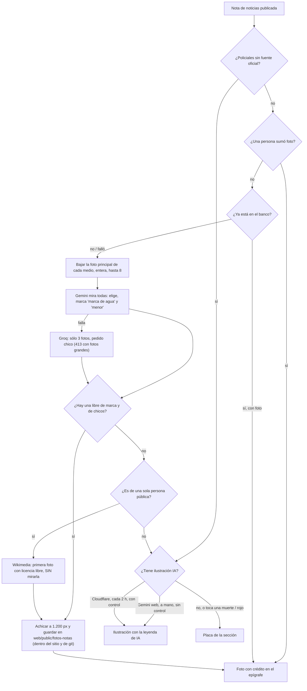
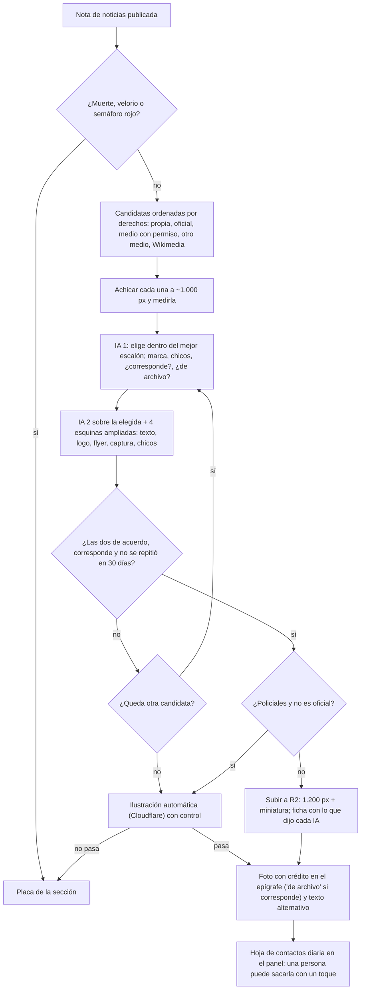

# 03 · Las fotos (auditoría para Radar 2.0)

*16/10/2026. Hecho leyendo el código y con los datos del repositorio de ese día (`web/data/` del commit "Auditoría IA · 16/10 23:00"),
sin gastar cupo de IA y sin tocar nada. Si el código cambia, manda el código. Cómo se midió, al final.*

## Resumen en 10 líneas

1. De las **250 notas de noticias** de los últimos 7 días, **213 salieron con foto real (85 %)**, **8 con una ilustración hecha con IA (3 %)** y **29 con la placa de la sección (12 %)**.
2. El "90 % con foto" que da `npm run auditar-fotos` está **inflado**: cuenta como foto las ilustraciones, los collages de los repasos y la imagen fija del clima.
3. De las 29 placas, **10 son fallas técnicas** que se arreglan en el código (casi siempre la IA de respaldo rechaza el pedido porque **se le mandan las fotos enteras, sin achicar**), 8 son por chicos, 3 Policiales, 3 notas cuya fuente no tenía foto, 2 marcas de agua, 2 fotos borradas por error y 1 que no ilustraba.
4. **La única defensa contra marcas de agua, chicos y fotos que no corresponden es una sola pasada de IA**, sin segunda opinión y sin que una persona mire. Revisé 36 imágenes publicadas: **ningún logo de otro medio pegado encima**, pero sí una captura con el cartel **"Activar Windows"**, un **flyer de una rifa** usado como foto, una **foto de stock** acreditada a un diario, dos casos de **edad dudosa** y dos fotos de Wikimedia que **no corresponden al hecho**.
5. Las fotos de Wikimedia "de la persona de la nota" **no pasan por ningún control de visión**: la misma foto de Messi de 2012 ilustró **7 notas** (una era sobre el show suspendido de un grupo musical), y un choque de GT de 2026 salió con un Fórmula 1 de 2016.
6. Las ilustraciones **hechas a mano con Gemini web** (la vía "de más calidad") **rompen las reglas propias en 5 de 6**: texto legible ("CARAVANA DE LA ALEGRÍA", "JUEZ FINAL PROVINCIAL"), marcas (Spalding, Sennheiser) y gente de fondo. Las automáticas de Cloudflare, que sí pasan por un control, salieron limpias pero genéricas.
7. **9 notas del archivo muestran una imagen rota** (apuntan a un `.png` que se borró al achicar las fotos el 29/09) y **6 notas vivas perdieron su foto para siempre** porque la poda las borró en un momento en que no estaban publicadas.
8. Las fotos viven **dentro del sitio y del repositorio**: 969 archivos y 67 MB hoy; en régimen (3.700 notas) serán unas **3.500 fotos**, casi **el 18 % del tope de 20.000 archivos** de Cloudflare. Ya son **~120 MB del historial de git (60 %)**. Pasarlas a **R2 está construido en un 80 %** y nunca se prendió.
9. Hay **unas 2.200 líneas de fotos (código y pruebas) que no se usan** (`ingesta/foto-ia.mjs` y `ingesta/foto-stock.mjs`, con reglas que contradicen las vigentes) y cuatro caminos distintos para hacer imágenes con IA.
10. Para 2.0 propongo: **un orden de fuentes por derechos** (propia → oficial → medio con permiso → otro medio → foto libre → ilustración → placa), **dos opiniones de IA** sobre la foto elegida (texto/logos en las esquinas, chicos, si corresponde a la nota), **fotos en R2** con miniaturas, **cortar Gemini web y el código muerto**, y una **hoja de contactos diaria** en el panel para que una persona saque lo que no va con un toque.

---

## 1. Cómo se elige hoy la foto de una nota, de punta a punta

### 1.1 La escalera, en el orden en que gana cada cosa

Lo que decide qué imagen lleva cada nota es `conFotosDelBanco` (`web/scripts/fotos-notas.mjs`), que corre en cada vuelta de
"Actualizar la web" (`web/scripts/generar-datos.mjs`). Para una **nota de noticias** (la que viene de las fuentes):

| Orden | Qué | De dónde sale | Quién lo decide |
|---|---|---|---|
| 1 | **La foto que sumó una persona** | `web/data/fotos-manuales.json` (pestaña Fotos del panel del celular → `web/scripts/foto-manual.mjs`) | La persona (el código confía en ella) |
| 2 | **La foto del banco**: la de un medio o un organismo que la IA eligió entre las fuentes, o una de Wikimedia si la nota es de una sola persona pública | `web/data/banco-fotos.json` + `web/public/fotos-notas/<id>.jpg` (`ingesta/fotos.mjs`) | Una IA con visión (Gemini; Groq de respaldo) |
| 3 | **Una ilustración hecha con IA** (un bodegón de objetos, sin gente) con la leyenda "Ilustración generada con IA" | `web/data/fotos-ia.json` + `<id>-ia.jpg`: la de **Gemini web** (a mano, con la PC prendida) gana sobre la **automática de Cloudflare** (cada 2 horas) | Gemini web: una persona. Cloudflare: un control con IA |
| 4 | **La placa de la sección** | El dibujo de la sección (`PlacaSeccion`, `web/components/piezas.js`) | Nadie: es lo que queda |

Frenos que se aplican encima de la escalera:

- **Policiales sin una fuente oficial no lleva foto real**, ni la del banco ni la que sumó una persona (`elegiblePorSeccion`). Sí puede llevar ilustración (regla 185).
- **Ninguna foto real con un chico reconocible**, salvo la excepción de la regla 186 (foto propia del Municipio, el Concejo o la Facultad, en una actividad, con todo en regla), que está **apagada** (`FOTOS_MENORES_OFICIALES`). En el banco no hay ninguna foto que haya entrado por ella.
- **Sin ilustración** si la nota toca una muerte, un velorio o un sepelio, o cae en el semáforo rojo (`ilustracionPermitida`, `motivoParaSaltar`).

Las **notas propias** no usan la escalera: cada una trae su imagen.

| Nota propia | Imagen | Dónde |
|---|---|---|
| El clima | Una de 27 ilustraciones fijas hechas una vez con Cloudflare, según el estado del tiempo del día | `web/lib/fondos-clima.js`, `clima-<estado>-<n>.jpg` |
| "Un día como hoy" | La ilustración fija de la hoja de almanaque, con el año y la fecha escritos | `web/scripts/foto-efemeride.mjs`, `efemeride-*.jpg` |
| Los repasos (podcasts) | Un collage de 2 a 4 fotos del banco de las notas que cuenta (o la única que haya) | `web/scripts/collage.mjs`, `collage-<id>.jpg` |
| F1 y fútbol | Una foto libre de Wikimedia del circuito o el estadio, sin repetir entre notas | `web/scripts/foto-libre.mjs`, `libre-<id>.jpg` |
| La de una pista | La que se subió desde el celular | `fotos-manuales.json` |
| El dólar | Ninguna | — |

### 1.2 Cómo se busca la foto real (lo que hace la IA)

Sólo en la nube, en cada vuelta de "Actualizar la web" (cada media hora):

1. **A quién**: las notas de noticias que se publican en esta vuelta y todavía no se probaron, **las más nuevas primero**, **hasta 10 por vuelta** (`TOPE_POR_CORRIDA`). Una nota ya probada no se vuelve a probar, salvo que haya fallado (hasta 3 veces con una hora de por medio y 2 repasos cada 6 horas) o que haya ganado fuentes.
2. **Las candidatas**: por cada medio que contó la noticia (hasta 8) se abre su nota y se toma la foto que el propio medio marca como principal (`og:image`; si no, `twitter:image`; si no, la primera foto grande del cuerpo). Se baja entera (hasta 6 MB).
3. **La comparación**: un solo pedido a **Gemini** (`gemini-flash-lite-latest`, clave gratis de clasificación) con todas las fotos y una instrucción larga (`instruccion()`): elegir la que mejor ilustra; marcar `tiene_marca` si un medio le **pegó** un logo, un nombre, un zócalo de TV (no lo que estaba en la escena, como el micrófono de una radio, permitido desde el 29/09); marcar `menor` si se reconoce a alguien que parece menor ("ante la duda, es menor"); nunca elegir una marcada.
4. **La red de seguridad del código** (`interpretarRespuesta`): sólo vale una foto que la IA evaluó **explícitamente** sin marca y sin menor; si eligió una marcada, se toma la primera libre; si no hay ninguna, nada.
5. **Si Gemini falla**: el mismo pedido a **Groq** (`qwen/qwen3.8-27b`), que acepta **3 fotos como mucho** y pedidos chicos.
6. **Si ninguna sirve**: se le pregunta a Gemini si la nota es de **una sola persona pública** y, si sí, se busca su nombre en **Wikimedia Commons**: la primera foto JPEG/PNG de 400 × 300 o más con licencia libre. **No se mira la imagen.**
7. **Se guarda** achicada a 1.200 px en JPEG en `web/public/fotos-notas/<id>.jpg`, con su ficha en el banco (medio, crédito, enlace, imagen original, por qué). El crédito ("Foto: *medio*") va **en el epígrafe**, nunca encima de la imagen.
8. **La poda** (`podarFotos`): en cada vuelta se borra la foto de toda nota retirada a mano o que ya no está en el archivo, la portada ni la ingesta.

### 1.3 Las ilustraciones con IA

- **Automáticas (Cloudflare)**, reglas 182 y 185: el reloj de Cloudflare dispara "Ilustrar notas sin foto" a los :20 cada 2 horas, de 7 a 23. Toma las notas de la portada de las **últimas 24 horas** sin foto, Gemini escribe un prompt de bodegón con el tono de la nota, el Worker `radar-balcarce-imagenes` lo dibuja con **SDXL** (1024 × 576, gratis dentro de las neuronas del plan) y otra pasada de Gemini **mira la imagen**: personas, rostros, texto, logos, algo sensible, algo raro. Sólo se publica si todo viene en "no". Tope: **20 por día**.
- **A mano con Gemini web** (`docs/flujos/IMAGENES-CON-GEMINI-WEB.md`): Claude maneja el Chrome de la PC, le pide la imagen a gemini.google.com, "una persona" la mira y se sube. **No pasa por el control automático.** Gana sobre la de Cloudflare.

### 1.4 El recorrido de hoy, en un dibujo

---

## 2. Cómo se audita hoy

| Riesgo | Qué lo controla hoy | Cuándo | El hueco |
|---|---|---|---|
| **Marca de agua o nombre de otro medio encima** | La instrucción de Gemini (`tiene_marca`) y la red de seguridad del código | Una vez, al elegir | Una sola opinión. La IA mira la foto entera reducida: un logo chico y semitransparente en una esquina se le puede pasar. Nadie vuelve a mirar. La foto se guarda entera: no se recorta nada |
| **Chicos reconocibles** | La instrucción de Gemini (`menor`), "ante la duda, es menor" | Una vez, al elegir | Una sola opinión. No queda guardado qué vio en cada candidata, así que no se puede auditar después. Las fotos de Wikimedia y las que suma una persona no pasan por ahí |
| **Víctimas** | El semáforo rojo frena la nota antes (lista de `REGLAS_SEMAFORO`) | Antes de publicar | Depende del texto, no de la foto |
| **Policiales** | `elegiblePorSeccion`: sólo foto de fuente oficial | Cada vuelta | Bien resuelto (y probado) |
| **Crédito en el epígrafe** | `creditoDeFoto`, `fotoDeLaWeb`; prueba `pruebas/fotos-notas.test.mjs` | Siempre | El crédito dice el medio de donde se bajó, aunque la foto sea de una agencia o de un banco de imágenes |
| **Calidad y tamaño** | Ninguno: se acepta cualquier tamaño (Wikimedia pide 400 × 300) | — | 29 de 234 fotos recientes tienen menos de 800 px de ancho; 6 son verticales y la página las recorta |
| **Foto que no corresponde a la nota** | "Elegí la que mejor ilustra" | Al elegir | No hay una pregunta explícita "¿esto muestra la nota?"; Wikimedia, ninguna |
| **Foto repetida en varias notas** | Sólo en las fotos libres de F1 y fútbol (`excluir`) | — | Ni en el banco ni en Wikimedia de personas |
| **Ilustraciones con IA** | Cloudflare: control de Gemini con 6 preguntas. Gemini web: "una persona" | Al hacerlas | Gemini web no tiene control automático |
| **Mirar todo junto** | `npm run auditar-fotos` (sólo cuenta por qué falta foto; `--html` muestra las candidatas de las notas **sin** foto) | A mano, en la PC | Nadie mira las fotos **publicadas**. El número mezcla foto real con ilustración |

---

## 3. Lo que medí

### 3.1 Qué imagen llevó cada nota (últimos 7 días, 284 notas)

| Tipo de imagen | Notas | % de las 284 | % de las 250 de noticias |
|---|---|---|---|
| **Foto real de un medio u organismo** | 207 | 72,9 % | 82,8 % |
| Foto de Wikimedia (persona pública) | 5 | 1,8 % | 2,0 % |
| Foto que sumó una persona | 1 | 0,4 % | 0,4 % |
| **Subtotal foto real** | **213** | | **85,2 %** |
| Ilustración IA, Gemini web | 5 | 1,8 % | 2,0 % |
| Ilustración IA, Cloudflare | 3 | 1,1 % | 1,2 % |
| **Subtotal ilustración** | **8** | | **3,2 %** |
| **Placa (sin imagen)** | **29** | 10,2 % | **11,6 %** |
| Notas propias: collage o foto de un repaso | 20 | 7,0 % | — |
| Notas propias: clima y "Un día como hoy" (fija IA) | 8 | 2,8 % | — |
| Notas propias: foto libre de F1/fútbol | 3 | 1,1 % | — |
| Notas propias sin imagen (el dólar) | 3 | 1,1 % | — |

Por sección (sólo noticias): Agro y Tecnología 100 % con foto real; Economía 42 de 48; Balcarce 18 fotos reales, 3 ilustraciones y 6 placas;
Cultura y agenda 14 fotos, 1 ilustración y 4 placas; **Policiales 0 de 3** (regla firme, y ninguna ilustrada todavía).

**Quién pone las fotos**: Infobae 25, Radio Gabal 21, La Vanguardia 17, Clarín 13, TN 12, La Nación 11, Ámbito 9, Perfil 9. Los **medios de
Balcarce aportan 59 de 213 (28 %)**. La Municipalidad, ninguna esta semana; en 30 días, 23 de las 43 notas que la tenían entre sus fuentes
salieron con su foto, y **12 de esas 43 (28 %) quedaron sin foto**, más que el promedio: sus fotos suelen tener chicos.

### 3.2 Por qué faltan las 29

| Motivo | Notas | ¿Se arregla? |
|---|---|---|
| **Falló la IA**: Gemini no contestó y Groq rechazó el pedido por grande (`413`, 6 notas) o por cupo (`429`, 2) | 8 | **Sí, en el código**: achicar las fotos antes de mandarlas |
| "No se pudo volver a bajar la elegida" (la foto venía en un formato que el código no guarda, probablemente) | 2 | Sí, en el código |
| La IA vio un chico reconocible | 8 | Regla firme (la excepción 186 rescataría alguna, apagada) |
| Policiales sin fuente oficial | 3 | Regla firme; la ilustración las cubre desde la regla 185 |
| La fuente no tenía foto | 3 | Ilustración |
| Marca de agua (Noticias Argentinas) o logo encima (Radio Gabal) | 2 | Regla firme |
| **La poda borró la foto de una nota que sigue publicada** | 2 | **Sí, en el código** |
| La foto no ilustraba (una sola persona para un viaje de nueve) | 1 | Ilustración |

En 7 días el banco anotó **17 veces que Gemini falló** (lo sabemos porque después falló Groq; el error de Gemini **no se guarda**, así que
no se puede saber si es cupo o qué).

### 3.3 Fotos repetidas

- En las notas publicadas en 7 días, **una sola foto se repitió** en dos notas distintas: la hornalla de Camuzzi de **2024** de Radio Gabal,
  en "Balcarce evalúa su postura judicial ante la quita de Zona Fría" (`11eff0s`) y "El Gobierno promulga la Ley 27.828" (`3xm1ge`).
- En todo el banco, **31 imágenes originales se usaron en 69 notas**. Lo peor es Wikimedia: **la misma foto de Messi contra Suiza (2012) en 7
  notas**, entre ellas "Grupo Cali explica los motivos de la suspensión de su show" (`kr8nxa`, una banda) y "La Messi Cup define fechas"
  (`kzftcz`); la de Colapinto en 3; la de Mariano Werner en 2.
- En el disco hay **18 grupos de archivos idénticos (40 archivos)**.

### 3.4 Peso y cantidad de archivos

| | Hoy |
|---|---|
| Archivos en `web/public/fotos-notas/` | **969** (862 del banco y a mano, 50 collages, 33 fijas de clima y efemérides, 12 libres, 12 ilustraciones) |
| Peso | **67 MB** (promedio 69 KB; la más pesada, 516 KB) |
| Formatos | 955 JPEG, 13 WebP, 1 PNG |
| Contra el tope de Cloudflare Pages (20.000 archivos por sitio; el 15/10 había 15.900 en total) | **~6 % hoy**. En régimen (las 3.700 notas con página, ~90 % con foto, más collages) serán **~3.500 archivos: ~18 % del tope** y ~250 MB en cada subida |
| Historial de git | Las fotos ya son **~120 MB de los 196 MB del repositorio (60 %)**, y la foto borrada sigue en el historial público |
| Archivos a los que apunta una nota y no existen | **9** (ver hallazgo 7) |
| Fotos de menos de 800 px de ancho | 118 de 969 (14 de menos de 600 px); en las recientes, 29 de 234 (Crónica entrega 600 × 316) |

### 3.5 Revisión a ojo (36 imágenes publicadas)

Miré las imágenes guardadas de 36 notas de los últimos 7 días, eligiendo a propósito las de riesgo: medios locales, Deportes, Balcarce,
Cultura, capturas de TV, Wikimedia y todas las ilustraciones. Las direcciones son `https://radarbalcarce.com/nota/` + lo que figura.

**Problemas**

| Nota | Qué vi | Gravedad |
|---|---|---|
| `el-segundo-llamado-a-licitacion-del-matadero-municipal-queda-desierto-1vhit3n` (Radio Gabal) | Captura de pantalla con el cartel **"Activar Windows"** abajo a la derecha. Texto encima de la imagen | Media |
| `el-merendero-dona-norma-lanza-su-tercera-campana-solidaria-con-rifa-66so6t` (Puntonueve) | No es una foto: es **el flyer de la rifa** (autos, montos en pesos, todo texto), con pinta de hecho con IA. Funciona como publicidad | Media |
| `la-recoleccion-de-residuos-electronicos-pasa-para-el-lunes-130eay0` (La Vanguardia) | **Foto de banco de imágenes** (chatarra electrónica) acreditada "Foto: Diario La Vanguardia", que no es de ellos | Media (derechos) |
| `deportistas-locales-participan-del-torneo-argentino-de-padel-1ge6irq` (Acción 5) | Montaje de **tres caras**; dos se ven **muy jóvenes**. La IA no marcó menor. La misma imagen fue sola la del repaso de esa tarde | **Revisar edad** |
| `pato-naranja-y-pato-negro-clasifican-a-semifinales-del-torneo-11lwkfl`, `campo-de-pato-mete-a-sus-dos-equipos-en-semifinales-de-rugby-1mfnr70`, `campo-de-pato-clasifica-a-sus-dos-equipos-a-las-semifinales-1fi9fiz` | Planteles de rugby de un "Torneo Desarrollo": casi todos adultos jóvenes, **alguno de edad dudosa**. Además, dos son chicas (590 y 794 px de ancho) | Revisar categoría |
| `max-verstappen-choca-al-argentino-ezequiel-perez-companc-en-portugal-gizbaj` (Wikimedia) | Un **Fórmula 1 Red Bull de 2016** para un choque de **GT en 2026**: el lector puede creer que es el auto del choque | Media |
| `la-messi-cup-define-fechas-y-cruces-para-su-segunda-edicion-kzftcz` (Wikimedia) | Messi y Xhaka en 2012; la **misma foto en 7 notas** | Baja |
| `la-cuna-del-quintuple-incorpora-mesas-profesionales-de-tenis-de-mesa-mly1kv` | Cuadro de un video vertical (1080 × 1408): en la página se recorta | Baja |
| `el-rio-iguazu-supera-su-marca-habitual-por-veinticinco-metros-y-191geto` (Crónica) | 600 × 316: se ve pixelada a lo ancho de la columna | Baja |
| `productores-ganaderos-trasladan-vacas-ante-la-crecida-de-los-rios-1fb5jbq` (A24) | Cuadro de un video de celular, borroso | Baja |
| **Ilustraciones de Gemini web** (5 de las 6 que hay): `la-escuela-municipal-de-basquet-juega-una-nueva-fecha-lf9d6b`, `ariel-bilbao-asume-como-juez-en-las-finales-de-los-juegos-bonaerenses-u0hcbv`, `el-abogado-de-virginia-aparicio-visita-una-radio-local-para-hablar-1ixp88o`, `reprograman-la-caravana-de-la-alegria-para-noviembre-aa7nni`, `la-estudiantina-2026-arranca-el-lunes-con-propuestas-deportivas-y-1eb747m` | **Texto legible** ("SÁBADO JORNADA DE LIGA ESC. MUNICIPAL" con una lista de horarios y nombres escritos a mano, "PLANILLA DE COMPETENCIA - JUEGOS BONAERENSES", "ENTREVISTA 10 AM - CASO PLAGUICIDAS", "REPROGRAMADO 15 DE NOVIEMBRE… CARAVANA DE LA ALEGRÍA", "ESTUDIANTINA '26"), **marcas** (Spalding, Sennheiser) y **gente de fondo** (jugadores; en la Estudiantina, una pista llena de chicos desenfocados). Son tan realistas que un cartel escrito a mano se puede tomar por real. Rompen los puntos 1, 4 y 7 del pedido de Hernán | **Alta** (contra reglas propias) |
| `luciano-nakis-apunta-a-gabriel-milito-…-q9ik7h` (Cloudflare) | Botines con **las tres tiras de Adidas**: el control no lo vio como logo | Baja |
| `trenes-argentinos-compra-cuarenta-y-tres-…-1wze6ju` (Cloudflare) | Una herramienta oxidada sobre madera, oscura: **no dice nada de trenes** | Baja (calidad) |

**Sin problema**: `jennifer-lasa-gana-en-el-campeonato-argentino-de-powerlifting-1h2xfr3`, `atletas-locales-logran-buenos-puestos-en-tamangueyu-y-balcarce-2g6pf5`,
`la-direccion-de-juventud-relanza-el-programa-arte-urbano-1vqqg6`, `balcarce-suma-un-plan-provincial-de-seguridad-y-educacion-vial-1dun8ft`,
`el-pronostico-anticipa-una-semana-fresca-con-lluvias-y-minimas-bajas-fa17ki`, `udocba-concreta-paro-docente-con-alto-acatamiento-y-reclama-mejoras-n6v2wu`,
`lalcec-balcarce-ofrece-mamografias-y-prepara-la-jornada-comunitaria-16q0gf8`, `valeria-ares-comparte-su-experiencia-a-dieciseis-anos-de-su-doble-tctot0`
(el micrófono con el nombre de una radio está en la escena: permitido desde el 29/09), `el-museo-historico-municipal-expone-el-proyecto-cruz-del-centenario-1xyp583`,
`el-miercoles-presenta-ambiente-fresco-y-probabilidad-de-chaparrones-9n2ees`, `gabriel-petruccelli-pide-informes-por-las-excavaciones-en-el-cerro-el-1o0mwr9`,
`guillermo-lobo-y-lorena-maciel-recuerdan-al-meteorologo-fernando-sddf3a`, `balcarce-evalua-su-postura-judicial-ante-la-quita-del-regimen-de-zona-11eff0s`
(foto de archivo de 2024, ver 3.3), el collage del repaso de la tarde del 16/10 y las ilustraciones de Cloudflare `una-vecina-dona-un-rinon-a-su-hija-…-1edq6ii`
y de Gemini web `la-direccion-de-juventud-firma-un-acuerdo-…-1jdsdep`.

**Lo que no encontré**: ningún logo ni nombre de otro medio pegado encima de una foto publicada, ni zócalos de TV. En ese punto la IA está
cumpliendo. Una muestra de 36 no alcanza para decir que no hay ninguna.

---

## 4. Hallazgos

1. **Las fotos se mandan enteras a la IA.** Se bajan hasta 6 MB y van tal cual, en base64. Groq acepta pedidos chicos y responde `413`
   ("demasiado grande"): es la causa más común de las placas evitables (6 de 29 esta semana) y de reintentos que gastan cupo. Achicarlas a
   ~1.000 px antes de compararlas (el proyecto ya tiene `achicarFoto`, con ffmpeg) lo resuelve y además hace todo más rápido.
2. **El error de Gemini se pierde.** Cuando Gemini falla y Groq también, el banco sólo guarda el de Groq. No hay forma de saber si fue cupo
   (comparte la clave con la lectura con IA) o qué.
3. **Una sola pasada de IA decide todo.** No hay segunda opinión, no se guarda qué vio en cada candidata, nadie mira las fotos publicadas.
   La revisión a ojo encontró lo que una sola pasada deja pasar: texto encima ("Activar Windows"), un flyer, una foto de stock, edades dudosas.
4. **Wikimedia sin mirar.** La búsqueda por nombre toma la primera foto con licencia libre **sin pasarla por la visión** ni controlar que no
   se haya usado: 7 notas con la misma foto de Messi, una de ellas sobre una banda; un F1 de 2016 para un choque de GT.
5. **Las ilustraciones de Gemini web no cumplen el pedido.** 5 de 6 tienen texto legible, marcas o gente de fondo, y son las que "nunca se
   pisan". Además, manejar la web de Gemini con un robot es zona gris de los términos de Google (lo dice el propio flujo), necesita la PC
   prendida y es la única parte de las fotos que no anda sola. Las de Cloudflare cumplen pero son flojas: genéricas y a veces sin relación
   con la nota.
6. **El auditor cuenta de más.** `motivoDeLaNota` (`ingesta/auditar-fotos.mjs`) da "con foto" a todo lo que tenga imagen: ilustraciones,
   collages, clima. El 90 % es en realidad **85 % de foto real**.
7. **Imágenes rotas en el archivo.** 9 notas del archivo apuntan a un archivo que ya no existe: 8 quedaron con la dirección `.png` o `.webp`
   de antes del achique del 29/09 (el banco dice `.jpg`) y 1 (`la-ultra-trail-tierras-del-diablo-abre-los-ultimos-cupos-1a6c23d`) es una foto
   que se sacó a propósito porque era el logo de La Vanguardia. Lo comprobé en vivo: las tres páginas que probé cargan y su foto da 404. El
   archivo guarda la foto de cada nota y nadie la vuelve a comparar con el banco.
8. **La poda borra fotos de notas vivas.** 6 notas publicadas (2 de esta semana: `el-transporte-publico-aumenta-desde-noviembre-…-ha42x9`,
   `gobierno-expulsa-a-ciudadano-brasileno-…-19q2x7e`) tienen la foto marcada "borrada": en alguna vuelta no figuraban (por una fusión, un
   cambio de semáforo) y la poda la borró. "Borrada" nunca se reintenta.
9. **Sin control de calidad de imagen.** Se aceptan fotos de 600 px, verticales o cuadros de video. Ninguna regla dice "si hay otra
   candidata más grande y buena, preferila".
10. **Las fotos ocupan lugar donde más duele.** Dentro del sitio cuentan contra el tope de 20.000 archivos (hoy 6 %, en régimen ~18 %) y
    dentro de git son el 60 % del repositorio. La salida está casi hecha: `web/lib/fotos.js` ya arma las direcciones con `FOTOS_BASE`
    (con prueba), el workflow "Fotos a R2" ya copia todo; falta crear el depósito, el dominio y que los scripts guarden allá en vez de en
    `web/public/`.
11. **La página carga la foto grande en todos lados.** La miniatura de 240 px de la portada baja el archivo de 1.200 px, y todas las
    imágenes tienen `alt=""` (sin texto alternativo: peor para lectores de pantalla y para Google Imágenes).
12. **Código y documentos de más.** `ingesta/foto-ia.mjs` (499 líneas, "NO está conectado a nada", con reglas que hoy no valen: nunca en
    Policiales ni Política, estilo collage de papel, clave paga) y `ingesta/foto-stock.mjs` (675 líneas), con ~1.000 líneas de pruebas, más
    `docs/fotos/PROPUESTA-IMAGEN-IA.md` y `PROPUESTA-STOCK.md`. De `foto-ia.mjs` sólo se usa `nombresDePersona`. Hay cuatro caminos de
    imagen con IA (Worker con cinco modelos, Gemini web, `foto-ia.mjs`, el probador `probar-imagen-nota.yml`) para dos usos reales.
13. **El crédito puede ser falso.** "Foto: *medio*" dice de dónde se bajó, no quién la sacó. Los medios usan fotos de agencias (NA, Télam,
    AFP), de bancos de imágenes o de archivo de años anteriores; ninguna se marca como "de archivo".
14. **Hay fotos que nunca mira una IA.** Lo que suma una persona desde el panel no pasa por ningún control (se confía en ella; una de
    las 20 manuales salió de una miniatura de Google Imágenes), y lo que ya está en el banco se reusa en el collage del repaso y en las
    redes sin volver a mirarse: la foto del pádel de edad dudosa (`1ge6irq`) fue sola la imagen del repaso de esa tarde.

---

## 5. Cómo debería ser en Radar 2.0

### 5.1 El orden de las fuentes: primero los derechos, después la calidad

Hoy la IA elige "la que mejor ilustra" entre todas las fuentes por igual, y la de un diario nacional pesa lo mismo que la del Municipio.
Propongo que gane la que **más derecho tenemos a usar**, y dentro de cada escalón, la mejor:

| Escalón | Fuente | Por qué ahí |
|---|---|---|
| 1 | **Foto propia** (la saca alguien de Radar, o la manda un vecino desde el panel o WhatsApp **con su permiso y su nombre**) | Sin riesgo de derechos y es lo que distingue a un medio local |
| 2 | **Foto oficial** del Municipio y sus áreas, el Concejo, la Facultad, la Provincia, los clubes que publican sus fotos | Se publican para que se difundan; conviene pedirles una vez por escrito el permiso de uso con crédito |
| 3 | **Foto de un medio con permiso** (un acuerdo simple con Radio Gabal, La Vanguardia, El Diario Balcarce, Puntonueve, Infórmese: los cinco ponen el 28 % de las fotos) | Convierte el riesgo aceptado el 27/09 en algo acordado |
| 4 | **Foto de otro medio sin permiso** (lo de hoy, riesgo aceptado) | Sólo si pasa todos los controles de 5.2 |
| 5 | **Foto libre** (Wikimedia) | Sólo si la visión confirma que muestra lo que dice la nota y no se usó en los últimos 30 días |
| 6 | **Ilustración IA automática**, con control | Para lo que queda sin foto: chicos, Policiales, notas sin imagen |
| 7 | **Placa de la sección** | Lo último |

### 5.2 Los controles automáticos (gratis)

Todos sobre **la foto elegida**, antes de guardarla. Una sola llamada extra por foto (~50 por día), dentro de lo gratis de Gemini o de
Workers AI de Cloudflare.

| Control | Cómo | Qué hace si falla |
|---|---|---|
| **Segunda opinión** | Un segundo modelo con visión distinto del primero (por ejemplo uno de los modelos de visión de Workers AI, que ya pagamos con el plan; a confirmar cuál al implementarlo) | Si los dos no coinciden en "sin marca y sin chicos", no se usa: pasa a la siguiente candidata o a la ilustración |
| **Texto y logos encima** | Además de la foto entera, se le mandan **las cuatro esquinas ampliadas** (donde se esconden las marcas de agua chicas y transparentes) y se pregunta "¿hay letras, logo, zócalo, captura de pantalla o es un flyer?" | No se usa |
| **Chicos** | La misma pregunta de hoy a los dos modelos. Si el texto de la nota habla de categorías juveniles (sub-17, cadetes, juveniles, escuela, desarrollo) se exige que los dos digan "todos adultos" | No se usa (o, si la regla 186 se prende, va por ese camino) |
| **¿Corresponde a la nota?** | El modelo describe la foto en una línea y responde "muestra el hecho / es genérica o de archivo / no corresponde" | "No corresponde": no se usa. "De archivo": se puede usar, y el epígrafe lo dice ("Foto de archivo: *medio*") |
| **Calidad** | Se mide ancho y alto (ffmpeg, ya está) | Menos de 800 px, vertical o cuadro de video: se prefiere otra candidata; si es la única, se usa igual |
| **Repetida** | Una huella de la imagen (un "hash perceptual" de 64 bits, con ffmpeg) comparada con las de los últimos 30 días | Si ya ilustró otra noticia, se busca otra o se marca "de archivo" |
| **Las de Wikimedia y las que suma una persona** | Pasan por los mismos controles (a la persona, el panel le muestra el resultado y decide igual) | Wikimedia: no se usa |
| **Ilustraciones** | Un solo camino (Cloudflare automático) con el control de hoy más "marcas en objetos" (tiras, swoosh) y "¿tiene relación con la nota?" | No se publica |

Y una **persona, cinco minutos por día**: una **hoja de contactos** en el panel del celular con las fotos que salieron en las últimas 24
horas, en miniatura, con un botón "sacar esta foto" (escribe en el banco con motivo, cuándo y quién, y la próxima vuelta la reemplaza).
La pestaña Fotos ya muestra las notas **sin** foto; esto es lo mismo para las que **tienen**.

Todo lo que deciden los controles queda guardado en la ficha de la foto (qué dijo cada modelo, medidas, huella, descripción), así se puede
auditar después. La descripción, de paso, sirve de **texto alternativo** (`alt`) de la imagen.

### 5.3 Dónde guardarlas: R2

| Hoy | En 2.0 |
|---|---|
| `web/public/fotos-notas/` dentro del sitio y de git | Un depósito **R2** de Cloudflare con dominio propio (`fotos.radarbalcarce.com`) |
| Cuentan contra los 20.000 archivos del sitio | No cuentan |
| Cada foto queda para siempre en el historial público de git, aunque se borre | Se borra de verdad (importa si una foto no tenía que salir) |
| El repositorio crece unos MB por día | No crece: en git queda sólo el banco (el índice en JSON) |
| Una sola medida (1.200 px) para todo | Dos al subir: 1.200 px y una miniatura de ~480 px en WebP para la portada |
| Caché de una semana | Caché de un año (cada foto tiene nombre propio y no cambia) |
| Al salir del archivo, la foto se borra | Se puede guardar para el archivo permanente que se está armando en R2 (`docs/salud-tecnica/ARCHIVO-PERMANENTE.md`) |

Costo: R2 da 10 GB y la salida gratis; en régimen son ~250 MB. **Cero pesos.** Lo que falta hacer: crear el depósito y el dominio (una
persona, en Cloudflare), poner `FOTOS_BASE`, correr una vez "Fotos a R2", y cambiar los cuatro lugares que escriben fotos
(`generar-datos.mjs`, `ilustrar-notas.mjs`, `foto-manual.mjs`, `collage.mjs`/`foto-libre.mjs`) para que suban al depósito en vez de escribir
en `web/public/`. Las fijas (clima, efemérides) pueden quedar en el sitio.

### 5.4 El recorrido propuesto

---

## 6. Recomendaciones

Impacto, esfuerzo y riesgo: Alto / Medio / Bajo. "Riesgo" es lo que puede salir mal al hacer el cambio.

| Qué hacer | Tipo | Impacto | Esfuerzo | Riesgo |
|---|---|---|---|---|
| Achicar las fotos antes de mandarlas a la IA (adiós al `413` de Groq) | Mejorar | Alto | Bajo | Bajo |
| Guardar el error de Gemini junto al de Groq, y aceptar los formatos que hoy dan "no se pudo volver a bajar" | Mejorar | Medio | Bajo | Bajo |
| Arreglar las 9 imágenes rotas del archivo y que el archivo tome la foto del banco en cada vuelta | Mejorar | Medio | Bajo | Bajo |
| Que la poda no marque "borrada para siempre" a una nota que vuelve | Mejorar | Bajo | Bajo | Bajo |
| Que `auditar-fotos` separe foto real, ilustración y propias | Mejorar | Medio | Bajo | Bajo |
| Pasar las fotos de Wikimedia por la visión y no repetirlas en 30 días | Mejorar | Medio | Bajo | Bajo |
| Segunda opinión con otro modelo de visión + las cuatro esquinas ampliadas | Mejorar | Alto | Medio | Bajo (puede dejar más notas sin foto; las cubre la ilustración) |
| Pregunta "¿corresponde a la nota? ¿es de archivo?" y epígrafe "Foto de archivo" | Mejorar | Medio | Bajo | Bajo |
| Ordenar las candidatas por derechos (propia, oficial, con permiso, sin permiso) | Mejorar | Alto | Medio | Bajo |
| Pedir permiso escrito al Municipio y a los cinco medios de Balcarce | Mejorar | Alto (legal) | Bajo (son mails) | Bajo |
| Hoja de contactos diaria en el panel, con "sacar esta foto" | Mejorar | Alto | Medio | Bajo |
| Fotos a R2 con miniaturas y caché de un año | Mejorar | Alto | Medio | Medio (tocar cómo se sirven todas las fotos; ya hay prueba y workflow) |
| Texto alternativo de cada foto con la descripción de la IA | Mejorar | Medio (accesibilidad, Google) | Bajo | Bajo |
| Preferir candidatas de 800 px o más y horizontales | Mejorar | Bajo | Bajo | Bajo |
| Ilustraciones con Gemini web por el Chrome de la PC | **Cortar** | Medio (5 de 6 rompen las reglas; zona gris de términos; necesita la PC) | Bajo | Bajo: las cubre Cloudflare |
| `ingesta/foto-ia.mjs`, `ingesta/foto-stock.mjs`, sus pruebas y sus propuestas (mover `nombresDePersona` antes) | **Cortar** | Medio (2.200 líneas que confunden) | Bajo | Bajo |
| El probador `probar-imagen-nota.yml` y los modelos del Worker que no se usan (`flux`, `phoenix`, `dreamshaper`, `sdxl-lightning`) | **Cortar** | Bajo | Bajo | Bajo |
| Groq como respaldo de visión (3 fotos como mucho, pedidos chicos) | **Achicar** (reemplazar por la segunda IA, que también hace de respaldo) | Medio | Medio | Bajo |
| Wikimedia "de la persona de la nota" | **Achicar** (sólo con visión y sin repetir) | Medio | Bajo | Bajo |
| Collage de los repasos en redes | **Achicar** (en la web sí; en redes, la placa: es reenviar fotos ajenas a Facebook e Instagram) | Bajo | Bajo | Bajo |
| Banco propio con ficha por foto, crédito en el epígrafe | **Dejar** | — | — | — |
| Ninguna foto real con chicos; excepción 186 apagada hasta que la revisen | **Dejar** | — | — | — |
| Policiales sólo con foto oficial | **Dejar** | — | — | — |
| Ilustración automática de Cloudflare con control (sumarle "marcas en objetos" y "relación con la nota") | **Dejar** y mejorar | — | — | — |
| Clima y "Un día como hoy" con imagen fija | **Dejar** | — | — | — |
| La placa como último recurso | **Dejar** | — | — | — |

## 7. Lo que tienen que decidir Hernán y Andrés

1. **¿Cortamos Gemini web?** Recomiendo que sí: hoy produce imágenes que rompen las reglas que ustedes pusieron y depende de la PC.
2. **¿Pedimos permiso escrito** al Municipio y a los cinco medios de Balcarce? Es lo que más baja el riesgo legal de todo el sistema de fotos.
3. **¿Prender R2?** Una persona tiene que crear el depósito y el dominio en Cloudflare (pasos en `docs/propuestas/PASOS-PARA-USTEDES.md`).
4. **¿Hoja de contactos diaria?** Cinco minutos por día en el celular a cambio de que nada raro quede publicado más de un día.
5. **Las dudas de esta revisión**: la edad de los chicos del pádel (`1ge6irq`) y del rugby de "Torneo Desarrollo", y si el flyer de la rifa
   (`66so6t`) y la foto con "Activar Windows" (`1vhit3n`) se sacan.

---

## Cómo se midió

- `npm run auditar-fotos -- --dias=7` (no gasta cupo; no ensució el repositorio: `git status` limpio después).
- Dos scripts propios, fuera del repositorio, que leen `portada.json`, `archivo.json`, `banco-fotos.json`, `fotos-ia.json` y
  `fotos-manuales.json`, clasifican cada nota por el **archivo** que muestra (`-ia.jpg`, `collage-`, `clima-`, `libre-`, banco) y miden en el
  disco cantidad, peso, medidas (leyendo el encabezado de cada JPEG/PNG/WebP) y archivos idénticos (huella MD5).
- El peso de las fotos en el historial de git, con `git rev-list --objects` sobre `web/public/fotos-notas`.
- Las imágenes rotas, comprobadas en `radarbalcarce.com` (la página carga, su foto da 404).
- La revisión a ojo: 36 imágenes abiertas una por una, elegidas por riesgo, no al azar.
- Límites: los datos son del 16/10 a la noche; la muestra a ojo no es representativa de todo el banco; las causas de "no se pudo volver a
  bajar" y de las fallas de Gemini son probables, no comprobadas (el banco no guarda el detalle).
