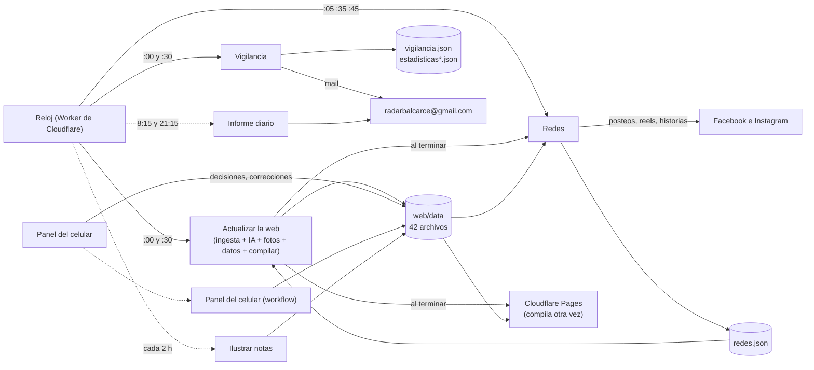
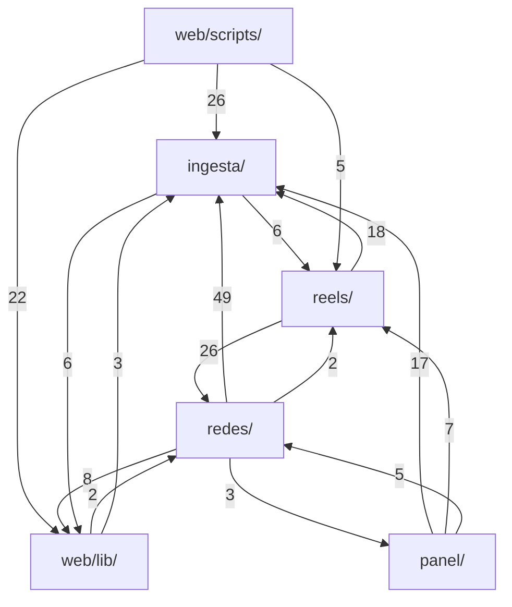
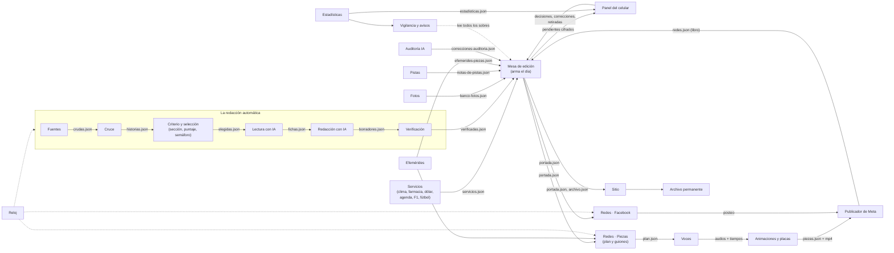

# 05 · Módulos, redes y animaciones: cómo está armado hoy y cómo sería Radar 2.0

*Auditoría del 16/10/2026. Medido sobre el repositorio (`git ls-files`, siguiendo los `import` de verdad
de los 543 programas) y sobre las corridas reales de GitHub de los últimos 15 días (`gh run list`,
del 2/10 al 16/10). No se tocó código ni datos. Los números de este documento se pueden rehacer con los
comandos del anexo.*

*Otros informes de esta misma auditoría cubren el armado, el despliegue, los workflows y la
infraestructura; las fuentes, el criterio y las repetidas; las fotos; y la IA y los modelos. Acá se
nombran sólo cuando hace falta, sin repetirlos.*

---

## Resumen en diez renglones

1. Hoy las carpetas **no son módulos**: casi todas se importan entre sí en círculo (`redes` usa `reels`
   y `reels` usa `redes`; `ingesta` usa `reels` y `reels` usa `ingesta`; `panel` y `redes`, igual).
   Tocar una carpeta puede romper otra sin que se note a simple vista.
2. Hay **ocho piezas "de todos"** guardadas en el cajón equivocado (la hora de Balcarce en `ingesta/`,
   las claves de IA en `reels/`, el registro de uso de IA en `redes/`, la firma de las notas en un
   componente de la web…). Moverlas a una carpeta común corta la mitad de los cruces.
3. Los **contratos entre partes ya existen**: son los 42 archivos de `web/data/`. Pero no tienen formato
   escrito, ni versión, ni una prueba que controle que quien escribe y quien lee digan lo mismo.
4. Seis archivos gigantes (de 1.200 a 2.000 renglones) **mezclan varios trabajos**; el peor,
   `ingesta/ingesta.mjs`, lee fuentes, decide el semáforo y además trae el clima y las farmacias.
5. Quedan **restos del panel de la PC** también adentro del código vivo ("modo PC" en el armado de la web
   y en el plan de los videos), además de los once archivos del panel en sí.
6. Las redes publican **unas 38 piezas por día** y fallan poco (27 corridas rojas de 1.866 en 15 días,
   1,4 %, casi todas un rechazo pasajero de Instagram que se arregla solo en la vuelta siguiente).
7. Pero **el 89 % de las corridas de "Redes" no hacen nada** (miran el reloj y terminan en 20 segundos):
   unas 110 por día que se pueden ahorrar avisándoles sólo a las horas en que hay pieza.
8. Lo que rinde es **Facebook**: trae entre el 80 y el 90 % de las visitas a la web, con picos justo
   después de cada repaso. Instagram (7 seguidores, 4 a 9 reproducciones por reel) no trae visitas.
9. La medición de las piezas está **rota a medias**: las historias y los reels de Facebook y las
   historias de Instagram nunca tienen números. Hay que arreglarla antes de decidir qué recortar.
10. Se propone un mapa de **20 módulos** con su entrada, su salida, su prueba, su interruptor y quién lo
    cuida, y un plan de limpieza en **nueve pasos**, del que no tiene riesgo al que más cuidado pide.

---

## Palabras que aparecen (en media línea cada una)

| Palabra | Qué quiere decir acá |
|---|---|
| **Módulo** | Una parte del sistema con un solo trabajo, que se puede mejorar sin tocar las demás. |
| **Contrato** | El archivo (o el formato) que un módulo deja y otro lee: si los dos lo respetan, cada uno puede cambiar por dentro. |
| **Importar** | Cuando un programa usa una función escrita en otro archivo. Si A importa B, tocar B puede romper A. |
| **Acoplado** | Muy atado a otros: lo usan muchos o usa a muchos. Es lo más delicado de tocar. |
| **Interruptor** | Una variable (en GitHub o en el código) que apaga un módulo sin borrar nada. Hoy existe `REDES_ACTIVAS`, por ejemplo. |
| **Corrida** | Una vez que GitHub ejecuta un workflow (una "tarea" automática). |
| **Workflow** | Una receta de pasos que GitHub corre sola o a pedido (`.github/workflows/*.yml`). |
| **Pieza** | Cada cosa que sale en las redes: una historia, un reel, un posteo. |
| **Reel / historia** | Reel: video que queda en el perfil. Historia: video que dura 24 horas. |
| **Placa** | La imagen fija de 1080 × 1920 sobre la que se arma el video. |
| **Escena** | La versión animada de una placa (las cosas entran, se mueven). |
| **Manifiesto** | La lista que deja el armado de videos (`reels/salida/piezas.json`) para que el publicador sepa qué subir. |
| **Libro** | `web/data/redes.json`: lo que ya se publicó en cada red, para no publicarlo dos veces. |
| **Puente** | Un archivo viejo que sólo reenvía al nuevo, para mover algo sin romper a quien lo usaba. |
| **En sombra** | Un módulo que calcula pero no cambia nada de lo publicado (para comparar antes de prenderlo). |

---

## Parte 1 · El mapa real de hoy

### 1.1 Cuánto código hay y dónde

Contado con `git ls-files` (sólo lo que está en el repositorio), en renglones:

| Carpeta | Programas | Renglones | Qué es |
|---|---:|---:|---|
| `ingesta/` | 44 | 15.838 | El motor de las notas (y bastante más: ver 1.4) |
| `redes/` | 41 | 9.215 | Facebook, Instagram, vigilancia, informes, estadísticas |
| `reels/` | 31 | 7.375 | Placas, voces, videos **y la redacción con IA** |
| `web/lib/` | 34 | 5.480 | La lógica del sitio (también la usan otros) |
| `web/scripts/` | 21 | 4.694 | El armado de los datos de la web, fotos, archivo |
| `web/public/panel/` | 17 | 4.393 | La app del panel del celular |
| `panel/` | 20 | 3.117 | Lo del celular en GitHub **y** el panel de la PC (en desuso) |
| `web/app/` + `web/components/` | 55 | 4.744 | Las páginas y las piezas de la interfaz |
| `infra/` | 10 | 2.350 | Los Workers de Cloudflare |
| **Producción, total** | **273** | **~57.200** | |
| `pruebas/` | 211 | 38.159 | Las pruebas (207 archivos `.test.mjs`, unas 2.700 pruebas) |
| `docs/` | 25 | 4.986 | **Programas** que viven dentro de la documentación |
| `pruebas-modelos/`, `criterio-unico/`, `comercial/`, `motor/` | 33 | 3.448 | Ensayos y borradores, nada de producción |

Dos cosas para mirar: hay **25 programas adentro de `docs/`** (los que generaron informes de las etapas)
y una prueba depende de uno de ellos (`revision-fuentes.test.mjs`); y las pruebas suman dos tercios de lo
que suma el código de producción.

### 1.2 Quién importa a quién (la matriz)

Cada número es cuántas veces un programa de la fila usa uno de la columna (sin contar las pruebas).
Lo de adentro de la misma carpeta no se cuenta.

| Desde ↓ / hacia → | ingesta | reels | redes | panel | web/lib | web/scripts | otros |
|---|---:|---:|---:|---:|---:|---:|---|
| **ingesta** | — | **6** | 1 | | 6 | | |
| **reels** | 18 | — | **26** | 1 | 4 | | |
| **redes** | **49** | 2 | — | 3 | 8 | 1 | web/components 1 |
| **panel** | 17 | 7 | 5 | — | 4 | | |
| **web/lib** | 3 | | 2 | | — | | web/components 2 |
| **web/scripts** | 26 | 5 | 3 | 2 | 22 | — | infra 1, web/public/panel 1 |
| **infra** | 1 | | | | | | |

Lo que dice la tabla, en castellano:

- **Hay círculos**: `ingesta ↔ reels`, `reels ↔ redes`, `redes ↔ panel`, `ingesta ↔ web/lib`,
  `web/lib ↔ redes`. Con círculos no hay "de abajo para arriba": cualquier cambio puede volver.
- **`redes/` depende muchísimo de `ingesta/`** (49 usos de 10 archivos distintos). Casi todo es la hora,
  los números del criterio, las listas de fuentes y leer JSON: cosas comunes, no del motor.
- **`web/scripts/generar-datos.mjs` es el nudo**: usa 42 archivos de 6 carpetas. Es el lugar donde hoy
  se junta todo, y por eso el que más miedo da tocar.

**Las ocho piezas "de todos" que están en el cajón equivocado** (sacarlas a una carpeta común deshace la
mayoría de los círculos):

| Pieza | Dónde está | La usan | Debería estar en |
|---|---|---|---|
| La hora de Balcarce (`zona.mjs`) | `ingesta/` | 36 programas de 6 carpetas | `comun/` |
| Leer un JSON sin romperse (`json.mjs`) | `ingesta/` | 17 programas de 4 carpetas | `comun/` |
| Las claves de IA (`claves.mjs`) | `reels/` | 16 programas de 5 carpetas (también `ingesta/`, `panel/`, `redes/`) | `comun/` |
| El registro de uso de IA (`uso-ia.mjs`) | `redes/` | la redacción (`reels/`) y las fotos (`ingesta/`) | `comun/` |
| Comparar y limpiar textos (`texto.js`) | `web/lib/` | 24 programas de 8 carpetas, también el motor | `comun/` |
| La firma de cada nota (`firmaCorta`, `quienEscribio`) | `web/components/metadatos.js` (un componente de la web) | el RSS, los datos para agentes y **el archivo de piezas de redes** | `comun/` |
| Mandar un aviso por mail (`avisar-por-mail.mjs`) | `redes/` | la vigilancia, el armado de la web, el despliegue, el informe | `comun/` |
| Qué secciones esperan a una persona y el interruptor de redes | `redes/elegir.mjs` (558 renglones) | la web (`notas-propias.js`) y el armado (`generar-datos.mjs`) | el módulo Criterio (sus números) y `comun/interruptores` |

Hay otros cruces sueltos que también conviene cortar: el armado de la web importa una función **de la
app del celular** (`web/scripts/foto-manual.mjs` → `web/public/panel/fotos.js`); el informe diario
importa del armado del sitio (`contar-archivos.mjs`); la auditoría con IA usa el cifrado del panel; y el
**semáforo** (`semaforoDelTexto`) vive adentro de `ingesta/ingesta.mjs`, así que seis programas tienen que
cargar el motor entero para preguntar si un texto es rojo.

### 1.3 Los archivos más acoplados

**Los que más usan otros** (tocarlos afecta a muchos):

| Archivo | Lo usan (sin pruebas) | De cuántas carpetas |
|---|---:|---:|
| `ingesta/zona.mjs` | 36 | 6 |
| `web/lib/datos.js` | 30 | 3 |
| `web/lib/texto.js` | 24 | 8 |
| `ingesta/criterio.mjs` | 23 | 5 |
| `web/components/metadatos.js` | 21 | 4 |
| `ingesta/fuentes.mjs` | 20 | 6 |
| `ingesta/ingesta.mjs` | 19 | **7** |
| `web/lib/ruta.js` | 18 | 6 |
| `redes/elegir.mjs` | 17 | 4 |
| `web/lib/cuerpo.js` | 17 | 6 |

**Los que más usan de otros** (son los que se rompen cuando algo cambia):

| Archivo | Usa | De cuántas carpetas |
|---|---:|---:|
| `web/scripts/generar-datos.mjs` | 42 | 6 |
| `reels/plan.mjs` | 20 | 5 |
| `panel/servidor.mjs` (en desuso) | 20 | 5 |
| `redes/vigilar.mjs` | 17 | 2 |
| `reels/reescritura.mjs` | 16 | 4 |

### 1.4 Los archivos gigantes que mezclan trabajos

| Archivo | Renglones | Qué mezcla | Cómo se partiría |
|---|---:|---|---|
| `web/public/panel/app.js` | 1.990 | Las once pestañas del celular, la llave, los datos, las tareas en curso | Un archivo por pestaña (ya empezó: `fotos.js`, `pistas.js`, `numeros.js`…) y `app.js` sólo como "índice" |
| `ingesta/ingesta.mjs` | 1.924 | Bajar y leer los feeds; clasificar y semáforo; **el clima y las farmacias** ("datos fijos", renglones 942 a 1.344); correr; vista previa | `fuentes/` (bajar y leer), `criterio/semaforo` (clasificar), `servicios/` (clima, farmacias) |
| `ingesta/fuentes.mjs` | 1.510 | La lista de fuentes **y** todas las listas de palabras (sección, semáforo, local, zona, figuras, temas) | Las fuentes por un lado; las palabras del criterio por otro (la lista roja, con su candado de "no tocar sin preguntar") |
| `reels/reescritura.mjs` | 1.420 | La redacción con IA entera: orden, topes, pedido, verificación, nivel. **No tiene nada de video**: está en `reels/` por historia | Mudarla a `redaccion/`; el nivel de verificación, a `verificacion/` |
| `web/scripts/generar-datos.mjs` | 1.313 | Leer decisiones, llamar a la ingesta, a la IA, a las fotos, al archivo, a las notas propias, a la agenda, cifrar para el celular, escribir 20 archivos | Una "mesa de edición" que sólo encadena pasos; cada paso en su módulo |
| `ingesta/verificar.mjs` | 1.207 | El verificador **y** los arreglos de escritura (tildes, título en pasado, letras rotas) | Está bien que sea uno solo, pero partido en dos archivos: lo que juzga y lo que arregla |
| `redes/vigilar.mjs` | 994 | Vigilar la web y los workflows, las claves de IA, los vencimientos, las efemérides, el archivo de R2, el contrato de redes, el cierre de las 23:30 **y medir las estadísticas** | La vigilancia por un lado; las estadísticas en su propio módulo (ver Parte 3) |
| `redes/informe-diario.mjs` | 808 | Leer todo, armar las secciones del mail, los dos formatos y mandarlo | Razonable; se achica solo cuando cada módulo exponga su "resumen del día" |
| `web/lib/notas-propias.js` | 788 | La nota del dólar, la de cada repaso, la del clima y la de "Un día como hoy" | Cada nota propia con el módulo que la origina (Servicios, Piezas, Efemérides) |

### 1.5 Los contratos de hoy: los archivos de `web/data/`

Son 42 JSON (más `historico/`). Hoy funcionan como contrato, pero ninguno tiene su formato escrito ni
una versión. Esta es la tabla de quién escribe y quién lee cada uno (agrupados por quién los escribe):

| Archivo | Tamaño | Lo escribe | Lo leen |
|---|---:|---|---|
| `portada.json` | 305 KB | Actualizar la web | La web, **las redes** (todo lo que va a una pieza sale de acá), el panel, la vigilancia, el informe |
| `archivo.json` | 3,1 MB | Actualizar la web | La web, el archivo en R2, auditorías, panel, respaldo |
| `agenda.json` | 6 KB | Actualizar la web | La web, el plan de las piezas (la agenda del jueves) |
| `banco-fotos.json` | 888 KB | Actualizar la web (también "Ilustrar") | La web, las tarjetas, el espejo de Instagram, el panel |
| `fichas.json`, `fusionadas.json`, `intentos-ia.json`, `esperando-cuerpo.json`, `vistas.json`, `notas-por-dia.json`, `clima-historia.json`, `dolar-historia.json`, `f1.json`, `futbol.json`, `uso-ia.json` | 1 a 708 KB | Actualizar la web | Sobre todo la misma "Actualizar la web" en la vuelta siguiente; algunos el informe y el panel |
| `celular-pendientes.json`, `celular-estado.json` | 135 y 6 KB | Actualizar la web (cifrado) | El panel del celular |
| `celular-decisiones.json`, `celular-llaves.json`, `contactos-celular.json` | 37, 2 y 0 KB | El celular | Actualizar la web, el cifrado, el archivo de piezas |
| `correcciones.json` | 152 KB | El celular, una persona o Claude | La web (y 8 programas más) |
| `retiradas.json` | 1 KB | Una persona o Claude | La web, la redacción, el archivo en R2 |
| `celular-borradores.json`, `fotos-manuales.json` | 178 y 10 KB | Panel del celular (workflow) | El celular; el armado de la web |
| `pistas.json`, `notas-de-pistas.json` | 43 y 11 KB | El celular, "Pistas", "Panel del celular" | La web, el panel |
| `redes.json` (el libro) | 193 KB | Redes, Piezas, Reintentar, Fijar piezas | Actualizar la web (direcciones, nota del repaso), vigilancia, informe, contrato |
| `vigilancia.json`, `estadisticas.json`, `estadisticas-piezas.json` | 1, 65 y 141 KB | Vigilancia | El informe, la pestaña Números; `estadisticas-piezas.json` **no lo muestra nadie** |
| `auditoria.json` | 0 KB | Auditoría (lunes) | La vigilancia, la web |
| `auditoria-ia.json`, `correcciones-auditoria.json` | 17 y 2 KB | Auditoría IA | El panel (Revisión), la web |
| `fotos-ia.json` | 7 KB | Ilustrar notas sin foto | El armado de la web |
| `efemerides-*.json`, `feriados-piezas.json` | 0 a 235 KB | La corrida mensual y el panel (Fechas) | Las piezas, la nota de la web, la vigilancia |
| `agenda-suspendidos.json` | 0 KB | Una persona o Claude | La agenda |
| `decisiones.json`, `avisos.json`, `eventos-panel.json` | 0 KB, vacíos desde fines de septiembre | **El panel de la PC (en desuso)** | La web todavía los lee |

Tres cosas que salen de esta tabla:

- **Las redes dependen enteramente de `portada.json`.** El 11/10, cuando la web estuvo siete horas sin
  actualizarse, ese día no salieron posteos en Facebook ni el repaso de la tarde (no había notas nuevas).
  Está bien que una pieza sólo hable de lo ya publicado, pero el contrato tendría que decir "esto es de
  hace X horas" para que el módulo de redes sepa si está leyendo algo viejo y avise.
- **Un mismo archivo lo escriben varios workflows** (`redes.json` cuatro; `pistas.json` tres). Por eso
  existen `panel/unir-conflictos.mjs` y los "si choca, gana el mío" de los commits. Con un dueño por
  archivo eso desaparece.
- **Nadie controla el formato.** Una prueba que diga "lo que escribe A tiene esta forma y lo que lee B
  espera esta forma" (una por contrato) evitaría la mayoría de los "se congeló la web" del historial.

### 1.6 Lo muerto y los restos

La lista grande de lo que sobra ya está en `docs/COMO-FUNCIONA-HOY.html` § 12 (workflows de un solo día,
el panel de la PC, `comercial/`, `pruebas-modelos/`, módulos en sombra, 238 pruebas que se pueden
borrar). **No se repite acá.** Lo que esta auditoría **agrega**, siguiendo los imports:

| Resto | Dónde | Evidencia | Qué hacer |
|---|---|---|---|
| El "modo PC" adentro del código vivo | `web/scripts/generar-datos.mjs` (lee `panel/datos/` y `estado.json`), `reels/plan.mjs` (`panel/datos/ultima.json`, `estado.json`, `esPublicable`), `redes/datos.mjs`, `ingesta/agenda.mjs` | Desde el 8/10 nadie usa la PC; esas ramas nunca corren en GitHub | Sacarlas al retirar el panel de la PC (paso 2 del plan) |
| `panel/horarios.mjs` | En la carpeta del panel, pero es **el horario de las redes** | Lo usan `redes/piezas.mjs` y `reels/plan.mjs`; dice que lo guardado "vive en `panel/datos/estado.json`", que ya no existe en GitHub | Mudarlo a `redes/` (o al módulo Piezas) |
| Archivos del panel de la PC | `panel/servidor.mjs`, `acceso`, `seguridad`, `agenda`, `avisos`, `buzon`, `notas`, `respaldo`, `sincronizar`, `clave`, `panel.html`, `ARRANCAR.bat` | 2.914 renglones; nadie los importa salvo entre ellos | Retirar (ya recomendado en COMO-FUNCIONA § 12) |
| `web/components/reproductor-de-audio.js`, `web/lib/audio-de-nota.js` | Web | Nadie los usa (prototipo apagado del 16/10) | Dejar en sombra hasta decidir el audio en la página; anotarlo como "en sombra" |
| `reels/escenas/deportes.mjs` | Reels | Sólo lo usa el catálogo de ejemplos | Dejar (está anunciado "para más adelante") |
| `reels/render-cuadros.mjs` | Reels | Parece huérfano, pero **no lo es**: lo arranca `animacion.mjs` como tarea paralela | Dejar; anotarlo en su cabecera para que nadie lo borre |
| Programas adentro de `docs/` | 25 archivos (`docs/etapa-*`, `scripts/medir/informe-del-dia.mjs`, 1.293 renglones) | Herramientas de informes de una vez | Pasarlos a una carpeta `herramientas/` o borrarlos al cerrar cada etapa (la prueba que depende de uno se mueve con él) |
| Textos viejos en los criterios | `CRITERIO-REDES.md` renglones 16-17 y 96 (hablan del panel de la PC); dice "actualizado el 29/09" y tiene cambios del 8/10 y del 16/10; dice que un día normal usa **6** audios y `docs/07-REDES.md` dice **7** | | Corregir al retirar el panel de la PC |
| Una frase rota | `.github/workflows/piezas.yml` renglones 8-9: "Si Gemini falla, la pieza sale igual con otra voz: no sale…" | Quedó a medio corregir | Corregir: "Si Gemini falla, la pieza no sale" |
| Pruebas ordenadas por fecha | `arreglos-28-09.test.mjs`, `auditoria-28-09.test.mjs`… 35 archivos de pruebas tocan 3 carpetas o más | Imposible saber qué pruebas son de qué módulo | Agruparlas por módulo (paso 8) |

### 1.7 Diagrama de hoy

Cómo corre el trabajo hoy (lo lleno es cada media hora; lo punteado, a otras horas o a pedido):

Y cómo se usan las carpetas entre sí (cada flecha: "usa funciones de"; el número, cuántas veces):

Las flechas que van "para los dos lados" (ingesta y reels, reels y redes, redes y panel, ingesta y
web/lib) son los círculos.

---

## Parte 2 · El mapa de módulos de Radar 2.0

### 2.1 Las seis reglas de un módulo

1. **Una carpeta por módulo**, con un `LEEME.md` corto (su ficha: lo de la tabla de abajo).
2. **Entra un contrato y sale un contrato.** Un módulo no lee los archivos internos de otro: sólo su
   salida. Cada contrato tiene escrito su formato y una prueba que lo controla.
3. **Todo contrato viaja en un sobre igual**: `{ "version": 1, "modulo": "…", "generado": "fecha y hora",
   "datos": … }`. Con `generado`, el que lee sabe si es viejo; con `version`, si cambió la forma.
4. **Sólo se importa de `comun/`** (la hora, leer JSON, claves, textos, avisos, interruptores) y de las
   funciones públicas del otro módulo, nunca de su "cocina". La prueba que hoy vigila que `ingesta/` no
   importe paquetes de afuera se amplía para vigilar esto.
5. **Cada módulo tiene un interruptor** y, apagado, los demás siguen con su último contrato bueno.
6. **Si un módulo falla, deja el contrato anterior intacto y avisa.** Nunca escribe un contrato a medias.

**Los interruptores**, en un solo lugar: una variable de GitHub `MODULOS_APAGADOS` (por ejemplo
`voces,ilustraciones`) que lee `comun/interruptores.mjs` con `estaPrendido('voces')`. Los que ya existen
(`REDES_ACTIVAS`, `SECCIONES_NUEVAS`, `FOTOS_MENORES_OFICIALES`, `REELS_ESCENAS`, `REELS_ANIMADOS`, las
`R2_*`) se mantienen con su nombre y se anotan en la misma tabla. Resuelve además el "botón de
emergencia" que está en `PENDIENTES.md`.

**Quién cuida cada módulo** (propuesta para confirmar): cada módulo tiene **una persona que decide**
(lo que se publica, cuándo, cuánto) y **un agente que lo mantiene** (Claude, en una sesión que sólo abre
esa carpeta y su ficha). Se propone repartir así, a confirmar por ustedes: **Hernán** decide lo editorial
(Fuentes, Criterio, Redacción, Verificación, Efemérides, Panel, lo que dicen las Piezas) y **Andrés** lo
operativo y las cuentas (Reloj, Vigilancia, Estadísticas, Respaldo, Publicador de Meta, Comercial). Si los
dos prefieren decidir todo juntos, la columna queda igual y dice "los dos".

### 2.2 Diagrama propuesto

Cada caja es un módulo; cada flecha, un contrato (el archivo que pasa de uno a otro).

### 2.3 Las fichas

Cada ficha dice: qué hace, qué recibe, qué entrega (el contrato), sus pruebas, su interruptor, qué pasa si
falla, quién lo cuida y dónde está hoy. Los formatos son el "esqueleto" del contrato: los nombres exactos
de los campos se fijan al escribir la prueba de cada uno.

#### M0 · Común (`comun/`)

| | |
|---|---|
| **Qué hace** | Lo que usan todos: la hora de Balcarce, leer y escribir JSON sin romperse, las claves de IA, el registro de uso de IA, comparar textos, la firma de las notas, mandar un aviso por mail, los interruptores. |
| **Entra / sale** | Nada: son funciones, no datos. |
| **Pruebas** | Las que hoy prueban `zona`, `json`, `claves`, `texto`, `uso-ia`, `avisar-por-mail`. |
| **Interruptor** | No tiene (siempre prendido). |
| **Si falla** | Falla todo: por eso no hace nada con la red ni con el disco salvo `json` y `avisar`. |
| **Cuida** | Agente; ninguna decisión editorial. |
| **Hoy está en** | `ingesta/zona.mjs`, `ingesta/json.mjs`, `reels/claves.mjs`, `redes/uso-ia.mjs`, `web/lib/texto.js`, parte de `web/components/metadatos.js`, `redes/avisar-por-mail.mjs`, `redes/whatsapp.mjs`. |

#### M1 · Reloj

| | |
|---|---|
| **Qué hace** | Despierta a cada módulo a su hora. No hace el trabajo. |
| **Entra** | La hora. **Sale**: el pedido a GitHub de correr un workflow. |
| **Contrato** | Una tabla única de horarios (hoy `trabajosDelMinuto` en el Worker) que también lea el módulo Piezas, para que **el reloj sólo despierte a "Redes" cuando hay una pieza que sale** (ver Parte 3). |
| **Pruebas** | `reloj-cloudflare.test.mjs`. |
| **Interruptor** | Sacar un renglón de la tabla. |
| **Si falla** | Queda **un solo** horario de respaldo de GitHub por workflow y la vigilancia de Cloudflare avisa (el detalle, en el informe de infraestructura). |
| **Cuida** | Andrés (propuesta) + agente de infraestructura. |
| **Hoy está en** | `infra/reloj-cloudflare/`. |

#### M2 · Fuentes

| | |
|---|---|
| **Qué hace** | Baja los feeds y las páginas de los medios y saca el texto de cada nota. |
| **Entra** | La lista de fuentes. **Sale**: `crudas.json` = `[{ medio, feed, titulo, enlace, fecha, resumen, foto, textoCompleto? }]`. |
| **Pruebas** | Las de lectura de feeds, entrada, `articulo`, `listar-fuentes`. |
| **Interruptor** | Por fuente (`activa: false`, ya existe). |
| **Si falla** | Una fuente caída no frena a las demás; si caen todas, la web sigue con lo que tenía y la vigilancia avisa "sin notas nuevas". |
| **Cuida** | Hernán + agente de fuentes (el detalle del criterio de fuentes, en el informe de fuentes). |
| **Hoy está en** | `ingesta/ingesta.mjs` (parseo y `traer`), `ingesta/articulo.mjs`, `ingesta/fuentes.mjs` (la parte de la lista), `ingesta/fuentes-cruce.mjs`. |

#### M3 · Cruce

| | |
|---|---|
| **Qué hace** | Junta las notas que cuentan el mismo hecho y recuerda 36 horas. |
| **Entra** | `crudas.json` y lo ya publicado. **Sale**: `historias.json` = `[{ id, notas:[…], medios, primera, ultima }]`. |
| **Pruebas** | Las del cruce, el cruce coherente y las repetidas. |
| **Interruptor** | No se apaga (sin cruce no hay "cuántos medios"); `CRUCE_COHERENTE` sí, como hoy. |
| **Si falla** | No sale nada nuevo de afuera; lo de Balcarce podría seguir con una historia por nota (a decidir). |
| **Cuida** | Hernán + agente de fuentes. |
| **Hoy está en** | `ingesta/cruce.mjs`, `ingesta/repetidas-publicadas.mjs`, parte de `ingesta/lectura-ia.mjs` y `web/lib/repetidas.js`. |

#### M4 · Criterio y selección

| | |
|---|---|
| **Qué hace** | Sección, puntaje, "de acá", medios mínimos, cupos y **semáforo** (rojo, amarillo, nunca). |
| **Entra** | `historias.json`. **Sale**: `elegidas.json` = `[{ historia, seccion, puntaje, semaforo, motivo, deAca }]`. |
| **Pruebas** | Casi todo el núcleo legal (semáforo, exenciones, de-acá, entrada, copia de afuera, lotería, efemérides ajenas). |
| **Interruptor** | **No se apaga**: es el freno. Lo que se prende y apaga es lo nuevo (`SECCIONES_NUEVAS`, el flujo nuevo en sombra). |
| **Si falla** | No sale nada (lo seguro). |
| **Cuida** | Hernán (la lista roja, "no tocar sin preguntar") + agente de criterio. |
| **Hoy está en** | `ingesta/ingesta.mjs` (renglones 441-942), las listas de palabras de `ingesta/fuentes.mjs`, `criterio.mjs`, `exenciones.mjs`, `menores.mjs`, `seleccion-nueva.mjs` y `secciones-nuevas*.mjs` (en sombra). |

#### M5 · Lectura con IA

| | |
|---|---|
| **Qué hace** | Una IA lee cada historia y deja una ficha (puede sacarla, cambiarla de sección o juntarla con una repetida; nunca destraba un freno). |
| **Entra** | `elegidas.json`. **Sale**: `fichas.json` (ya existe). |
| **Pruebas** | `lectura-ia.test.mjs` y las de fichas. |
| **Interruptor** | `lectura-ia`: apagada, pasa lo elegido sin ficha (como cuando Gemini y Groq fallan). |
| **Si falla** | Sigue sin ficha. |
| **Cuida** | Hernán + agente de IA (los modelos, en el informe de IA). |
| **Hoy está en** | `ingesta/lectura-ia.mjs`, `ingesta/perfil-balcarce.md`. |

#### M6 · Redacción con IA

| | |
|---|---|
| **Qué hace** | Escribe título, bajada y cuerpo con el texto completo de hasta 4 fuentes, con las reglas de `CRITERIO-EDITORIAL.md` § 12. |
| **Entra** | Lo elegido + fichas + textos completos. **Sale**: `borradores.json` = `[{ id, titulo, copete, cuerpo, textoRedes, seSabe, noConfirmado, fuentesUsadas, modelo, intentos }]`. |
| **Pruebas** | `reescritura`, `json-ia`, `escape-en-el-texto`, `entrada-ampliada`. |
| **Interruptor** | `redaccion`: apagada, las notas esperan cuerpo (la regla "sin cuerpo no se publica" ya cubre esto). |
| **Si falla** | Crece "Esperando cuerpo"; el panel puede escribirlo a mano. |
| **Cuida** | Hernán + agente de IA. |
| **Hoy está en** | **`reels/reescritura.mjs`** (se muda), `ingesta/fuentes-para-la-ia.mjs`, `ingesta/prompt-editorial.mjs`, `panel/reescribir-una.mjs` (el pedido a mano usa el mismo camino). |

#### M7 · Verificación

| | |
|---|---|
| **Qué hace** | Compara cada número, nombre y dato con las fuentes; lo que no está, lo descarta; arregla sin inventar; pone el nivel (alta, media, baja) y vuelve a pasar el semáforo sobre lo escrito. |
| **Entra** | `borradores.json` + las fuentes. **Sale**: `verificadas.json` = `[{ id, …borrador, nivel, descartado:[…], arreglos:[…] }]`. |
| **Pruebas** | Núcleo legal: `verificar`, `verificador-copia-fechas-letras`, `cuerpo`. |
| **Interruptor** | **No se apaga.** |
| **Si falla** | Nada escrito por la IA sale. |
| **Cuida** | Hernán + agente de criterio. |
| **Hoy está en** | `ingesta/verificar.mjs`, el nivel de verificación de `reels/reescritura.mjs`, `web/lib/titulos.js`. |

#### M8 · Fotos

| | |
|---|---|
| **Qué hace** | Busca una foto que sirva para cada nota (sin marca, con crédito), la guarda en el banco propio; ilustraciones con IA y fotos a mano. |
| **Entra** | Las notas que van a salir. **Sale**: `banco-fotos.json` + `web/public/fotos-notas/`. Sub-contratos: `fotos-ia.json` (sólo "Ilustrar"), `fotos-manuales.json` (sólo el panel). |
| **Pruebas, interruptor y detalle** | En el informe de fotos de esta auditoría. Interruptores que ya existen: `FOTOS_MENORES_OFICIALES`; se suma `ilustraciones`. |
| **Si falla** | La nota sale con la placa de la sección (ya es así). |
| **Cuida** | Hernán + agente de fotos. |
| **Hoy está en** | `ingesta/fotos.mjs`, `ingesta/fotos-menores.mjs`, `web/scripts/fotos-notas.mjs`, `achicar-foto.mjs`, `ilustrar-notas.mjs`, `foto-manual.mjs`, `foto-libre.mjs`. |

#### M9 · Servicios (los datos del día)

| | |
|---|---|
| **Qué hace** | Clima (Open-Meteo, y `api.met.no` si falla), avisos de clima, farmacia de turno, dólar, teléfonos útiles, agenda del municipio, F1 y fútbol. |
| **Entra** | Las API de cada uno. **Sale**: `servicios.json` = `{ clima, avisosClima, farmacias, utiles, agenda, dolar }` + `f1.json`, `futbol.json`, `clima-historia.json`, `dolar-historia.json` (ya existen). |
| **Pruebas** | `clima`, `farmacia`, `utiles`, `f1`, `futbol`, `agenda`. |
| **Interruptor** | Uno por servicio (`servicio-f1`, `servicio-futbol`…). |
| **Si falla** | Queda el último valor bueno con su hora ("actualizado a las…"); nunca frena las notas. Hoy viven adentro de la ingesta: si el clima tira un error raro, arrastra al motor. |
| **Cuida** | Andrés (propuesta) + agente. |
| **Hoy está en** | `ingesta/ingesta.mjs` ("datos fijos"), `alertas.mjs`, `utiles.mjs`, `agenda.mjs`, `f1.mjs`, `futbol.mjs`, `web/lib/dolar.js`, la sección agenda de `generar-datos.mjs`. |

#### M10 · Mesa de edición (armar el día)

| | |
|---|---|
| **Qué hace** | Junta todo en lo que se publica: notas verificadas, decisiones de una persona, correcciones, retiradas, fusionadas, notas propias (dólar, repasos, clima, efemérides, pistas), la fecha y la dirección fija de cada nota, las ventanas (36 horas, 12 horas, tope de 3.700). Cifra lo que espera a una persona. |
| **Entra** | Los contratos de M3 a M9, del panel, de pistas, de efemérides, de la auditoría y el libro de redes. **Sale**: `portada.json`, `archivo.json`, `agenda.json`, `celular-pendientes.json`, `celular-estado.json`, `esperando-cuerpo.json`, `historico/`. |
| **Pruebas** | `archivo`, `repetidas-*`, `cuerpo`, `celular`, `armado-vacio`, las de notas propias. Más una **prueba de espejo**: mismos datos de entrada → mismo `portada.json` (para partir `generar-datos.mjs` sin cambiar nada). |
| **Interruptor** | No se apaga; si se frena, la web queda como estaba. |
| **Si falla** | No escribe nada a medias: la web, las redes y el panel siguen con lo anterior y el sobre dice de cuándo es. |
| **Cuida** | Hernán + agente de armado (el detalle del flujo y del despliegue, en el informe de armado). |
| **Hoy está en** | `web/scripts/generar-datos.mjs` (1.313 renglones), `web/lib/archivo.js`, `cuerpo.js`, `repetidas.js`, `notas-propias.js`, `panel/celular-datos.mjs`, `panel/cifrado.mjs`. |

#### M11 · Sitio

| | |
|---|---|
| **Qué hace** | Arma las páginas (Next.js exportado como HTML), el RSS, los sitemaps, `llms.txt`, los datos para agentes, el buscador. |
| **Entra** | `portada.json`, `archivo.json`, `agenda.json`, `banco-fotos.json`, `fusionadas.json`, `retiradas.json`. **Sale**: `web/out/` → Cloudflare Pages. |
| **Pruebas** | `seo-paginas`, `armado-vacio`, las de `web/lib`. |
| **Interruptor** | No subir (la web queda como estaba). |
| **Si falla** | La web anterior sigue en línea; avisa "web vieja" a los 100 minutos. |
| **Cuida** | Los dos (lo visible se propone antes, según lo acordado) + agente de web. |
| **Hoy está en** | `web/app/`, `web/components/`, `web/lib/` (menos lo que pasa a Mesa y a Común), `web/scripts/` del build. |

#### M12 · Archivo permanente

| | |
|---|---|
| **Qué hace** | Guarda en R2 las notas que salen del sitio y las sirve cuando Pages ya no las tiene. |
| **Entra** | `archivo.json`, `retiradas.json`. **Sale**: el depósito R2 y su `estado.json`. |
| **Detalle** | En el informe de infraestructura. Interruptor `R2_ARCHIVO` (ya existe). |
| **Hoy está en** | `infra/archivo-cloudflare/`, `web/scripts/archivar-a-r2.mjs`. |

#### M13 · Redes · Facebook (los posteos)

| | |
|---|---|
| **Qué hace** | Elige hasta 5 notas por día para Facebook (con foto, 90 minutos entre una y otra, nunca Política ni Policiales solas) y su espejo de foto en Instagram. |
| **Entra** | `portada.json`, `banco-fotos.json`, decisiones del celular, el libro. **Sale**: un "posteo a publicar" para el Publicador (`{ notaId, texto, enlace, foto, red }`). |
| **Pruebas** | `redes`, `redes-criterio`, `elegir`, `espejo`, `tarjeta`. |
| **Interruptor** | Hoy `REDES_ACTIVAS` apaga todo junto. Se propone **`redes-facebook` aparte de `redes-piezas`**: Facebook es lo que trae lectores y conviene poder dejarlo prendido aunque se apaguen los videos. |
| **Si falla** | Ese posteo no sale; la vuelta siguiente lo vuelve a intentar mientras la nota siga en hora. |
| **Cuida** | Hernán. |
| **Hoy está en** | `redes/elegir.mjs` (558 renglones: elige, escribe el texto, los podcasts y el interruptor), `redes/publicar.mjs --facebook`, `redes/espejo.mjs`, `web/lib/tarjeta*.js`. |

#### M14 · Redes · Piezas (el plan del día y los guiones)

| | |
|---|---|
| **Qué hace** | Decide qué pieza sale y a qué hora (clima, farmacia, repasos, efemérides, participá, útiles, agenda, feriado, avisos de clima), qué notas van en cada repaso y qué dice la voz. **No dibuja ni habla**: escribe el plan. |
| **Entra** | `portada.json`, `agenda.json`, `efemerides-piezas.json`, `feriados-piezas.json`, el libro, `CRITERIO-REDES.md`. **Sale**: `plan.json` = `[{ nombre, tipo: "reel"|"historia", hora, ventana, voz, estilo, guion, placa: { tipo, datos }, notaIds, items }]`. |
| **Pruebas** | `piezas`, `guiones`, `repasos`, `contrato`, `redes-criterio` (la tabla de números contra el código). |
| **Interruptor** | `redes-piezas`; y por pieza, el horario (`activa: false`). |
| **Si falla** | No sale ninguna pieza; Facebook sigue. |
| **Cuida** | Hernán (qué se dice y a qué hora). |
| **Hoy está en** | `redes/piezas.mjs`, **`panel/horarios.mjs`** (se muda acá), `redes/guiones.mjs`, `redes/repasos.mjs`, `redes/efemeride.mjs`, `feriado.mjs`, `participa.mjs`, `redes/datos.mjs`, `redes/prompt-redes.mjs` y la parte "plan" de `reels/plan.mjs`. |

#### M15 · Voces

| | |
|---|---|
| **Qué hace** | Convierte cada guion en audio con la voz propia que le toca (Gemini, dos voces que vencen el 29/09/2027), con memoria (el mismo texto no se pide dos veces), corta si se acabó el cupo de 10 audios, mide cuándo arranca cada palabra (para los subtítulos). |
| **Entra** | `plan.json`. **Sale**: `audios.json` = `[{ nombre, archivo, duracion, palabras:[{ texto, desde, hasta }], voz, deLaMemoria }]` + los `.wav`. |
| **Pruebas** | `voz`, `voz-gemini`, `tiempos`, `alinear`, la auditoría de voz. |
| **Interruptor** | `voces`: apagado, no se arma ningún video (nunca con otra voz). |
| **Si falla** | Esa pieza no sale; el reloj la vuelve a pedir en su ventana. |
| **Cuida** | Hernán (cómo suena) + agente de IA (el modelo y el cupo). |
| **Hoy está en** | `reels/voz-gemini.mjs`, `voz.mjs`, `alinear.mjs`, `tiempos.mjs`, `crear-voces.mjs`, `auditar-voz.mjs`, `redes/auditoria-voz.mjs`. |

#### M16 · Animaciones y placas

| | |
|---|---|
| **Qué hace** | Dibuja la placa, arma la escena animada, pega voz y subtítulos con ffmpeg, mide el video y recorta la historia que pasa de 58 segundos. Reutiliza las piezas fijas. |
| **Entra** | `plan.json` + `audios.json`. **Sale**: el manifiesto `piezas.json` (ya existe: `{ nombre, tipo, hora, titulo, notaIds, items, archivo, duracion, archivoHistoria? }`) + los `.mp4`. |
| **Pruebas** | `placas`, `reel-dos-placas`, `escenas`, `animacion`, `duracion`, `piezas-fijas`. |
| **Interruptor** | `REELS_ESCENAS` y `REELS_ANIMADOS` (ya existen: apagados, sale la placa quieta). |
| **Si falla** | La escena cae a la placa; si falla ffmpeg, esa pieza no sale y las demás sí (ya es así). |
| **Cuida** | Los dos (lo visual) + agente de video. |
| **Hoy está en** | `reels/placa.mjs`, `animacion.mjs`, `render-cuadros.mjs`, `escenas/`, `reel.mjs`, `duracion.mjs`, `fijas.mjs`, `placas-efemeride.mjs`. |

#### M17 · Publicador de Meta

| | |
|---|---|
| **Qué hace** | Sube a Instagram y a la página de Facebook lo que le pasan (posteos, reels, historias), con sus reintentos, anota cada cosa en el libro, pide la dirección pública de cada repaso y guarda lo armado en R2. |
| **Entra** | El posteo de M13 y el manifiesto de M16. **Sale**: `redes.json` (el libro: `facebook`, `instagram`, `facebookVideos`, `instagramFeed`, `historiasDeReels`, `reelsEnFacebook`, `problemas`). |
| **Pruebas** | `publicar`, `publicar-piezas`, `meta`, `reintentar`, `archivar-piezas`. |
| **Interruptor** | `REDES_ACTIVAS` (apagado, simula); `R2_PIEZAS` para el archivo. |
| **Si falla** | Lo que salió queda anotado; lo que no, el reloj lo vuelve a pedir; si el token murió, corta todo y avisa. |
| **Cuida** | Andrés (las cuentas de Meta) + agente de redes. |
| **Hoy está en** | `redes/publicar.mjs`, `publicar-piezas.mjs`, `meta.mjs`, `reintentar.mjs`, `archivar-piezas.mjs`, `reloj.mjs`. |

#### M18 · Efemérides y feriados

| | |
|---|---|
| **Qué hace** | Arma el mes de "Un día como hoy" (Wikipedia + fechas curadas), lo deja para aprobar en el panel y prepara las piezas de los feriados. |
| **Entra** | Wikipedia, la API de feriados, `efemerides-curadas.json`, lo aprobado. **Sale**: `efemerides-piezas.json`, `feriados-piezas.json` (ya existen). |
| **Pruebas** | `efemerides`, `efemerides-ajenas`, `feriado`. |
| **Interruptor** | `efemerides`: apagado, esa pieza y su nota no salen. |
| **Si falla** | El vigilante avisa cuando se acaba el mes armado (ya existe). |
| **Cuida** | Hernán. |
| **Hoy está en** | `ingesta/efemerides*.mjs`, `generar-efemerides.mjs`, `datos-vivos.mjs`, `redes/efemeride.mjs`, `feriado.mjs`, `reels/placas-efemeride.mjs`, la nota en `web/lib/notas-propias.js`. |

#### M19 · Panel del celular (con Pistas y Auditoría IA como sub-módulos)

| | |
|---|---|
| **Qué hace** | La app del celular: aprobar, corregir, retirar, pedirle a la IA, fotos, fechas, contactos, números. Pistas: pegar un dato y seguirlo. Auditoría IA: releer lo publicado. |
| **Entra** | `celular-pendientes.json`, `celular-estado.json`, `celular-borradores.json`, `estadisticas.json`. **Sale**: `celular-decisiones.json`, `correcciones.json`, `retiradas.json`, `fotos-manuales.json`, `pistas.json`, `notas-de-pistas.json`, `auditoria-ia.json`. |
| **Pruebas** | `celular`, `celular-app`, `cifrado`, `pistas*`, `auditoria-ia`, `auditoria-correccion`. |
| **Interruptor** | `panel-ia` (los pedidos a la IA desde el celular); las decisiones de una persona nunca se apagan. |
| **Si falla** | La web sigue sola con lo automático; lo que espera a una persona, espera. |
| **Cuida** | Hernán + agente del panel. |
| **Hoy está en** | `web/public/panel/` (con `app.js` de 1.990 renglones), `panel/celular*.mjs`, `cifrado.mjs`, `reescribir-una.mjs`, `nota-de-pista.mjs`, `pistas-*.mjs`, `revisar-pistas.mjs`, `unir-conflictos.mjs`, `ingesta/pistas.mjs`, `busqueda.mjs`, `ingesta/auditoria-ia.mjs`, `redes/auditar-notas.mjs`. |

#### M20 · Vigilancia, avisos y mails

| | |
|---|---|
| **Qué hace** | Mira que todo ande (la web, los workflows, las claves, las voces, los vencimientos, el contrato de redes, el archivo de R2), avisa por mail (WhatsApp de respaldo) y manda los informes de las 8:15 y las 21:15. |
| **Entra** | **El sobre de cada contrato** (con `generado` sabe si algo se quedó viejo sin leer su interior) y las API de GitHub, Meta y Cloudflare. **Sale**: `vigilancia.json` y los mails (`POST /avisar` del vigilante de Cloudflare). |
| **Pruebas** | `vigilar`, `avisos`, `contrato`, `informe-diario`, `vigilante-cloudflare`. |
| **Interruptor** | No se apaga; sí por tipo de aviso. |
| **Si falla** | El vigilante de Cloudflare la vigila a ella (ya existe). |
| **Cuida** | Andrés (propuesta) + agente de operación. |
| **Hoy está en** | `redes/vigilar.mjs` (994 renglones), `avisos.mjs`, `contrato.mjs`, `informe-diario.mjs`, `auditar.mjs`, `auditar-redes.mjs`, `infra/vigilante-cloudflare/`. Está en `redes/` por historia: no es de redes. |

#### M21 · Estadísticas

| | |
|---|---|
| **Qué hace** | Visitas de la web (Cloudflare), seguidores y números de cada pieza (Meta). |
| **Entra** | Las API. **Sale**: `estadisticas.json`, `estadisticas-piezas.json`. |
| **Pruebas** | `estadisticas*`, `reparar-estadisticas`. |
| **Interruptor** | `estadisticas`. |
| **Si falla** | No cambia nada de lo publicado. |
| **Cuida** | Andrés (propuesta). |
| **Hoy está en** | Adentro de la Vigilancia: se mide **cada media hora** (por eso hay unos 15 commits por día de "Vigilancia"), cuando una vez por hora alcanza para las visitas y dos veces por día para las piezas (ver 3.3). |

#### M22 · Comercial y publicidad (futuro)

| | |
|---|---|
| **Qué hace** | Los avisos publicitarios del sitio y, más adelante, la guía de comercios. |
| **Entra** | Lo que cargue una persona. **Sale**: `avisos.json` (lo lee `web/components/avisos.js`). |
| **Interruptor** | `publicidad`. |
| **Hoy** | `avisos.json` lo escribía **el panel de la PC, que ya no se usa**: hoy no hay forma de cargar un aviso sin editar el archivo a mano. `comercial/` está quieta desde el 27/09. Se propone: archivar `comercial/` hasta que se decida la guía, y cuando haya un primer anunciante, una pestaña chica en el celular (o el archivo a mano con `motivo`, `cuando` y `por`, como `retiradas.json`). |
| **Cuida** | Andrés (propuesta). |

---

## Parte 3 · Redes, reels y animaciones en detalle

### 3.1 Qué sale por día

Contado en el libro (`web/data/redes.json`) del 10 al 15/10:

| | Por día |
|---|---:|
| Videos en Instagram (reels e historias) | 7 a 8 |
| Los mismos videos en la página de Facebook | 7 a 8 |
| Historias hechas con el video de cada reel (en las dos redes) | 7 a 12 |
| Clima y farmacia, además como reel en Facebook | 2 a 3 |
| Posteos de notas en Facebook | 5 (todos los días con web andando) |
| Su espejo en Instagram (foto) | 5 |
| **Total** | **34 a 40 publicaciones** |

El día tipo (hora de Balcarce): 7:00 clima de la mañana (historia) · 9:00 "Un día como hoy" (reel +
historia) · 10:00 repaso de la mañana (reel + historia) · 12:00 participá, o la agenda los jueves ·
15:00 repaso de la tarde · 19:00 farmacia · 20:00 clima de la noche · 21:00 repaso del día · y entre las 8
y las 22, los 5 posteos de Facebook. Los audios de voz que gasta: unos 7 de los 10 del cupo (participá no
gasta mientras valga su video armado de antemano).

### 3.2 Cuánto tarda y cuánto falla (15 días de "Redes", del 2 al 16/10)

| | |
|---|---|
| Corridas de "Redes" | **1.866** (unas 124 por día) |
| Que no armaron nada (miraron la hora y terminaron, menos de 1 minuto) | **1.656 (89 %)** |
| Que armaron o subieron piezas | unas 210 (14 por día) |
| Fallidas | **27 (1,4 %)** |
| Una corrida con piezas, por dentro | armar: 25 a 45 s · subir a Meta: **60 a 145 s** (casi todo es esperar que Meta procese el video) · guardar en R2: 17 a 32 s · total: unos 3 minutos |
| De dónde vienen las corridas | 1.026 del reloj (a los :05, :35 y :45) y 840 "al terminar Actualizar la web" |
| "Piezas" (a mano) | ninguna corrida en 15 días · "Reintentar": ninguna · "Fijar piezas": 2 (el 2/10 y el 10/10) |

**Las fallas, una por una:**

- **Casi todas son el mismo rechazo de Instagram**: "La subida del video falló (400) Request processing
  failed", a las 10:05 o a las 15:05 (el repaso de la mañana o el de la tarde), uno de cada dos o tres
  días. **Se arregla solo**: la vuelta siguiente lo vuelve a armar (la voz sale de la memoria, no gasta
  cupo) y sale unos minutos después (el 15/10, a las 10:09). Lo que a veces se pierde es **la historia de
  ese reel** (`problemas` del libro: 14/10 el repaso del día, 15/10 el de la mañana), porque entre
  corridas no se reintenta.
- **Un solo incidente largo**, el 5/10 de 16:35 a 17:45: seis corridas seguidas fallaron después de 15 a
  20 minutos cada una (los registros ya vencieron; no se pudo ver la causa).
- **El 11/10 no salió el repaso de la tarde ni ningún posteo de Facebook**: no por las redes, sino porque
  la web estuvo siete horas sin actualizarse (una prueba de diseño de los videos frenó "Actualizar la
  web"). Es la dependencia de `portada.json` de la que habla 1.5.
- **El 12/10 (feriado) no salió la farmacia**: no aparece ni en el libro ni en `problemas`. Conviene
  mirar si el techo de 8 historias (con el feriado y participá ese día) la dejó afuera: según
  `CRITERIO-REDES.md`, las del contrato nunca se sacan.

### 3.3 Qué rinde

Con los números que ya junta el sistema (`estadisticas.json`, `estadisticas-piezas.json`):

| | |
|---|---|
| Seguidores al 16/10 | Facebook **57** · Instagram **7** (con 173 publicaciones) |
| Visitas a la web por día (8 al 15/10) | 15 a 79 |
| De esas, las que llegan desde Facebook | **80 a 90 %** (Google, 1 a 4 por día; Instagram, ninguna) |
| A qué hora llegan | Picos a las **10-11**, a las **15** y a las **21-22**: justo después de cada repaso (que en Facebook lleva un solo enlace, a la nota del repaso) y de los posteos. A las 19 y 20 (farmacia y clima, sin enlace) casi nada |
| Reels de Instagram | de **4 a 9 reproducciones** en promedio (el repaso del día, 9; participá, 2) |
| Fotos espejo en Instagram | 2 a 10 reproducciones; alguna excepción de 30 a 66 |
| Posteos de Facebook | 0 a 13 vistas cada uno; casi ningún clic medido |
| Historias de Facebook | **siempre 0**: la métrica que se pide (`total_video_views`) no sirve para historias |
| Reels de Facebook e historias de Instagram | **sin ningún número**: nunca se midieron (Meta borra los de las historias a las 24 horas) |

Hay que leer esto con la decisión del 12/10 en la mano: **las redes no se difunden hasta la versión
1.0**, así que estos números son los de una cuenta que casi nadie conoce. No alcanzan para recortar, pero
sí dicen dos cosas: **Facebook es la puerta de entrada a la web**, y **la medición de las piezas está a
medio hacer**. La prueba de "dónde sale cada pieza" (8/10, cuatro semanas) termina alrededor del 5/11: sin
arreglar la medición, ese día no va a haber con qué decidir.

### 3.4 Pasos que sobran o se pueden comprimir

| Qué | Hoy | Propuesta | Ahorro |
|---|---|---|---|
| El reloj de redes despierta a "Redes" tres veces por hora, de 7 a 23, aunque no toque nada | 1.026 corridas en 15 días; el 89 % de todas no hace nada | Que el reloj despierte a "Redes" **sólo en las horas en que se abre una pieza** (7, 8, 9, 10, 12, 15, 17, 19, 20, 21) a los :05 y con un segundo intento a los :35. La tabla de horas sale del mismo módulo Piezas (una prueba controla que el Worker y `HISTORIAS_FIJAS` digan lo mismo) | De ~70 a ~20 corridas del reloj por día |
| "Redes" corre también al terminar cada "Actualizar la web", y cuando cae a la vez que el reloj, las dos esperan en fila y la segunda no hace nada | Pares a las 13:04/13:05, 15:05/15:06, 22:04/22:05 | Separar en dos trabajos: **Facebook** (se cuelga de "Actualizar la web", porque necesita notas nuevas) y **Piezas** (sólo con el reloj). Cada uno con su candado | Menos esperas y ninguna corrida doble |
| Tres workflows que hacen casi lo mismo: "Redes", "Piezas" y "Reintentar" | "Piezas" y "Reintentar" no corrieron en 15 días | **Un solo workflow "Redes"** con acciones: `reloj`, `facebook`, `armar` (lo de "Piezas"), `reintentar` (lo pide el botón del celular), `verificar`. "Fijar piezas" queda aparte (es una vez por año) | Dos workflows menos, una sola receta que mantener |
| Medir las estadísticas cada media hora adentro de la Vigilancia | ~15 commits por día; `estadisticas-piezas.json` de 141 KB reescrito en cada vuelta y nadie lo muestra | Sacarlo a su módulo: **visitas una vez por hora; piezas dos veces por día** (a las 13 y a las 23, así se llega a medir las historias antes de que Meta borre sus números) | ~40 commits menos por día y una medición que sirva |
| Instagram: "un solo intento" al subir un reel | El rechazo pasajero de las 10:05 y las 15:05 deja la corrida en rojo y a veces pierde la historia | **Un segundo intento a los 60 segundos con el mismo video** (no gasta voz) y, si sale, la corrida queda verde. Si falla dos veces, recién ahí rojo | Menos rojos falsos y menos historias perdidas |
| Guardar cada video en R2 | 17 a 32 s por corrida, para siempre | Dejarlo (es barato y sirve de archivo), pero **fuera del camino**: que corra después de anotar el libro, como ya hace, y con un tope de tiempo más corto | — |

### 3.5 Qué mejorar en el resultado

**Los reels (lo que se ve):**

1. **El repaso, que es la pieza más importante, es la menos animada.** El clima, la farmacia, la
   efeméride, el feriado, participá, los útiles y la agenda tienen su escena animada; el repaso tiene
   sólo la "entrada" (los renglones aparecen en los primeros 2 segundos) y después **queda quieto unos
   50 segundos** mostrando la lista. Se propone una escena del repaso que **resalte la nota que se está
   contando** en ese momento (el sistema ya sabe cuándo arranca cada palabra, por los subtítulos) y, si la
   nota tiene foto en el banco, la muestre recortada arriba. Es lo que más cambia la calidad con lo que
   ya existe.
2. **Los primeros dos segundos.** Hoy arranca con el rótulo "Repaso · tapa" y el nombre del repaso. En un
   reel se decide en dos segundos si se sigue mirando: conviene que lo primero sea **el titular más fuerte
   en grande** y después la lista.
3. **La tapa del reel** (la imagen fija que se ve en el perfil antes de darle play): elegirla a propósito
   (el cuadro con la lista completa) en vez de dejar la que elige Meta.
4. **Volver a medir el ritmo de la voz** con las voces nuevas (sigue pendiente: el 2,4 palabras por segundo
   se midió con la voz anterior). Los repasos salieron de 27 a 53 segundos: si el ritmo real es otro, el
   presupuesto de 55 segundos corta notas de más o de menos.

**Los textos:**

5. Lo del 16/10 está bien encaminado (Instagram sin enlaces, Facebook con un solo enlace a la nota del
   repaso): los picos de visitas a las 10, 15 y 21 lo confirman. **Hacer lo mismo con el clima y la
   farmacia en Facebook**: cuando salen como reel, sumarles el enlace completo a `/clima` y a
   `/farmacias` (hoy cierran con "Más en radarbalcarce.com", sin la página justa, y a esas horas casi no
   llega nadie a la web).
6. Que el texto de cada reel de Instagram termine con **tres etiquetas fijas** (`#Balcarce` y la sección)
   como ya hacen los posteos: hoy los reels no llevan.

**Los horarios:**

7. Los picos de visitas son 8, 10-11, 15 y 21-22. Los posteos de Facebook ya se reparten en 8-22 con 90
   minutos entre uno y otro: conviene **que dos de los cinco caigan cerca de las 8 y de las 13**, que hoy
   son horas con lectores y sin repaso.
8. **No mover nada más hasta el 5/11**, cuando termina la prueba de cuatro semanas, y decidir ese día con
   la medición arreglada: si las historias de Facebook siguen en cero, sacar las historias de Facebook de
   cada reel (son 3 a 6 publicaciones por día que no ve nadie).

---

## Parte 4 · Tabla de recomendaciones

**Acción**: Cortar (sacar) · Achicar (hacer más chico o menos seguido) · Mejorar · Dejar (está bien).
**Impacto, esfuerzo y riesgo**: alto, medio, bajo. **Etapa**: el paso del plan de la Parte 5.

| # | Qué | Acción | Impacto | Esfuerzo | Riesgo | Etapa |
|---:|---|---|---|---|---|---|
| 1 | Workflows de un solo día y restos sin uso (COMO-FUNCIONA § 12: `prueba-whatsapp`, `probar-flux`, sondeo, videos de ejemplo, el cron de "Fijar piezas") | Cortar | bajo | bajo | bajo | 1 |
| 2 | Corregir la frase rota de `piezas.yml` y los textos viejos de `CRITERIO-REDES.md` (panel de la PC, "6 audios", fecha) | Mejorar | bajo | bajo | bajo | 1 |
| 3 | Panel de la PC entero (11 archivos, 2.914 renglones, `ARRANCAR.bat`, `npm run panel`, 81 pruebas) | Cortar | medio | medio | bajo | 2 |
| 4 | El "modo PC" adentro de `generar-datos.mjs`, `reels/plan.mjs`, `redes/datos.mjs`, `ingesta/agenda.mjs` | Cortar | medio | medio | medio | 2 |
| 5 | `panel/horarios.mjs` → `redes/` (es el horario de las redes) | Mejorar (mover) | medio | bajo | bajo | 2 |
| 6 | `decisiones.json`, `eventos-panel.json` vacíos (los escribía la PC) | Cortar, con su lectura | bajo | bajo | bajo | 2 |
| 7 | `avisos.json` sin forma de cargarlo | Mejorar (a mano con motivo/cuándo/por, o pestaña del celular cuando haya anunciante) | bajo | bajo | bajo | 2 |
| 8 | Los 25 programas adentro de `docs/` | Achicar (a `herramientas/` o borrar al cerrar cada etapa) | bajo | bajo | medio (una prueba depende de uno) | 3 |
| 9 | `pruebas-modelos/` (resultados pesados), `criterio-unico/`, `comercial/` | Achicar / archivar (ya recomendado en COMO-FUNCIONA) | bajo | bajo | bajo | 3 |
| 10 | Carpeta `comun/` con las ocho piezas "de todos", con puentes en la ruta vieja | Mejorar | **alto** | medio | bajo (con puentes) | 4 |
| 11 | Prueba de dependencias ampliada: cada módulo sólo importa de `comun/` y de la parte pública de otro | Mejorar | **alto** | bajo | bajo | 4 |
| 12 | Reloj de redes sólo a las horas con pieza | Achicar | medio | bajo | bajo | 5 |
| 13 | Separar Facebook de Piezas (dos trabajos, dos interruptores `redes-facebook` y `redes-piezas`) | Mejorar | medio | medio | medio | 5 |
| 14 | Un solo workflow "Redes" (absorbe "Piezas" y "Reintentar") | Achicar | bajo | medio | medio (el botón del celular llama a `reintentar.yml`) | 5 |
| 15 | Segundo intento de Instagram con el mismo video | Mejorar | medio | bajo | bajo | 5 |
| 16 | Estadísticas fuera de la Vigilancia, con la medición de historias y reels de Facebook arreglada | Mejorar | **alto** (sin esto no se puede decidir el 5/11) | medio | bajo | 5 |
| 17 | Escena animada del repaso (resaltar la nota que se cuenta, con su foto) | Mejorar | **alto** | medio | bajo (si falla, sale la placa) | 5 |
| 18 | Primeros dos segundos del repaso y tapa del reel | Mejorar | medio | bajo | bajo | 5 |
| 19 | Enlace a `/clima` y `/farmacias` en los reels de Facebook; etiquetas en los reels | Mejorar | medio | bajo | bajo | 5 |
| 20 | Volver a medir el ritmo de la voz | Mejorar | bajo | bajo | bajo | 5 |
| 21 | Mirar por qué el 12/10 no salió la farmacia | Mejorar | bajo | bajo | bajo | 5 |
| 22 | Historias de Facebook de cada reel (siempre 0) | Decidir el 5/11 (probablemente Cortar) | bajo | bajo | bajo | 5 |
| 23 | Mudar la redacción con IA de `reels/` a `redaccion/` | Mejorar (mover) | medio | bajo | bajo (con puente) | 6 |
| 24 | Partir `ingesta/ingesta.mjs`: fuentes, semáforo, servicios | Mejorar | **alto** | alto | medio | 6 |
| 25 | Partir `ingesta/fuentes.mjs`: fuentes por un lado, palabras del criterio por otro (la lista roja con su candado) | Mejorar | medio | medio | medio (la lista roja: preguntar) | 6 |
| 26 | Partir `generar-datos.mjs` en la Mesa de edición, con prueba de espejo | Mejorar | **alto** | alto | **alto** (es el corazón) | 6 |
| 27 | Partir `vigilar.mjs` (vigilancia / estadísticas) y `app.js` del celular (por pestaña) | Mejorar | medio | medio | bajo | 6 |
| 28 | `notas-propias.js` repartida en sus módulos | Mejorar | bajo | medio | bajo | 6 |
| 29 | Sobre igual para todos los contratos (`version`, `modulo`, `generado`) + una prueba de contrato por archivo | Mejorar | **alto** | medio | bajo | 7 |
| 30 | Un dueño por archivo de `web/data/` (que deje de haber cuatro workflows escribiendo `redes.json`) | Mejorar | medio | medio | medio | 7 |
| 31 | Interruptores por módulo (`MODULOS_APAGADOS`) y el botón de emergencia | Mejorar | **alto** | medio | bajo | 7 |
| 32 | Pruebas agrupadas por módulo (`pruebas/<modulo>/`) y borrar las 238 redundantes de COMO-FUNCIONA § 13 | Achicar | medio | medio | bajo | 8 |
| 33 | Una ficha `LEEME.md` por módulo; `CLAUDE.md` que remita a ellas y se achique | Mejorar | medio | bajo | bajo | 9 |
| 34 | Los módulos en sombra (`seleccion-nueva`, secciones nuevas, `destinos`, `podcast-feed`, `mcp-cloudflare`, audio en la página, `escenas/deportes`) | Dejar, anotados como "en sombra" en su ficha | — | — | — | — |
| 35 | El verificador como programa (no IA), el semáforo, "sin cuerpo no se publica", las voces propias sin respaldo de otra voz, el libro de redes | Dejar | — | — | — | — |
| 36 | Las piezas fijas (participá armado de antemano) y la memoria de voces | Dejar: son las dos cosas que más cuidan el cupo de voz | — | — | — | — |

---

## Parte 5 · Plan de limpieza, en orden

Cada paso se hace **solo**, en su propio commit (con `git commit -- archivos`, como pide `CLAUDE.md`),
con `npm test` antes de subir y una corrida a mano de "Actualizar la web" y de "Redes" (acción `reloj`)
después. Ningún paso cambia lo que ve el lector ni lo que sale en las redes, salvo el 5, que se propone
antes a los dueños.

**Antes de empezar**: una marca en el historial (`git tag antes-de-2-0`) para poder volver de un saque,
y guardar una copia de `portada.json` armada con los datos de ese momento (es la "foto de control" para la
prueba de espejo del paso 6).

| Paso | Qué se hace | Riesgo | Cómo se prueba |
|---|---|---|---|
| **1 · Lo que no tiene riesgo** | Borrar lo marcado "borrar" en COMO-FUNCIONA § 12 (workflows de un día, sondeo, videos de ejemplo, el cron de "Fijar piezas", `npm prune`). Corregir la frase de `piezas.yml` y los textos viejos de `CRITERIO-REDES.md` | Ninguno | `npm test` (se van con sus pruebas: `sondeo-fuentes`, la de `piezas-fijas` se ajusta) |
| **2 · Retirar el panel de la PC** | Borrar sus 11 archivos, `ARRANCAR.bat` y `npm run panel`; sacar el "modo PC" de `generar-datos.mjs`, `reels/plan.mjs`, `redes/datos.mjs`, `ingesta/agenda.mjs`; mudar `panel/horarios.mjs` a `redes/horarios.mjs` (con un puente en la ruta vieja por una semana); dejar de leer `decisiones.json` y `eventos-panel.json`; corregir `PUBLICIDAD.md` y `POLITICA-PRIVACIDAD.md` | Bajo-medio: toca el corazón del armado | `npm test`; `armado-vacio`; **comparar `portada.json` antes y después con los mismos datos** (tiene que dar igual, salvo la hora); una corrida a mano de "Redes" que muestre el mismo plan del día |
| **3 · Archivar ensayos** | `pruebas-modelos/` (dejar los programas, sacar los resultados pesados), `criterio-unico/` y, si lo deciden, `comercial/` a `docs/historico/`; los programas de `docs/` a `herramientas/` (la prueba `revision-fuentes` se muda con el suyo) | Bajo | `npm test` |
| **4 · La base común** | Crear `comun/` y mover ahí las ocho piezas de 1.2. En la ruta vieja queda un **puente** de una línea (`export * from '../comun/zona.mjs'`) para que nada se rompa; después se cambian los imports de a una carpeta y, al final, se borran los puentes. Ampliar la prueba de dependencias | Bajo con puentes | `npm test` después de cada carpeta; la prueba de dependencias nueva tiene que pasar al final |
| **5 · Redes** | (a) reloj sólo a las horas con pieza; (b) separar Facebook de Piezas, con dos interruptores; (c) un solo workflow "Redes" (cambiar en el celular `reintentar.yml` por `redes.yml` con la acción `reintentar`); (d) segundo intento de Instagram; (e) Estadísticas fuera de la Vigilancia y medición arreglada; (f) la escena del repaso y el comienzo del reel, **mostrados antes a Hernán y Andrés** con el catálogo de plantillas, sin gastar voz | Medio en (b) y (c); bajo en lo demás | Las pruebas de `piezas`, `reloj-cloudflare`, `publicar-piezas`, `contrato`; una prueba nueva que compare las horas del Worker con `HISTORIAS_FIJAS`; un día entero mirando el contrato del día en la pestaña Redes del celular |
| **6 · Partir los gigantes** | Mudar `reels/reescritura.mjs` a `redaccion/` (con puente); partir `ingesta/ingesta.mjs` (fuentes / semáforo / servicios), `ingesta/fuentes.mjs` (fuentes / palabras; **la lista roja no cambia ni una coma**), `generar-datos.mjs` (la Mesa: un archivo que sólo encadena pasos), `vigilar.mjs` y `app.js` | Alto en `generar-datos.mjs`; medio en lo demás | El núcleo legal intacto; **la prueba de espejo** (mismos datos → mismo `portada.json`, `archivo.json` y `celular-pendientes.json`); un día con las dos versiones en paralelo, la nueva en sombra, antes de cambiar |
| **7 · Contratos e interruptores** | El sobre (`version`, `modulo`, `generado`) en cada archivo de `web/data/`, primero leyéndolo con y sin sobre; una prueba por contrato; un dueño por archivo; `MODULOS_APAGADOS` y el botón de emergencia | Medio: muchos lectores | Una prueba por contrato; `armado-vacio` con cada módulo apagado de a uno (la web tiene que salir igual) |
| **8 · Las pruebas** | Moverlas a `pruebas/<modulo>/` y borrar las 238 redundantes (COMO-FUNCIONA § 13), manteniendo el núcleo legal en su lista | Bajo | Que el número de pruebas del núcleo legal no baje y que `npm test` siga verde |
| **9 · La documentación** | Una ficha `LEEME.md` por módulo (la de la Parte 2), `docs/01-ARBOL.md` regenerado, `CLAUDE.md` más corto que remita a las fichas | Ninguno | Leerlo |

**Qué no se toca en ningún paso**: la lista roja del semáforo, las reglas que no se negocian de
`CLAUDE.md`, las marcas `<!-- … -->` de los dos criterios, los archivos que escribe una persona
(`celular-decisiones.json`, `correcciones.json`, `retiradas.json`) y los horarios de las piezas (salvo que
los dueños lo pidan).

**El orden importa**: el paso 2 (sacar lo de la PC) y el 4 (la base común) hacen que el 6 (partir los
gigantes) sea mucho más fácil y menos riesgoso. El 5 (redes) se puede hacer en paralelo al 3 y al 4,
porque toca otra zona.

---

## Anexo · Cómo se midió

- **Los imports**: un programa recorrió los 543 archivos `.mjs`, `.js` y `.cjs` del repositorio, leyó cada
  `import`, `export … from` e `import()`, resolvió las rutas (también el atajo `@/` de la web) y armó la
  matriz entre carpetas, sin contar lo que importan las pruebas. Los "huérfanos" son los que ningún
  programa de producción importa; después se cruzaron a mano con los workflows y `package.json` (por eso
  `render-cuadros.mjs`, que se arranca como tarea paralela, no figura como muerto).
- **Los contratos**: para cada archivo de `web/data/` se buscó qué programas lo nombran y en qué
  workflow está su `git add`.
- **Las corridas**: `gh run list --workflow redes.yml --created 2026-10-02..2026-10-16` (1.866 corridas),
  más el detalle de los pasos de ocho corridas con piezas (`gh run view --json jobs`) y el registro de las
  fallas (`gh run view --log-failed`). La duración incluye la espera en fila.
- **Las métricas**: `web/data/redes.json` (lo publicado por día), `web/data/estadisticas.json` (visitas,
  de dónde llegan, a qué hora, seguidores) y `web/data/estadisticas-piezas.json` (442 mediciones).
- Los programas de la medición quedaron fuera del repositorio (en la carpeta temporal de la sesión); no
  se escribió nada en `web/data/` ni en el código.
