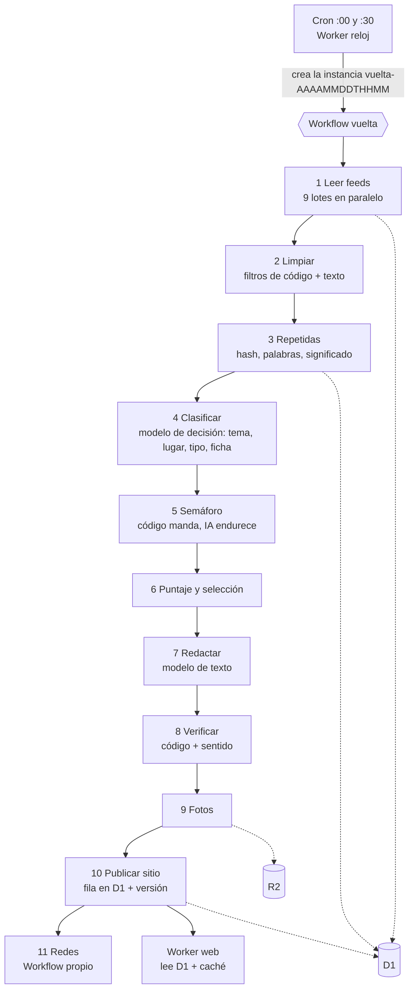
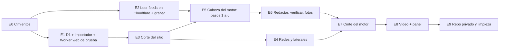

# Diseño del motor nuevo: de la fuente a la nota, todo en Cloudflare

*15/10/2026. **Es sólo un diseño: no se construyó nada, no se tocó ningún archivo existente y no hay commit.** Meta de Andrés y Hernán (15/10): "mucho menos GitHub y mucho más Cloudflare; repensar todo el sistema desde la fuente hasta la nota; que dure años", todo dentro de unos US$ 25 por mes, con Cloudflare Workers Paid (US$ 5) ya contratado. Se apoya en `docs/etapa-10-operacion/ANALISIS.md` (dónde corre cada cosa), `docs/etapa-2-5/` (entrada, duplicadas, puntaje), `docs/etapa-6-9/` (semáforo, redacción, fotos, redes), `docs/salud-tecnica/` (módulos, archivo eterno), `docs/analiticas/` y `docs/etapa-1-fuentes/LISTA-ELEGIDA.md`.*

**Cómo leer las marcas.** **[MEDIDO]** salió de datos reales del proyecto. **[DOCS 15/10]** son los límites de Cloudflare que leyó un modelo chico el 15/10 en la documentación oficial (están en `ANALISIS.md` de esta carpeta; no pude volver a abrir esas páginas: que una persona mire las cifras clave antes de firmar). **[SIN VERIFICAR]** es memoria o suposición mía: se prueba antes de apostar. Las decisiones que tocan lo legal o lo editorial son de Hernán y están marcadas **[HERNÁN]**.

**Palabras que aparecen** (una sola vez): *Worker* = programa chico que corre en Cloudflare, sin servidor nuestro. *Workflow* = una receta de pasos que Cloudflare ejecuta uno por uno, con reintentos y sin apuro de tiempo. *D1* = base de datos (SQLite) de Cloudflare. *R2* = depósito de archivos (fotos, audios, respaldos). *Cron* = el reloj que despierta a un Worker. *Cola (Queue)* = fila de mensajes para repartir trabajo.

---

## 0. En doce líneas

1. **La verdad pasa de los archivos JSON de git a una base (D1) y un depósito (R2).** Git queda sólo para el código y las pruebas. Se terminan los ~107 commits de datos por día, los choques con `--theirs`, el tope de 3.500 notas / 180 días y el de 20.000 archivos.
2. **Una sola "vuelta" cada 30 minutos = un Workflow** de unos 12 pasos chicos, cada uno con su reintento y sus datos guardados en D1. El cron sólo lo dispara (el cron de menos de una hora tiene 30 s de CPU [DOCS 15/10]; el Workflow no tiene tope de tiempo por paso).
3. **Se lee todo desde Cloudflare**: el sondeo del 15/10 dio **97 de 103 feeds andando** [MEDIDO, dato de los dueños]; sólo **Infobae bloquea**. Desde GitHub fallaban unos 65 de 236.
4. **El código decide lo legal y la IA sólo puede endurecer.** El rojo del semáforo (menores, víctimas, sepelios) sigue en código con su huella; ningún modelo puede destrabarlo.
5. **Modelos chicos para lo repetitivo, uno de decisión para clasificar, uno fuerte sólo para desempatar** (con tope diario). Costo estimado de IA: **US$ 9 a 15 por mes**; con Cloudflare (US$ 5 a 9) quedan **US$ 14 a 24**, por debajo del tope.
6. **El sitio se sirve desde un Worker que arma las páginas con lo que hay en D1** (recomendado), no desde 5.000 archivos compilados cada media hora. Las direcciones de las notas no cambian: el identificador va al final y las viejas dan 301.
7. **Orden recomendado: primero el sitio (corre contra el 6/12/2026, cuando se llega al tope de 3.500 notas), después las redes y lo liviano, después el motor.** Un "puente" que copia lo que produce el robot de hoy a D1 desacopla los cortes: cada paso se puede revertir en minutos.
8. **Nada de modo sombra largo.** Se graban las respuestas reales de los feeds y se "repiten" contra el código nuevo (horas, no semanas); la única prueba en vivo es un ensayo de 24 horas sin publicar.
9. **Pausas**: una de hasta 4 horas (corte del motor) y otra de hasta 2 (redes). El corte del sitio no necesita pausa.
10. **Pruebas**: unos 45 archivos / ~600 pruebas que protegen lo legal, lo ya publicado mal y las direcciones; corren al cambiar código, nunca en la vuelta. En la vuelta hay "guardas de datos" de milisegundos que avisan y no congelan.
11. **Lo que sigue necesitando otro lugar: el video (ffmpeg).** No cabe en un Worker. Primero un repositorio público de render sin secretos; después, si Containers está maduro, un contenedor de Cloudflare.
12. **Lo más riesgoso** es reescribir la capa que lee y escribe archivos (~70 módulos) y que el HTML del sitio nuevo cambie algo que Google ya indexó. Se baja con migrar por etapas, la prueba de espejo de las 1.120 notas y dejando siempre el camino viejo andando hasta que el nuevo lleve una semana sin fallar.

### Principios del diseño

| Principio | Qué significa en la práctica |
|---|---|
| **D1 es la fuente de verdad** | Todo estado (historias, notas, versiones, decisiones, libro de redes, uso de IA) es una fila. R2 guarda lo pesado. |
| **Cada paso es idempotente** | Si un paso se reintenta o la vuelta se dispara dos veces, el resultado es el mismo (claves naturales, `INSERT … ON CONFLICT DO NOTHING`). Es el reemplazo del candado de `concurrency` de GitHub. |
| **El lector nunca toca el motor** | La web lee D1 y la caché; si el motor se cae, el sitio sigue sirviendo lo último. |
| **Código manda en lo legal, la IA sólo endurece** | Dos lecturas coincidentes para soltar algo; una sola para frenar. |
| **Todo tiene interruptor** | Una fila `estado` por componente (`redes_activas`, `motor_activo`, `ia_fuerte_activa`…). Apagar es una escritura, no un despliegue. |
| **Un almacén detrás de una interfaz** | Los pasos hablan con `almacen.mjs` (`leerNota`, `guardarNota`…). Hay dos implementaciones: D1 y SQLite local (`node:sqlite`, viene con Node 24 [SIN VERIFICAR que alcance para todo]). Así las pruebas corren sin red y la PC puede trabajar sin Cloudflare. |
| **Se puede salir de Cloudflare** | D1 es SQLite: el volcado diario a R2 + la copia mensual externa permiten rearmar todo en otro lado. |

Carpetas propuestas (se mueve por etapas, sin apuro): `motor/` (pasos 1 a 9, sin dependencias), `sitio/` (el Worker web), `redes/` (sin dependencias, como hoy), `compartido/` (utilidades puras que hoy cuelgan de `web/lib/`: `texto`, `titulos`, `cuerpo`, `ruta`, `zona`, `criterio`), `esquema/` (migraciones SQL numeradas), `infra/` (los Workers: reloj, vigilante, sondeo, respaldos).

---

## 1. El flujo nuevo, paso por paso

**Límites de Cloudflare que mandan el diseño** [DOCS 15/10, plan Paid]: cron de menos de 1 hora → **30 s de CPU**; Workflow → **sin tope de tiempo por paso, 30 s de CPU por paso (hasta 5 min), 10.000 pasos, 10.000 pedidos salientes, estado de 1 GB**; **6 conexiones abiertas a la vez** por ejecución; **10.000 pedidos salientes (subrequests)**; **128 MB de memoria**. La espera a una IA o a un medio **no cuenta como CPU**. Cada paso de abajo dice cómo los respeta.

### Trabajo por vuelta (para dimensionar) [MEDIDO / estimado]

~8.200 elementos leídos por vuelta con los 103 feeds (con repetidas); de ellos, unos **50 son nuevos** (2.350 crudos por día medidos con 236 feeds / 48 vueltas; con 103 serán menos, SIN VERIFICAR); ~19 sobreviven al código; ~650 historias por día; ~40 notas publicadas por día; ~90 pasan por la IA de redacción por día. **Casi toda la vuelta es "mirar lo que ya vi"**: eso es una consulta por índice a D1, no un proceso pesado.

### Paso 0 · El reloj (ya existe)

- **Qué hace**: a los :00 y :30 crea una instancia del Workflow `vuelta` con nombre único (`vuelta-20261015T1430`); un segundo cron liviano (cada 5 a 10 min) decide si toca alguna pieza de redes. Si ya existe una instancia con ese nombre, no se duplica (hace de candado) [SIN VERIFICAR que Workflows rechace nombres repetidos].
- **Dónde**: Worker cron (`infra/reloj-cloudflare/worker.mjs`), **sin cambios de fondo**: `trabajosDelMinuto` deja de pedirle workflows a GitHub y pasa a crear la instancia. Mientras dure la mudanza, una variable `MOTOR=github|cloudflare` elige a quién le avisa (plan B inmediato).
- **Guarda**: una fila en `vueltas` (id, cuándo, quién la disparó).
- **Reutiliza**: `infra/reloj-cloudflare/worker.mjs` y su prueba. **Reescribe**: sólo `despertar()`.

### Paso 1 · Leer feeds

- **Qué hace**: baja los 103 feeds activos (11 de Balcarce, 10 de la zona, 50 del país; RSS, Atom, índices de noticias y 2 portadas raspadas) en **9 lotes de unos 12**, cada lote un paso del Workflow; los lotes corren en paralelo. Parsea, normaliza, calcula el identificador de la nota y la guarda si es nueva. Anota la salud de cada feed (cuántas notas trajo, cuánto tardó, el motivo real si falló).
- **Dónde**: Workflow, paso `leer-lote-N`. Sin IA.
- **Guarda**: `items_crudos` (nuevos), `fuentes_salud` (una fila por feed y por día, sumando), `vueltas`/`pasos_de_vuelta` (duración). En R2 `grabaciones/` la respuesta cruda de cada feed **durante la migración** (3 a 4 días, ~0,5 a 1 GB por día comprimido, borrado automático): es el material para repetir pruebas (sección 5).
- **Límites**: 6 conexiones a la vez por ejecución (de a 12 feeds con 15 s de espera máxima = ~1 minuto por lote; los lotes paralelos corren en ejecuciones distintas [SIN VERIFICAR que no compartan el tope]); CPU: parsear un índice de 800 notas son centenares de milisegundos; memoria: un feed por vez; pedidos salientes: ~103 feeds + ~100 páginas de notas ≪ 10.000.
- **Infobae**: bloquea a Cloudflare. Opciones, de menor a mayor esfuerzo: probar otro nombre de navegador (el sondeo ya tiene el modo `navegador`/`robot`); leer sólo ese medio desde un runner chico de GitHub cada hora (~720 min/mes: entra en los 2.000 gratis, pero no sobra); o dejarlo afuera y vivir con los otros 49 (Infobae fue imprescindible en 30 de 1.326 notas: ~2 %). **[Dueños]**: ver pregunta 6.
- **Reutiliza tal cual**: `ingesta/fuentes.mjs` y `fuentes-cruce.mjs` (la lista y las reglas: se cargan a la tabla `fuentes` con un script, pero la lista sigue editándose en código), de `ingesta/ingesta.mjs` las funciones puras `parsearFeed`, `tituloDelSitemap`, `enlaceAlternativo`, `normalizar`, `motivoDeFalla`, `esReintentable`, `parsearScrape` y `ampliar`; `ingesta/articulo.mjs`, `ingesta/zona.mjs`, `ingesta/utiles.mjs`.
- **Reescribe**: `traer()` (usa `Buffer` de Node; pasa a `TextDecoder` y detección de charset), la cabecera y `ingestar()` de `ingesta.mjs` (1.820 líneas que mezclan lectura, filtros, cruce, semáforo y escritura de archivos: se parte en `motor/entrada.js` y compañía), la memoria en `.cache`.

### Paso 2 · Limpiar

- **Qué hace**: filtros de código, baratos y seguros, **antes de cualquier IA**: lotería y quiniela, horóscopo, secciones prohibidas en la dirección (`/mexico/`, `/mundo/`, `/recetas/`…), repetido del mismo medio (medio + título normalizado), policiales de afuera, fecha y "no es nuevo" (más de 72 h), y **el rojo y los sepelios por palabras** (así lo rojo no gasta ni un token y nunca llega a un modelo). A lo que sigue le baja el texto completo de la nota.
- **Dónde**: Workflow, paso `limpiar` (un paso por tanda de ~25 notas, por los pedidos de texto). Sin IA.
- **Guarda**: `items_crudos.estado` y `motivo_descarte`; texto de la nota en R2 (`textos/…`) mientras sea candidata; el rojo queda registrado con su motivo y sin titular en ningún panel público.
- **Límites**: 30 s de CPU por paso: el trabajo es de milisegundos por nota; el texto completo son ~20 a 100 pedidos por vuelta.
- **Reutiliza tal cual**: `motivoDeDescarte`, `marcarDeAfuera`, `esPolicialDeAfuera`, `TITULO_HOROSCOPO`, `TITULO_LOTERIA`, `SECCIONES_QUE_NO_ENTRAN`, `esEfemerideAjena`, `ingesta/menores.mjs`, `ingesta/exenciones.mjs`, `ingesta/articulo.mjs` (`traerTexto`). **Reescribe**: el pegado entre ellas (hoy es una sola función larga).

### Paso 3 · Repetidas

- **Qué hace**: tres capas. (a) **Código**: mismo enlace o mismo medio + título = una sola vez (clave única en D1). (b) **Palabras**: TF-IDF contra las "anclas" abiertas de las últimas **72 h**, **incluidas las ya publicadas y las de Balcarce** (hoy la memoria de 36 h guarda sólo lo de afuera; ahí está el fallo del Jardín 905 y de la Liga). (c) **Significado**: para los pares dudosos (0,55 a 0,75; lo de Balcarce desde 0,60) una huella de significado (embedding) y la confirmación de un modelo de decisión de a 12 pares; se une **contra el ancla, sin encadenar** (agrupación en estrella). **Una noticia, una sección**: la que queda manda; la otra suma su medio como fuente.
- **Dónde**: Workflow, paso `repetidas`; modelo de **embeddings** (`bge-m3`) y modelo de **decisión** (Mercury Decide; otro proveedor, Jev, si dudó).
- **Guarda**: `historias` (nueva o existente), `historia_items`, la huella en `historias.embedding` (sólo 72 h; después se pone en NULL), `uso_ia`.
- **Límites**: CPU: ~50 notas nuevas contra ~2.000 anclas son unos millones de multiplicaciones (< 1 s) [estimación]; memoria: ~2.000 huellas de 1.024 números = ~8 MB; pedidos: 1 a 3 llamadas de IA por vuelta.
- **Reutiliza tal cual**: `ingesta/cruce.mjs` (`agruparPorHecho`, `CRUCE`), `fuentes-cruce.mjs` (grupos de dueño: Clarín, TN, Olé y Radio Mitre cuentan una vez), `contarMedios`/`cuantosMedios`, de `lectura-ia.mjs` `confirmarParejas`, `agruparRepetidas`, `unirGrupos`, `quitarRepetidas`, `ingesta/repetidas-publicadas.mjs`, y `web/lib/repetidas.js` (`parecido`, `parejasSospechosas`). **Reescribe**: la memoria (de `cruce-memoria.json` a D1), comparar contra lo publicado (nuevo), embeddings y agrupación en estrella (nuevo).

### Paso 4 · Clasificar (lugar, tema, tipo y ficha de sensibilidad)

- **Qué hace**: una nota por pedido. Devuelve, con un esquema cerrado: **tema** (las secciones que se decidan), **lugar** (Balcarce / La zona / De afuera), **tipo** (hecho, servicio, anuncio, declaración, opinión, análisis, curiosidad, consejo, chimento, publicidad, en vivo, cotización, pronóstico), **interés** (directo/indirecto/nulo y razón), **probabilidad de publicar** y la **ficha de sensibilidad**: `menor_mencionado`, `menor_identificable`, `victima_identificable`, `hecho_policial`, `acusa_a`, `muerte`. Va en el mismo pedido para no pagar dos veces. Regla nueva: **la cantidad de medios ordena, nunca rescata un tipo excluido ni un "interés nulo"** (el caso del videojuego en Formosa con 8 medios).
- **Dónde**: Workflow, un paso por tanda de 12 notas; modelo de **decisión** (Mercury Decide); segunda opinión (Jev o un modelo chico) sólo si la probabilidad cae entre 0,2 y 0,8, si el lugar es Balcarce o si la ficha marca algo sensible. **Respaldo**: Gemini Flash-Lite (gratis) con el mismo esquema, y si ninguno contesta, las reglas de palabras de hoy (`clasificar`).
- **Guarda**: columnas de `historias` (tema, lugar, tipo, interés, prob_publicar, sensibilidad en JSON), `uso_ia`.
- **Límites**: la espera de la IA no es CPU; ~20 a 60 pedidos por vuelta; el prompt incluye `ingesta/perfil-balcarce.md` tal cual.
- **Reutiliza tal cual**: `lectura-ia.mjs` (`pedidoPara`, `entradaDeNota`, `ESQUEMA`, `fichaValida`, `leerGrupo`, `leerGrupoGroq`, `LECTURA`), `perfil-balcarce.md`, `REGLAS_SECCION`, `PALABRAS_DEBILES`, `esDeAca` (queda como respaldo y como control: si la IA dice "Balcarce" y el código no ve nada de acá, espera). **Reescribe**: el esquema (campos nuevos), `aplicarFichas` (la regla de arriba), y el modelo de "lugar" (reemplaza `local`, `deLaZona`, `nombraBalcarce`). Cuántas secciones: **[dueños]**, pregunta 8.

### Paso 5 · Semáforo

- **Qué hace**: junta el color del código y la ficha. **Rojo = palabra roja o `menor_identificable`/`victima_identificable` en "sí"** (esto cierra el hueco de "dos niñas internadas tras el choque"). **Amarillo** = lo que hoy frena por palabras, salvo que **dos lecturas coincidan** en "sin menor identificable y sin hecho policial" y la nota no sea de Policiales ni de Balcarce. Lo dudoso de acá (3 a 6 por día) va al celular; lo dudoso de afuera lo decide el segundo modelo y, si no, no sale. **[HERNÁN]**: todo esto es la opción A2 de `docs/etapa-6-9/`; hasta que él lo apruebe por escrito, el semáforo se porta **tal cual está hoy** (con los arreglos de palabras A1 si los aprueba).
- **Dónde**: Workflow, paso `semaforo`, código puro. Segunda lectura (modelo chico) sólo donde corresponde.
- **Guarda**: `historias.semaforo_color`, `semaforo_motivo`, `requiere_persona` (la cola del celular, tope blando de 8 por día con aviso si se pasa), `uso_ia`.
- **Límites**: ninguno (funciones puras).
- **Reutiliza tal cual**: `semaforoDelTexto`, `laMuerteFrena`, `aflojaParaLoDeAca`, `REGLAS_SEMAFORO` (la lista roja **no se toca**; sigue con su huella en una prueba), `AMARILLO_QUE_SE_SUELTA_*`, `ingesta/exenciones.mjs`, `semaforoDeLaReescritura`. **Reescribe**: sólo el "pegamento" que combina código e IA.

### Paso 6 · Puntaje y selección

- **Qué hace**: dos preguntas separadas. **¿Sale?** (puertas: semáforo, tipo permitido, de afuera con 4 grupos de medios distintos o probabilidad ≥ 0,8, ventana de 12 h para lo que nunca salió, cupos por sección). **¿Dónde va?** (puntaje y equilibrio): cercanía (Balcarce 25 / La zona 15 / De afuera 0), servicio 10, frescura hasta 15, medios distintos (cada grupo una vez), tipo (±5), interés (0/5/10); la tapa asegura al menos la mitad de lo de acá y un máximo de 2 notas del mismo hecho arriba. El puntaje se guarda **desglosado** (para poder explicarlo). Una vez por mes, un script recalcula los pesos con las visitas y muestra el cambio **antes** de aplicarlo.
- **Dónde**: Workflow, paso `puntaje`, código. Sin IA (los pesos mensuales los revisa una persona, opcionalmente con un modelo fuerte, sección 4).
- **Guarda**: `historias.puntaje`, `puntaje_detalle` (JSON), `estado` (`seleccionada`, `espera_persona`, `descartada`, `retenida`).
- **Límites**: ninguno.
- **Reutiliza tal cual**: `ingesta/criterio.mjs` (números), `mediosMinimosDe`, `exigirMedios`, `aplicarCupos`, `esperaSoloPorCantidad`, `HORAS_DE_UNA_NOTA_NUEVA`, `fechaDeLaNota` y `llegaTarde` (`web/lib/archivo.js`). **Reescribe**: la suma de `relevancia` (fórmula nueva) y el equilibrio de la tapa (pasa a la capa que sirve el sitio, paso 10).

### Paso 7 · Redactar

- **Qué hace**: escribe título, bajada, cuerpo, guion, claves, qué se sabe, qué falta confirmar, texto para redes y etiquetas, con las reglas de `CRITERIO-EDITORIAL.md` § 12 **empaquetadas dentro del Worker como texto** (si el archivo falta en el empaquetado, el despliegue falla: se mantiene el "si falta, no escribe"). Recibe las fuentes, el texto completo de la principal y los **antecedentes** (notas ya publicadas sobre el tema, leídas de D1).
- **Dónde**: Workflow, **un paso por historia** (cada uno con sus reintentos y su tope diario consultado en D1). Modelo de **texto**: Gemini Flash-Lite como hoy (gratis) hasta que la prueba a ciegas de 30 notas decida (Gemini / Haiku / Sonnet para lo de acá).
- **Guarda**: `notas` (estado `borrador`), `versiones_de_nota` (versión 1: `por='modelo:…'`), `uso_ia` (tokens reales de cada pedido).
- **Límites**: ~2 a 10 redacciones por vuelta; la espera de Gemini (hasta 60 s) no es CPU; 6 conexiones a la vez alcanzan.
- **Reutiliza tal cual**: `reels/reescritura.mjs` (la lógica de pedido, reintentos, `extrasDeLaRespuesta`, `nivelDeVerificacion`, `ordenarParaReescribir`, `antecedentesDe`, topes), `ingesta/prompt-editorial.mjs` (cambia sólo cómo se obtiene el texto), `CRITERIO-EDITORIAL.md`. **Reescribe**: `reels/claves.mjs` (lee `.env` con `fs`: pasa a leer los secretos del Worker), `redes/uso-ia.mjs` (de archivo a la tabla `uso_ia`), y se mueve la pieza de `reels/` a `motor/redaccion/` (ya lo pedía `docs/salud-tecnica/`, punto 19).

### Paso 8 · Verificar

- **Qué hace**: (1) **código, siempre**: números, nombres y fechas contra la fuente, copia, acusaciones sin atribuir, negaciones, título en pasado, relleno, letras rotas (con los arreglos B1 de `etapa-6-9`: copia flexible para fórmulas y nombres, la fecha de publicación cuenta como dato, control de forma); si falla, un reintento con el motivo; si fallan oraciones sueltas, se sacan; si igual no alcanza, "esperando cuerpo" (hasta 3 intentos). (2) **Sentido, con un modelo chico**: ¿cada afirmación está en la fuente? ¿alguna atribución quedó como hecho? ¿hay una palabra mal escrita? Lo que marca **no se publica solo**. (3) Sólo si (1) y (2) discrepan en algo de Balcarce o sensible, desempata un **modelo fuerte**. (4) El semáforo se vuelve a pasar sobre el texto completo y sobre lo escrito.
- **Dónde**: Workflow, paso `verificar` por nota. Mayormente código.
- **Guarda**: `notas.verificacion` (nivel ALTA/MEDIA/BAJA y problemas), `notas.estado` (`lista`, `esperando_cuerpo`, `espera_persona`), `uso_ia`.
- **Límites**: ninguno de peso. Es el módulo **más reutilizable**: `verificar.mjs` (1.155 líneas) no toca archivos.
- **Reutiliza tal cual**: `ingesta/verificar.mjs` entero (`verificar`, `arreglarEscritura`, `depurarCuerpo`, `letrasRotas`, `acusacionSinAtribuir`…), `web/lib/cuerpo.js` (70 palabras mínimas), `semaforoDeLaReescritura`, `FRENO_POR_VERIFICACION`. **Reescribe**: agregar los arreglos B1 y el verificador de sentido.

### Paso 9 · Fotos

- **Qué hace**: abre la página de la fuente, toma la foto principal, y un modelo con visión elige la mejor **sin marca de agua y sin menores reconocibles**; si no hay, busca una foto libre (Wikimedia) para figuras públicas; si tampoco, **placa**. Achica a 1.200 px, guarda el crédito para el epígrafe, calcula una huella (dHash) para no repetir la misma foto en 7 días, y **reintenta** lo que falló por el servicio (429/413), que hoy se pierde para siempre (20 notas). Si el paso tarda de más, la nota sale con placa y la foto se agrega en una vuelta siguiente.
- **Dónde**: Workflow, un paso por nota (hasta 10 por vuelta); modelo de **decisión con visión** (Gemini/Groq gratis; probar Haiku). La imagen se achica con **Cloudflare Images** o `cf.image` [SIN VERIFICAR cupo y calidad]; si no sirve, en el runner de video.
- **Guarda**: R2 `fotos-notas/ID.jpg` (mismo camino de hoy) y la tabla `fotos` (reemplaza `banco-fotos.json`).
- **Límites**: Workers no tienen `sharp` ni `ffmpeg`: por eso el achicado y el dHash dependen de Images o de un runner. Las placas (SVG a PNG) usan `@resvg/resvg-wasm` [SIN VERIFICAR que dibuje igual nuestras fuentes y filtros].
- **Reutiliza tal cual**: `ingesta/fotos.mjs` (`elegirFotoParaNota`, `descargarImagen`, `creditoDeFoto`), `web/scripts/foto-libre.mjs`, las reglas de `docs/05-FOTOS.md` (nunca menor ni víctima, nunca marca de agua, Policiales sólo con fuente oficial). **Reescribe**: `web/scripts/fotos-notas.mjs` (usa `fs` y git), `achicar-foto.mjs` (ffmpeg), `foto-manual.mjs`, `reels/placa.mjs` (resvg nativo → wasm), el dHash (nuevo).

### Paso 10 · Publicar el sitio

- **Qué hace**: pasa la nota a `publicada` en D1: fija su **identificador y su dirección una sola vez** (`slug`), su **fecha** (que envejece y nunca rejuvenece), suma +1 a `portada_version`, registra en `redirecciones` toda "misma noticia con otra dirección" (la regla de `repetidas.js`), avisa a IndexNow y corre una **prueba de humo** (pide 5 páginas al Worker web y mira estado, canónica y datos estructurados). No hay compilación: el Worker arma la página al pedirla.
- **Dónde**: Workflow, paso `publicar`. Código.
- **Guarda**: `notas`, `versiones_de_nota`, `redirecciones`, `estado.portada_version`.
- **Límites**: ninguno; el Worker web (sección 3) responde con caché de borde.
- **Reutiliza tal cual**: `web/lib/*` puro: `ruta.js`, `repetidas.js`, `cuerpo.js`, `archivo.js` (fecha, retiradas, correcciones; deja de existir la poda por 3.500 notas / 180 días), `notas-propias.js`, `eventos.js`, `farmacias.js`, `clima.js`, `dolar.js`, `rss.js`, `seguir-leyendo.js`, `tablas.js`, `web/components/*`, `redes/indexnow.mjs`. **Reescribe**: `web/scripts/generar-datos.mjs` (1.197 líneas, ~25 archivos JSON de entrada y salida: se reparte entre los pasos 1 a 10), `web/lib/datos.js` (la lectura de archivos pasa a D1; `armarTapa` se queda), `web/app/*` (Next → Worker), `generar-redirects.mjs`, `indexar.mjs` (Pagefind), `contar-archivos.mjs` (desaparece).

### Paso 11 · Redes

- **Qué hace**: igual que hoy: contrato del día, elegir qué sube (Política y Policiales **siempre esperan a una persona**), escribir, publicar posteos de Facebook con espejo en Instagram, historias y reels. La diferencia es dónde: un Worker cron (cada 5 a 10 min) decide si toca una pieza y lanza un **Workflow `pieza`**; la espera a que Instagram procese el video es `step.sleep`, que **no cuesta**. Las fotos y videos se publican por **dirección pública de R2** (`medios.radarbalcarce.com`).
- **Dónde**: Worker cron + Workflow `pieza`; texto con el modelo de texto; voz con Gemini TTS (cupo de 10 por día, igual que hoy); **video con ffmpeg afuera** (V2, repositorio público sin secretos, o V1, contenedor; sección 5, etapa 8).
- **Guarda**: `libro_redes` (clave de idempotencia **única**: es el seguro contra publicar dos veces), `piezas_medidas`, audios y videos en R2 (30 días, con borrado automático).
- **Límites**: Meta pide la dirección pública del archivo [SIN VERIFICAR que `rupload` desde un Worker ande; la alternativa es pasar la URL de R2]; 6 conexiones y la CPU no molestan.
- **Reutiliza tal cual**: `redes/meta.mjs`, `elegir.mjs`, `piezas.mjs`, `contrato.mjs`, `guiones.mjs`, `espejo.mjs`, `formatos.mjs`, `repasos.mjs`, `participa.mjs`, `avisos.mjs`, `previa.mjs`, `prompt-redes.mjs` (parcial), `CRITERIO-REDES.md`. **Reescribe**: `publicar.mjs`, `reloj.mjs`, `reintentar.mjs`, `efemeride.mjs`, `feriado.mjs` (leen y escriben `redes.json` y otros archivos), `reels/placa.mjs` (wasm), y todo lo de `reels/` que usa `ffmpeg` queda en el runner.

### Trabajos laterales (cada uno es un cron chico, ninguno entra en la vuelta)

| Trabajo | Dónde | Frecuencia | Notas |
|---|---|---|---|
| Datos vivos: clima (Open-Meteo, respaldo met.no), dólar, farmacia, F1 (Jolpica), fútbol (ESPN) | Workers cron | cada 10 a 60 min | `ingesta/f1.mjs`, `futbol.mjs`, `web/lib/pedir-clima.js`, `farmacias.js` se reutilizan; guardan en `datos_vivos` (clave + JSON + cuándo) |
| Vigilante | Worker (**ya existe**: `infra/vigilante-cloudflare/`) | :12 y :42 | pasa a mirar también D1 (vueltas, salud de feeds, gasto de IA); avisa por mail |
| Auditoría con IA de lo publicado, Pistas, estadísticas | Workers cron | 1 a 3 horas / diario | `ingesta/auditoria-ia.mjs`, `panel/revisar-pistas.mjs`, `redes/estadisticas*.mjs` |
| Respaldo | Worker cron | diario a R2 + mensual externo | volcado de D1; ver sección 2 |
| Efemérides del mes | Workflow | el día 20 | `ingesta/generar-efemerides.mjs`; sigue pidiendo aprobación |
| Panel del celular | Worker + Access | a pedido | etapa 8 |

### Qué se reutiliza y qué se reescribe, en una mirada

| Carpeta | Se reutiliza casi sin tocar | Se reescribe |
|---|---|---|
| `ingesta/` | `fuentes*.mjs`, `criterio.mjs`, `verificar.mjs`, `cruce.mjs` (algoritmo), `fotos.mjs`, `articulo.mjs`, `zona.mjs`, `utiles.mjs`, `menores.mjs`, `exenciones.mjs`, `f1.mjs`, `futbol.mjs`, `agenda.mjs`, `efemerides*.mjs`, `perfil-balcarce.md` | `ingesta.mjs` (se parte), `lectura-ia.mjs` (esquema y regla nuevos), `json.mjs`, `datos-vivos.mjs`, la memoria del cruce |
| `reels/` | `reescritura.mjs`, `voz-gemini.mjs`, `duracion.mjs` | `claves.mjs`, `placa.mjs`; `reel.mjs`, `animacion.mjs`, `presentacion.mjs` y el resto de video **no se mudan** (runner) |
| `redes/` | `meta.mjs`, `elegir.mjs`, `piezas.mjs`, `contrato.mjs`, `guiones.mjs`, `espejo.mjs`, `avisos.mjs`, `avisar-por-mail.mjs`, `estadisticas*.mjs` | `publicar.mjs`, `reloj.mjs`, `vigilar.mjs` (parte), `reintentar.mjs`, `uso-ia.mjs` |
| `panel/` | `cifrado.mjs`, `celular-datos.mjs`, `pistas-libro.mjs` | `celular.mjs`, `revisar-pistas.mjs`; el panel de la PC se borra |
| `web/` | `lib/*` puro, `components/*` (apenas usan `next/navigation`), CSS, íconos, el panel estático | `app/*` (Next → Worker), `scripts/generar-datos.mjs`, `lib/datos.js` (lectura) |

---

## 2. Modelo de datos

### 2.1 Tablas de D1 (SQLite)

Reglas generales: ids de nota y de historia son `TEXT`; fechas en ISO UTC (`TEXT`); lo que una persona escribe lleva **`por`, `cuando` y `motivo` con `NOT NULL`** (el defecto que hoy congela la web pasa a ser imposible); cada migración es un archivo SQL numerado en `esquema/` y se aplica con `wrangler d1 migrations`.

| Tabla | Para qué | Columnas clave | Índices |
|---|---|---|---|
| `fuentes` | Los 103 feeds (y los apagados, con `activa=0` y nota) | `id`, `medio`, `nombre`, `url`, `tipo` (rss/atom/sitemap/scrape), `alcance` (local/regional/provincial/nacional), `grupo`, `peso`, `oficial`, `seccion_fija`, `agente`, `activa`, `nota` | PK `id`; `(activa)` |
| `fuentes_salud` | Salud y rendimiento por feed y día (reemplaza el registro de `FUENTES.md` + `medir-fuentes`) | `fuente_id`, `dia`, `lecturas`, `fallas`, `motivo_ultima_falla`, `ms_promedio`, `items_traidos`, `items_nuevos`, `items_publicados`, `primera_en_contar` | PK `(fuente_id, dia)` |
| `items_crudos` | Cada nota que trae un feed | `id` (hash del enlace normalizado; el `idDe` de hoy), `fuente_id`, `medio`, `url`, `titulo`, `resumen`, `fecha_fuente`, `fecha_estimada`, `visto_primera_vez`, `titulo_hash` (medio + título), `estado` (`nuevo`/`descartado`/`agrupado`), `motivo_descarte`, `historia_id`, `texto_r2` | PK `id`; `(titulo_hash)`; `(historia_id)`; `(visto_primera_vez)` |
| `historias` | Un hecho contado por uno o más medios | `id`, `creada`, `ultima_actividad`, `ancla_item_id`, `tema`, `lugar`, `tipo`, `interes`, `razon`, `prob_publicar`, `sensibilidad` (JSON), `semaforo_color`, `semaforo_motivo`, `requiere_persona`, `medios_n`, `grupos_n`, `puntaje`, `puntaje_detalle` (JSON), `estado`, `nota_id`, `embedding` (BLOB, sólo 72 h) | PK `id`; `(estado, ultima_actividad)`; `(nota_id)`; `(ultima_actividad)` |
| `historia_items` | Qué items forman cada historia | `historia_id`, `item_id`, `rol` (ancla/miembro), `similitud`, `confirmado_por` (`hash`/`palabras`/`modelo`) | PK `(historia_id, item_id)` |
| `notas` | **Todo lo publicado, para siempre** | `id` (**el de hoy, no cambia**), `slug` (**fijo desde que sale**), `historia_id`, `seccion`, `lugar`, `tipo`, `estado` (`borrador`/`esperando_cuerpo`/`espera_persona`/`publicada`/`retirada`), `origen` (`automatica`/`persona`/`propia`), `escrita_por` (la firma: modelo o persona), `titulo`, `bajada`, `cuerpo`, `extras` (JSON: claves, seSabe, noConfirmado, aportes, textoRedes, etiquetas), `fuentes` (JSON), `verificacion_nivel`, `fecha_publicacion` (**no rejuvenece**), `fecha_hecho`, `version_actual`, `foto_id`, `intentos_ia` | PK `id`; `(estado, fecha_publicacion DESC)`; `(seccion, fecha_publicacion DESC)`; `(historia_id)` |
| `versiones_de_nota` | Historial inmutable de cada cambio (reemplaza `correcciones.json` y `correcciones-auditoria.json`) | `nota_id`, `version`, `cuando`, `por` (`modelo:…`/`hernan`/`andres`/`auditoria`), `motivo`, `cambio` (JSON campo → antes/después), `snapshot` (JSON) | PK `(nota_id, version)` |
| `direcciones` | La dirección canónica de cada nota (derivable de `notas`, pero guardada por si el titular cambia) | `nota_id`, `ruta` (`/nota/slug-id`), `creada` | PK `nota_id`; único `ruta` |
| `redirecciones` | Todo lo que debe llevar a otro lado | `desde` (ruta), `hacia_nota_id` o `hacia_ruta`, `codigo` (301/410), `motivo` (`formato_viejo`/`repetida_unida`/`seccion_renombrada`/`otra_direccion`/`retirada`), `creada` | PK `desde` |
| `fotos` | Reemplaza `banco-fotos.json` | `id`, `nota_id`, `origen` (`medio`/`wikimedia`/`manual`/`libre`/`placa`), `url_origen`, `credito`, `r2_clave`, `ancho`, `alto`, `dhash`, `decision` (`elegida`/`sin_foto`/`rechazada`), `motivo` (`marca`/`menor`/`servicio`/`logo`/`sin_fotos`), `intentos`, `probada_en` | PK `id`; `(nota_id)`; `(dhash)` |
| `decisiones_de_personas` | Reemplaza `celular-decisiones.json` | `id`, `objetivo_tipo` (`historia`/`nota`/`pieza`), `objetivo_id`, `accion` (`aprobar`/`descartar`/`retirar`/`a_redes`/`foto`/`nota_de_pista`…), `por`, `cuando`, `motivo`, `dispositivo` | PK `id`; `(objetivo_tipo, objetivo_id)` |
| `correcciones` | Bitácora a mano de lo que se corrigió (título, bajada, sección…); cada fila genera una versión | `id`, `nota_id`, `campo`, `antes`, `despues`, `por`, `cuando`, `motivo`, `version_generada` | PK `id`; `(nota_id)` |
| `retiradas` | Notas sacadas (con la regla de rectificación y de menores/víctimas) | `nota_id`, `motivo`, `por`, `cuando`, `codigo` (404/410) | PK `nota_id` |
| `uso_ia` | Cada llamada a un modelo (reemplaza `uso-ia.json` e `intentos-ia.json`) | `id`, `cuando`, `vuelta_id`, `tarea` (`embedding`/`pares`/`clasificar`/`sensibilidad`/`redactar`/`verificar`/`desempate`/`fotos`/`voz`/`auditoria`), `proveedor`, `modelo`, `clave_alias`, `tokens_entrada`, `tokens_salida`, `tokens_cache`, `ms`, `costo_usd_est`, `ok`, `error_codigo`, `nota_id`/`historia_id` | PK `id`; `(cuando)`; `(tarea, cuando)` |
| `mediciones` | Números por día para el tablero (web, redes, sistema). Un día **cerrado** no se pisa; un cero no pisa un dato | `dia`, `metrica`, `dimension`, `valor`, `cerrado`, `fuente`, `medido_en` | PK `(dia, metrica, dimension)` |
| `vueltas`, `pasos_de_vuelta` | Qué pasó en cada vuelta y cuánto tardó cada paso | `vueltas(id, inicio, fin, estado, disparada_por)`; `pasos_de_vuelta(vuelta_id, paso, inicio, ms, ok, items, error)` | PK; `(inicio)` |
| `libro_redes` | Lo publicado en Facebook e Instagram | `clave` (**única**: nota + canal + tipo), `nota_id`, `canal`, `tipo_pieza`, `meta_id`, `cuando`, `estado`, `utm_content` | PK `clave`; `(nota_id)` |
| `piezas_medidas` | Las mediciones de Meta por pieza | `pieza_clave`, `medido_en`, `alcance`, `vistas`, `reacciones`, `clics`, `valido` | PK `(pieza_clave, medido_en)` |
| `estado` | Interruptores y contadores (`redes_activas`, `motor_activo`, `portada_version`, `cupo_voz_hoy`…) | `clave`, `valor`, `actualizado` | PK `clave` |
| Otras que pasan 1 a 1 | `pistas`, `notas_de_pistas`, `agenda`, `agenda_suspendidos`, `efemerides`, `contactos` (cifrado), `llaves_celulares`, `datos_vivos`, `fichas_historicas` | igual que los JSON de hoy, con `por/cuando/motivo` obligatorios donde escribe una persona | — |

**Tamaño**: ~10.000 notas por año × 4 a 6 KB con versiones = ~50 MB; `items_crudos` sin texto, podada a 90 días, ~100 MB; embeddings sólo 72 h; `uso_ia`, ~10 MB por año. **Menos de 1 GB en el primer año** contra 10 GB por base [DOCS 15/10]. Las lecturas y escrituras previstas (~10.000 escrituras por día, ~400.000 lecturas por día) son una fracción de lo incluido (25.000 millones de lecturas y 50 millones de escrituras por mes) [DOCS 15/10].

### 2.2 Qué va a R2

| Depósito | Contenido | Retención |
|---|---|---|
| `radar-fotos` (con dominio `fotos.radarbalcarce.com`) | `fotos-notas/ID.jpg` (mismo camino de hoy), variantes chicas y WebP más adelante, tarjetas para compartir ya dibujadas (`og/ID-vN.png`) | permanente; caché de un año `immutable` |
| `radar-textos` | Texto completo de las fuentes de cada nota publicada (`fuentes/ID.json`): hace falta para re-verificar y para auditar; los textos de lo no publicado se borran a los 7 días | permanente para publicadas |
| `radar-medios` (con dominio público) | Audios, videos y placas de redes | 30 días, borrado automático |
| `radar-grabaciones` | Respuestas crudas de los feeds, para repetir pruebas | 3 a 4 días, sólo durante la migración |
| `radar-respaldos` | Volcado de D1 diario (7 diarios + 4 semanales + 12 mensuales, comprimidos) y copia de fotos | según rotación |
| `radar-archivo-html` *(opcional, año 2)* | HTML ya dibujado de las notas de más de 90 días | permanente |

**Copia fuera de Cloudflare y de GitHub**: un volcado mensual a otro proveedor o a un disco de la PC, **con una restauración probada** (sin eso, el respaldo no existe: hoy GitLab y R2 nunca se configuraron [MEDIDO]). *Opcional, año 2:* congelar a HTML en R2 las notas de más de 90 días, para que ni un cambio de plantilla ni una caída de D1 las afecten; una corrección o retirada las vuelve a dibujar.

### 2.3 Cómo se conservan las direcciones

1. **Formato actual** `/nota/titular-en-guiones-ID`: el ID es lo que va después del último guion (nunca tiene guiones: `idDeRuta`). El Worker toma el ID, busca la fila: si la dirección pedida es la canónica, sirve la página; si el titular no coincide, **301 a la canónica**; si es `/nota/ID` (formato viejo), **301**.
2. **El `slug` se calcula una sola vez** (`fijarSlug`) y se guarda en `notas.slug`; **nunca se recalcula**. Una prueba lo exige para las 1.120 notas.
3. **Repetidas unidas** (`fusionadas.json`) → fila en `redirecciones` (`repetida_unida`). `/seccion/servicios` y `/seccion/pais` → 301 a la sección nueva. Notas retiradas → 404/410 según la regla vigente.
4. **Sitemaps, feed, `llms.txt`, `robots.txt`, tarjetas OG y `instagram.png`**: mismas direcciones, generadas al pedirlas y guardadas en R2/caché. Las publicaciones de Facebook e Instagram ya hechas (hoy en `redes.json`) apuntan a estas direcciones: **se prueban todas**.
5. **Fotos**: mismo camino `/fotos-notas/ID.jpg`.

### 2.4 Migración de lo que existe (~1.120 notas)

Un script de una sola vez, `migrar-a-d1.mjs`, que **lee del repositorio** (sin tocar producción) y escribe archivos `.sql` idempotentes (`INSERT OR REPLACE` con los mismos ids) que se aplican por tandas:

| Origen | Destino |
|---|---|
| `web/data/archivo.json` (1.120 notas) y `web/data/historico/*.json` | `notas`, `direcciones`, `versiones_de_nota` (versión 1 = lo que hay hoy) |
| `retiradas.json`, `correcciones.json`, `correcciones-auditoria.json` | `retiradas`, `correcciones` + una versión por cada corrección (con `por`, `cuando`, `motivo`; las que no los tengan se completan con "importada 15/10") |
| `fusionadas.json`, `web/public/_redirects` (~1.000 líneas), índice `nota/indice.json` | `redirecciones` |
| `banco-fotos.json` (1.334) + `web/public/fotos-notas/` (862 fotos, 63 MB) | `fotos` + R2 (mismo camino) |
| `redes.json` | `libro_redes` (para **no volver a publicar** lo ya publicado) |
| `fichas.json`, `intentos-ia.json`, `vistas.json`, `uso-ia.json` | `historias` (histórico mínimo), `uso_ia`, `notas.intentos_ia` |
| `celular-decisiones.json`, `celular-llaves.json`, `contactos-celular.json`, `pistas.json`, `agenda*.json`, `efemerides*.json` | las tablas 1 a 1 |
| `estadisticas*.json`, `notas-por-dia.json` | `mediciones` (con `cerrado=1` los días sanos; los días en cero dudosos se marcan "sin dato") |

**Prueba de espejo**: para las 1.120 notas + las URLs de `redes.json` + las del sitemap, se pide la URL a producción y al Worker nuevo (en `nuevo.radarbalcarce.com` o `workers.dev`) y se comparan **estado HTTP, `<title>`, canónica, descripción, JSON-LD, foto y redirección**. No se apaga lo viejo hasta que dé 100 %.

---

## 3. Cómo se sirve el sitio

### 3.1 Las opciones

| | **(a) Estático con compilación** (Pages o Workers con archivos estáticos; compila Workers Builds disparado por un Worker) | **(b) Worker que arma las páginas desde D1/R2 con caché** |
|---|---|---|
| Cómo anda | Cada cambio de datos dispara un `next build` (143 s hoy) y se suben archivos | El Worker pide a D1 la nota, arma el HTML (`react-dom/server` con los componentes de hoy) y lo guarda en la caché de borde |
| Costo | Workers Builds: 48 por día × ~2,5 min = ~3.500 min por mes contra 6.000 incluidos en Paid [DOCS 15/10]; US$ 0 a 5 | Pedidos del lector: ~155 vistas por día más robots ≪ 10 millones incluidos; D1 y caché: centavos. **US$ 0 a 1** |
| Tiempo para ver una nota publicada | 4 a 6 min (compilar + subir) | segundos (la versión cambia y la caché se renueva sola) |
| Límite de 20.000 archivos | Con Workers + archivos estáticos sube a **100.000** [DOCS 15/10], pero la **compilación máxima es de 20 min**: con unas 8.000 a 10.000 páginas se pasa (~1 año a 10.000 notas por año) | **No existe**: las notas no son archivos |
| Tope de 3.500 notas / 180 días y 2.000 redirecciones | Siguen (o se sube el techo hasta que revienta la compilación) | Desaparecen: se conserva todo y se decide por criterio editorial |
| Next 15 sin parches desde el 21/10 | Hay que decidir Next 16 (y +3,1 archivos por página) | Se deja Next: `web/components/` ya son React puro (sólo 5 imports de `next/navigation`) |
| SEO | Idéntico al de hoy (es lo que ya está) | **Hay que demostrarlo** con la prueba de espejo; riesgo si cambia el HTML o los encabezados |
| Riesgo | Bajo ahora, **alto en 6 a 12 meses** | Medio ahora (se construye y se prueba); bajo después |
| Esfuerzo | Mínimo | 1 a 2 semanas (router, 12 rutas, tarjetas OG, sitemaps, buscador) |
| Reversible | — | Sí: el sitio viejo queda desplegado como reserva |

### 3.2 Recomendación: (b), por etapas

- **Worker plano con `react-dom/server`** y un router de unas 40 líneas (las rutas de hoy son ~12: portada, sección, tema, nota, agenda, clima, dólar, farmacias, tablas, `feed.xml`, `sitemap`, `robots`, `llms.txt`, tarjetas). **Sin OpenNext**, para no sumar una capa más que mantener [SIN VERIFICAR que sea posible reusar sin cambios las ~18 piezas de `web/components/`; las que hidratan en el navegador (`buscador`, `clima-vivo`, `dolar-vivo`, `horas-vivas`) necesitan un empaquetado de cliente con `esbuild`, que corre sólo al cambiar código].
- **Caché sin purgas**: el Worker hace una lectura puntual a D1 (`estado` y `version` de la nota; milisegundos) y usa la caché con la clave `URL + versión`. Una corrección, una retirada o una nota nueva **cambian la versión y la página se renueva sola**, sin llamar a una API de purga. La portada y las secciones usan `portada_version`. Las notas viejas viven un año en caché.
- **Si D1 falla**: sirve la última copia de la caché (`stale-if-error`) y, si tampoco hay, una página de emergencia fija. El proyecto de Pages actual **queda desplegado, sin tocar, 30 días** como reserva (el dominio vuelve a apuntarle en minutos).
- **Buscador**: Pagefind necesita compilar. Opciones: búsqueda por texto en D1 (FTS5, **SIN VERIFICAR** que esté disponible) o un índice que se regenera cada hora. Decisión de producto menor.
- **Prueba antes de apostar (2 días)**: servir *una* nota y la portada desde un Worker de prueba con datos copiados; comparar HTML, tarjeta y velocidad. Si no cierra, plan B: (a) con Workers estáticos y el tope subido, sabiendo que dura ~1 año.
- **Fecha límite**: el tope de 3.500 notas se alcanza hacia el **6/12/2026** [MEDIDO, `salud-tecnica`]; si el Worker no está antes, se sube el tope un par de meses como parche.

---

## 4. Qué modelo de IA va en cada tarea (y cuánto cuesta contra US$ 25)

Precios: los de `docs/etapa-2-5/ANALISIS.md` (OpenRouter de `02-IA-MODELOS`, 11/10) y de `docs/etapa-6-9/ANALISIS.md` (API de Anthropic al 6/10: **Haiku 5.5 US$ 0,10 / 0,50, Sonnet 5.5 US$ 2 / 10, Opus 5.5 US$ 4 / 20 por millón de tokens de entrada y salida**; caché de entrada a una décima, lote a la mitad). *Ojo*: el análisis de etapas 2 a 5 supuso Sonnet 3/15 y Opus 5/25 sin verificar; acá uso los de la etapa 6 a 9. **Todos los precios deben reconfirmarse antes de cargar crédito**, y el costo real se mide con `uso_ia` las dos primeras semanas (hoy nadie guarda los tokens).

| Tarea | Tipo | Modelo propuesto (respaldo) | Volumen por mes | US$ por mes |
|---|---|---|---|---|
| Leer feeds, limpiar, filtros, hash, semáforo de palabras, puntaje, ventanas, cupos, armado de tapa | **código** | — | todo | 0 |
| Huella de significado (duplicadas) | embeddings | `bge-m3` (Workers AI si está) | ~8 M tokens | 0,1 |
| ¿Es el mismo hecho? (pares dudosos) | **decisión** | Mercury Decide, de a 12 (Gemini Flash-Lite) | ~10 M tokens | 0,5 |
| Tema, lugar, tipo, interés, ¿se publica? **y** ficha de sensibilidad (mismo pedido) | **decisión** | Mercury Decide, una nota por pedido (Gemini Flash-Lite; luego palabras) | 900 notas/día | 1,2 a 2,1 |
| Segunda lectura de sensibilidad (cuando el código frena por palabras de menores fuera de Policiales/Balcarce) y segunda opinión en lo dudoso y en Balcarce | **chico** + decisión de otro proveedor | Haiku 5.5 + Jev 1.13 | ~120 notas/día | 1 + 0,35 |
| Campos de apoyo (protagonista, entidades, "por qué interesa"), motivo del amarillo para el celular | **chico**, en lote | Haiku 5.5 | ~250 notas/día | 0,8 a 1,5 |
| **Redactar** | texto | **Gemini Flash-Lite gratis** hoy; decidir tras la prueba a ciegas de 30 notas (Gemini / Haiku / Sonnet) | ~90 notas/día | **0** (Haiku 3 a 8; Sonnet sólo para ~15 notas de acá por día, 9 a 13) |
| Verificación de forma y datos | **código** | `verificar.mjs` | todo | 0 |
| Verificación de sentido | **chico** | Haiku 5.5 | ~95 notas/día | ~2 |
| Desempate donde discrepan (algo de Balcarce o sensible), con **tope de 15 pedidos por día** | **fuerte** | Sonnet 5.5 (~3.000 entrada + 300 salida por pedido = US$ 0,009; 450 pedidos) | ≤ 450 | ~4 |
| Fotos: elegir, marcas y menores | decisión con visión | Gemini (Groq de respaldo) gratis; probar Haiku con visión | ~80/día | 0 (a 1,3) |
| Auditoría mensual de calidad y línea editorial (50 notas) y revisión de los pesos | **fuerte** | Opus 5.5 | 50 notas + 200 casos | ~4 |
| Guiones de las piezas | plantillas | — | — | 0 |
| Voces | Gemini TTS (voces propias, vencen el 29/09/2027) | — | 7 a 10 audios/día | 0 |
| Comisión de OpenRouter (5,5 %) si se usa; con Anthropic directo es 0 | — | — | — | ~0,5 |
| **Total de IA** | | | | **~9 a 15** |
| Cloudflare: Workers Paid + uso (Workflows, D1, R2, Workers, correo) | — | — | — | **5 a 9** *(Containers, si se usa: 0 a 3 más)* |
| **Total del proyecto** | | | | **~14 a 24** |

**Dos escenarios y un seguro.** *Arranque* (sin la auditoría de Opus y con 8 desempates por día): IA ~8 más Cloudflare 5 a 8 = **~13 a 16**. *Recomendado*: ~15 más 5 a 9 = **~20 a 24**, dentro del tope pero con poco aire. **Que Sonnet escriba todo (US$ 60 a 100) no entra; que escriba sólo lo de acá, sólo si la prueba a ciegas lo justifica y se saca por otro lado.** Si Google dejara de dar Gemini gratis, escribir con Haiku suma US$ 3 a 8 y sigue entrando. *Seguros en el código*: un tope diario y mensual por tarea que se consulta en `uso_ia` **antes** de cada llamada; al 80 % avisa por mail; al 100 % pasa a modelo gratis o a "espera a una persona". *Riesgo de proveedor*: la API de decisiones (Mercury) es "alpha": siempre hay respaldo con el mismo esquema (Gemini Flash-Lite) y, al final, las reglas de código. *Defensa contra instrucciones escondidas en las notas*: todo texto de afuera entra al modelo como dato, la salida es un JSON de esquema cerrado, y el semáforo en código tiene la última palabra.

---

## 5. Plan de migración por etapas

**Reglas del plan.** Cada etapa es chica y reversible, y deja a GitHub andando hasta que lo nuevo lleve **una semana** sin fallar. **No hay modo sombra largo.** La prueba contra lo real se hace de tres maneras: (1) **repetición**: se graban en R2 las respuestas reales de los feeds (desde la etapa 2) y se corre el código nuevo sobre ellas, comparando con lo que publicó el robot de hoy esas mismas horas; (2) **espejo**: se pide cada URL a los dos sitios y se comparan; (3) **ensayo de 24 horas**: antes del corte, el Workflow nuevo corre contra una base de prueba, **sin publicar**, y los dueños miran qué habría salido. Pausas aceptadas el 15/10: **algunas horas**.

### E0 · Cimientos (1 a 2 días) — **ya mismo**
- **Se construye**: depósito R2 de respaldos con una **copia mensual externa y una restauración probada**; depósito de fotos con `FOTOS_BASE` y "Fotos a R2" (hoy no existen las variables); crear la base D1 vacía y las claves de IA del Worker. Arreglar la medición de Cloudflare (ceros que pisan datos) porque se necesita para comparar después.
- **Prueba**: restaurar el respaldo en una carpeta limpia y abrir el sitio; una nota abre su foto desde el dominio nuevo.
- **Listo cuando**: hay una restauración documentada y las fotos salen de R2.
- **Atrás**: nada que revertir. **Pausa**: ninguna.

### E1 · Base de datos, importador y Worker web de prueba (1 semana, en paralelo con E2)
- **Se construye**: `esquema/` (migraciones), `almacen.mjs` con las dos implementaciones, `migrar-a-d1.mjs`, el **puente** (un Worker cron a los :10 y :40 que lee `archivo.json` y `portada.json` de GitHub y los carga a D1; **cero cambios** en el robot de hoy), y el Worker web en `workers.dev` con portada, nota, sección, sitemap, feed y tarjetas.
- **Prueba**: **espejo** de las 1.120 notas + las URLs de `redes.json` + el sitemap; la prueba de 2 días de la sección 3.
- **Listo cuando**: el espejo da 100 % en estado, título, canónica, JSON-LD y redirecciones, y la portada coincide con la de producción tras dos vueltas del puente.
- **Atrás**: se borra el Worker de prueba. **Pausa**: ninguna.

### E2 · Leer los feeds desde Cloudflare y grabar (2 a 3 días + 48 h corriendo, en paralelo con E1)
- **Se construye**: el Workflow con sólo el paso 1; tabla `fuentes`, `fuentes_salud`, `items_crudos`; grabación cruda de feeds en R2 con borrado a los 4 días. **No publica nada.**
- **Prueba**: durante 48 horas, comparar contra lo que lee GitHub: ¿los mismos medios y las mismas notas? Medir qué feeds fallan y por qué (los 6 que no andan, Infobae). Con el corpus grabado se repiten después las etapas 3 a 6.
- **Listo cuando**: ≥ 97 de 103 feeds sanos dos días seguidos y la cantidad de notas nuevas por hora coincide ±15 % con el robot de hoy.
- **Atrás**: apagar el cron de esta tarea. **Pausa**: ninguna.

### E3 · Corte del sitio (1 día + 1 semana de reserva) — **antes del 6/12/2026**
- **Se construye**: nada nuevo; se enciende lo probado. El dominio pasa al Worker web; en el workflow de hoy se **sacan la segunda compilación, la subida a Pages y las 2.000 pruebas de la vuelta** (ahorra ~4.300 + ~1.200 min por mes de Actions).
- **Prueba**: espejo final, 10 URLs de Google Search Console y de Facebook a mano, y la prueba de humo que corre en cada publicación.
- **Listo cuando**: una semana sin diferencias en el espejo ni 5xx, y Search Console sin errores nuevos.
- **Atrás**: volver a apuntar el dominio al proyecto de Pages (queda desplegado). **Pausa**: ninguna para el lector; el robot de hoy sigue publicando.

### E4 · Redes y trabajos laterales a Workers (1 a 2 semanas)
- **Se construye**: `libro_redes` con clave única; publicación de Facebook y espejo de Instagram desde un Worker; reloj de redes interno; auditoría con IA, Pistas, estadísticas y respaldo diario como crones; vigilante leyendo D1. **El video sigue en GitHub** (piezas.yml).
- **Prueba**: con `redes_activas=No` simula todo; una semana de piezas en simulación comparadas con las del robot viejo; luego un posteo real de prueba.
- **Listo cuando**: tres días de posteos sin duplicados ni faltantes, y ningún posteo ya publicado se repite.
- **Atrás**: `redes_activas=No` en el lado nuevo y volver a encender `redes.yml`. **Pausa**: **hasta 2 horas sin posteos** durante el cambio del libro.

### E5 · Cabeza del motor, pasos 1 a 6 (2 semanas)
- **Se construye**: limpiar, repetidas (las tres capas), clasificar, semáforo, puntaje; con **modelos en el mismo pedido** y respaldos.
- **Prueba**: **repetición** sobre 72 h de feeds grabados, comparando contra lo publicado en esas 72 h: qué publicó el viejo que el nuevo no, qué publica el nuevo que el viejo no (se revisan a mano ≤ 40 casos, y **todo lo sensible lo mira Hernán**), duplicadas halladas contra las 127 parejas etiquetadas de `etapa-2-5`, falsos del semáforo contra las 39 de la corrida del 15/10 y las ~260 notas de menores etiquetadas por Hernán.
- **Listo cuando**: ningún caso rojo del viejo se suelta; las duplicadas bajan al menos 40 % contra la línea base (84 pares en 6 semanas); costo medido de IA dentro de lo previsto.
- **Atrás**: no está en producción (corre sobre grabaciones). **Pausa**: ninguna.

### E6 · Redactar, verificar y fotos, pasos 7 a 9 (2 semanas)
- **Se construye**: la pieza de redacción empaquetada (`CRITERIO-EDITORIAL.md` § 12 dentro del Worker), `verificar.mjs` con los arreglos B1 y el verificador de sentido, fotos con reintentos y dHash.
- **Prueba**: **prueba a ciegas** de 30 notas (Gemini / Haiku / Sonnet; leen Hernán y Andrés; < US$ 2); `comparar-instruccion` con las 24 notas de siempre; verificador contra las 14 notas con letras rotas.
- **Listo cuando**: el porcentaje de notas con cuerpo al primer intento es ≥ al de hoy (64 %) y no aparece ninguna nota con datos inventados en la muestra leída.
- **Atrás**: no está en producción. **Pausa**: ninguna.

### E7 · Corte del motor (1 día) — la pausa más larga
- **Se construye**: nada; se enciende. Primero un **ensayo de 24 horas** del Workflow completo contra una base de prueba, sin publicar. Luego: `actualizar.yml` pasa a sólo manual, el reloj lanza el Workflow (`MOTOR=cloudflare`), una vuelta a mano y una verificación completa.
- **Prueba**: las primeras 4 vueltas con los dueños mirando; la nota que sale es idéntica en forma a las de hoy (firma, fuentes, fecha).
- **Listo cuando**: 48 horas sin intervención, ≥ 40 notas por día, ninguna caída del vigilante.
- **Atrás**: `MOTOR=github` y `actualizar.yml` otra vez con `schedule` (el puente se apaga para no pisar). **Pausa**: **hasta 4 horas sin publicación** (ideal: un domingo a la madrugada).

### E8 · Video fuera de Actions y panel sin GitHub (2 a 3 semanas)
- **Se construye**: V2 (repositorio público de render sin secretos; el Worker le pasa direcciones temporales de R2) y, si Containers está maduro, V1; el panel del celular habla con un Worker detrás de **Cloudflare Access** (sin llaves de GitHub en los teléfonos) y las decisiones de personas van a D1.
- **Prueba**: un reel de cada tipo contra el actual; el panel nuevo en paralelo al viejo una semana.
- **Listo cuando**: Hernán y Andrés usan el panel nuevo sin pedir el viejo.
- **Atrás**: el panel viejo y `piezas.yml` siguen existiendo hasta el final. **Pausa**: ninguna.

### E9 · Repositorio privado y limpieza (3 a 5 días)
- Pasar el repo a privado (los minutos que queden son sólo pruebas: ~300 al mes), borrar `cron-job.org`, Vercel, Tailscale, el panel de la PC y `comercial/`, revocar `RELOJ_GITHUB_TOKEN`, documentar `docs/RECONSTRUIR.md`. **Atrás**: el repo puede volver a público (revisar secretos antes). **Pausa**: ninguna.

### Qué se puede construir YA, en paralelo (no cambia nada en producción)
1. **E0 entero** (respaldo con restauración probada, R2 de fotos, ceros de las estadísticas).
2. **El esquema de D1 y el importador con la prueba de espejo** (sólo lee del repositorio).
3. **El Worker web de prueba** (la portada y una nota) en `workers.dev`.
4. **El Worker que lee los feeds y los graba** (E2): es lo que más información da y lo que más tiempo necesita para juntar corpus.
5. **El registro de IA (`uso_ia`) y el envoltorio `llamarIA()`** (reintentos, respaldo, tope, tokens): todo lo demás lo usa.
6. **El etiquetado que sólo pueden hacer Hernán y Andrés**: las ~260 notas de menores para probar la ficha de sensibilidad; las 30 notas de la prueba a ciegas; los 6 feeds que no andan.
7. **Los arreglos que ya están decididos o son de costo cero**: el verificador B1 y la limpieza de las 14 notas con letras rotas; los arreglos de palabras A1 del semáforo (necesitan el sí de Hernán).
8. **La suite mínima de pruebas** (sección 6) y la prueba de dirección de imports.

---

## 6. Pruebas: la suite mínima del sistema nuevo

**Idea**: pocas pruebas, pero las que cuidan lo que ya salió mal o lo que no se puede negociar. Se parte de los 44 archivos / 583 pruebas "núcleo" de `ANALISIS.md` (`pruebas-nucleo.txt`) y se les suman las del sistema nuevo. Corren con `node --test` sin red; las del almacén, contra `node:sqlite`.

| Prueba | Qué protege | Caso real que la justifica |
|---|---|---|
| **Semáforo legal** | Menores, víctimas, sepelios, suicidio: huella de la lista roja (no cambia sin permiso de Hernán); la IA **sólo endurece**; las exenciones por frase exacta ("El Niño", "el menor de los hermanos", "petróleo"); los huecos de los plurales y las edades dobles | "Dos niñas quedaron internadas…", 20 falsos de 39 |
| **Cola de personas** | Política y Policiales esperan en todas las piezas de redes; las listas de sepelios no se publican nunca, ni aprobadas | reglas de siempre |
| **Verificador** | Datos inventados, copia (con la copia flexible), acusación sin atribuir, negaciones, título en pasado, letras rotas, relleno | las 14 notas con "Mart\u00inez" |
| **Sin cuerpo no se publica** | Nota automática sin 70 palabras no sale; el estado `esperando_cuerpo` se reintenta hasta 3 | regla del proyecto |
| **Repetidas** | Hash, palabras y significado (con respuestas de IA simuladas); comparación contra lo publicado; "una noticia, una sección" | Jardín 905, La Liga suspende la fecha, Vildoza (84 pares etiquetados) |
| **Direcciones fijas** | El `slug` no se recalcula; el ID es el último tramo; 301 al formato viejo y a las repetidas unidas; la **prueba de espejo de las 1.120 notas** como prueba de datos | los 404 del 25/09 |
| **Fecha** | Una nota tiene una sola fecha, envejece y nunca rejuvenece; lo que nunca salió no se estrena con > 12 h; la hora y el "hoy" son de Balcarce; la farmacia dura hasta las 8:30 | reglas de fechas |
| **Fotos** | Nunca menor ni víctima, nunca marca de agua ni nombre de otro medio pegado, Policiales sólo con fuente oficial, crédito obligatorio, el dHash no repite en 7 días | reglas de `05-FOTOS.md` |
| **Criterio ↔ código** | `criterio.mjs` y las tablas de `CRITERIO-EDITORIAL.md` dicen lo mismo; el prompt se arma desde § 12 y sin el archivo no escribe | `criterio.test.mjs` |
| **Esquema de datos** | `por`, `cuando` y `motivo` obligatorios; las migraciones se aplican de cero y dan el esquema esperado; el puente es idempotente | congelamiento por `retiradas.json` incompleto |
| **Redes no publican doble** | La clave del `libro_redes` es única; reintentar no repite; el espejo de Instagram no duplica | 25/09, repaso de la mañana dos veces |
| **Presupuesto de IA** | El tope diario/mensual se respeta y corta; sin modelo, las reglas de código deciden | tope de US$ 25 |
| **Fronteras de módulos** | `motor/`, `redes/` y `compartido/` no importan paquetes de afuera; `compartido` no importa de nadie; el Worker del sitio no importa de `motor/` ni de `redes/` | regla "sin dependencias" |
| **Humo del sitio** (no es unitaria) | 5 URLs devuelven lo esperado (200, canónica, JSON-LD, 404 real, 301) | cada publicación y cada despliegue |

**Cómo corren.** (1) **Al cambiar código** (push o pedido de cambio): el núcleo y las del área tocada, en GitHub mientras exista el repo o en Workers Builds; **es requisito para desplegar** el Worker del motor. (2) **Semanal**: las de diseño y detalle (la "clase b": escenas, tipografías, tonos). Si fallan, abren un aviso; **no frenan una publicación**. (3) **Nunca dentro de la vuelta de 30 minutos**. (4) **Evaluaciones de modelos** (`comparar-instruccion`, la prueba del semáforo con las notas etiquetadas): sólo al cambiar un prompt o un modelo, con costo de centavos. (5) **Guardas de datos en la vuelta**: al final de cada paso se chequean invariantes de milisegundos (mínimo de items, que la portada no quede vacía, que el JSON de IA tenga su esquema, que el gasto de IA no pase el tope) y, si algo falla, se **avisa y se conserva lo último bueno** en vez de congelar. Esto reemplaza a las 2.000 pruebas por vuelta que hoy cuestan ~1.200 minutos al mes y ya congelaron la web 7 horas el 11/10 [MEDIDO].

---

## 7. Observabilidad: qué se mide y dónde se ve

Todo con el principio de `docs/analiticas/`: **un dato dudoso no se guarda como cero**, un día cerrado no se pisa y un cero no pisa un dato.

| Qué se mide | Dónde se guarda | Dónde se ve | Alarma |
|---|---|---|---|
| Cada vuelta y cada paso (duración, items, error) | `vueltas`, `pasos_de_vuelta` | `GET /estado` del Worker y pestaña "Sistema" del panel | no hubo vuelta en 70 min (aviso) / 100 min (alta) |
| Salud de cada feed (motivo real de la falla, notas que trajo, cuántas llegaron a publicarse, primera en contar) | `fuentes_salud` | pestaña "Fuentes" | un feed de Balcarce 24 h sin notas; una fuente 60 días sin notas publicadas se propone apagar |
| Semáforo por día (verde/amarillo/rojo, motivo, cuántas esperan a una persona y cuánto) | `historias` + `mediciones` | pestaña "Sistema" | más de 8 por día esperando; una espera de más de 24 h |
| Producción (notas por día, con cuerpo, con foto o placa, propias/de acá/de afuera) | `mediciones` | idem | menos de 15 notas por día |
| IA: llamadas, tokens, errores 401/402/403/429 y respaldos usados, **costo estimado** por tarea y modelo, contra el tope | `uso_ia` | pestaña "Costo de IA" + mail diario de las 21 | 80 % del tope diario o mensual; clave rechazada |
| Verificación (ALTA/MEDIA/BAJA y por qué se cayó cada nota) y correcciones tras publicar (retiradas, corregidas por personas y por la auditoría) | `notas`, `versiones_de_nota`, `retiradas` | informe mensual | subida de correcciones |
| Latencia (minutos desde que la primera fuente publica hasta que sale la nota; cada tramo de la vuelta) | `pasos_de_vuelta`, `notas.fecha_hecho` | pestaña "Sistema" | — |
| Lectores: visitas reales (sin robots), lecturas reales (15 s visibles + scroll), de dónde llegan, con UTM por pieza | contador propio en **Analytics Engine** (3 meses) + resumen diario a `mediciones` | pestaña "Números" y mail semanal | cobertura de medición < 80 %; tráfico sospechoso > 30 % |
| Piezas de redes (publicadas vs prometidas, alcance por pieza, visitas por `utm_content`) | `libro_redes`, `piezas_medidas`, `mediciones` | pestaña "Números" | pieza prometida que no salió |
| Sitio: estado 5xx, tasa de aciertos de caché, SEO (humo) | registros del Worker web + humo en cada publicación | panel de Cloudflare y mail | 5xx > 1 % o humo en rojo |
| Cuota de voz (audios usados de 10) y vencimientos (voces 29/09/2027, dominio 21/09/2027, token del reloj) | `estado` | mail diario | 7 de 10 audios; vencimiento a 30 días |
| Tamaño de D1 y R2 | `mediciones` | mail semanal | D1 > 70 % de lo asignado |

- **Quién vigila al vigilante**: el vigilante de Cloudflare (que ya existe) mira desde afuera y manda mail; un chequeo **barato y separado** (un cron de GitHub cada 3 horas, ~120 min al mes, o un servicio externo gratuito de "latido") lee `GET /estado` y avisa si el vigilante mismo no contestó. El resumen de las 21 llega todos los días; si un día no llega, se mira el Worker.
- **Mails y avisos**: Cloudflare Email (ya anda con `vigilante@radarbalcarce.com`) para todo; Telegram sólo para lo urgente si ustedes quieren instalarlo.
- **Informe mensual** (45 min, primer lunes): los diez números de `docs/analiticas/` + el costo de IA + las correcciones del mes; de ahí salen como máximo tres decisiones, que se anotan en `docs/DECISIONES.md`.

---

## 8. Riesgos principales y qué no se sabe

### 8.1 Riesgos

| # | Riesgo | Qué tan grave | Cómo se baja |
|---|---|---|---|
| R1 | **Reescribir la capa de archivos** (~70 módulos con `fs`) rompe algo sutil | Alto | Interfaz `almacen`; etapas chicas; repetición contra grabaciones; lo puro (`verificar`, `cruce`, `criterio`, `repetidas`) no se toca |
| R2 | **El HTML del sitio nuevo cambia algo que Google ya indexó** o rompe las direcciones compartidas | Alto en SEO | Prueba de espejo de 1.120 notas + URLs de redes; sitio viejo de reserva 30 días; Search Console vigilado |
| R3 | **Medios que bloquean a Cloudflare** (hoy sólo Infobae; otros pueden empezar) | Medio | Salud por feed con aviso; cambiar el nombre de navegador; runner chico para los rebeldes; apagar con criterio |
| R4 | **Publicar doble** durante las convivencias (redes, notas) | Alto en imagen | Clave única en `libro_redes`; un interruptor por componente; `redes_activas=No` en el lado que no manda |
| R5 | **Costo de IA que se dispara** (un bucle, un reintento sin fin) | Medio | Topes diarios y mensuales consultados antes de cada llamada; tope de pasos del Workflow; aviso al 80 % |
| R6 | **Modelos que cambian solos** (`-latest`), proveedor que cambia precios o retira lo gratis, API de decisiones en "alpha" | Medio | Versión fija cuando se pueda; respaldo con el mismo esquema; las reglas de código como último recurso |
| R7 | **Una sola cuenta de Cloudflare** concentra sitio, base, depósitos, reloj y vigilante | Alto | Volcado diario a R2 **y copia mensual externa probada**; `docs/RECONSTRUIR.md`; 2FA y llaves en un gestor compartido |
| R8 | **Texto de afuera con instrucciones** (inyección en el prompt) | Medio | Salida con esquema cerrado, el semáforo en código tiene la última palabra, la IA sólo endurece |
| R9 | **Datos de menores y víctimas en D1** | Alto legal | Rojo sin titular en cualquier panel; D1 privada (a diferencia del repo público, que hoy obliga a cifrar); prueba de que nada rojo sale al sitio ni a las redes |
| R10 | **Voces propias vencen el 29/09/2027**; no hay plan B de voz | Medio | Calendario de mantenimiento; segundo proveedor de voz documentado (no instalado) |
| R11 | **Un Workflow o un cron se queda colgado** y nadie se entera | Medio | Alarma de "no hubo vuelta en 70 min"; chequeo externo de latido; interruptor para volver a GitHub |
| R12 | **Dependencia de Meta** (Facebook trae el ~70 % de las visitas) | Medio, de negocio | Fuera de este diseño; las analíticas lo muestran |

### 8.2 SIN VERIFICAR (lo que dependía de documentación que no pude abrir)

1. **Workflows**: que repetir el nombre de instancia sea rechazado (candado); el máximo de pasos en paralelo y de instancias simultáneas; el tamaño máximo de lo que devuelve un paso; cómo se cobra (CPU y pedidos como un Worker, supuesto).
2. **Que los pasos paralelos no compartan el tope de 6 conexiones** y que cada uno tenga sus 30 s de CPU.
3. **D1**: que los pedidos a D1 no cuenten contra los 10.000 salientes; guardar huellas como BLOB; **FTS5** para buscar; latencia desde un Worker; el tope de parámetros por consulta; **Time Travel** (restauración a un momento) en nuestro plan.
4. **Colas**: no se usan en este diseño (los Workflows alcanzan); si hicieran falta, sus topes (tamaño de mensaje, lote) no están verificados.
5. **Workers AI**: que `bge-m3` y los modelos de decisión estén disponibles ahí (si no, se llaman por OpenRouter o directo); precios de **Mercury Decide, Jev, Sonnet 5.5 y Opus 5.5** (los de las etapas 2 a 5 y 6 a 9 no coinciden en los dos últimos).
6. **Caché de borde**: comportamiento de `stale-if-error` y de la clave con versión; costo de purgar si hiciera falta.
7. **`@resvg/resvg-wasm`** dibujando bien nuestras placas y tarjetas (fuentes cargadas a mano); **Cloudflare Images / `cf.image`** (cupo y calidad) para achicar y para el dHash.
8. **Subir video a Instagram desde un Worker** (`rupload`) o con URL pública de R2; **Containers** como producto general o en beta; **Cloudflare Access** gratis hasta 50 usuarios.
9. **Analytics Engine**: topes del plan, y qué campos de `request.cf` (ASN) hay en cada plan para clasificar robots.
10. **`react-dom/server` con los componentes de `web/components/` sin cambios**, y el esfuerzo del empaquetado de los componentes que hidratan en el navegador.
11. **`node:sqlite`** de Node 24 para correr las pruebas del almacén (estabilidad y alcance).
12. **Que 97 de 103 feeds** se sostengan en el tiempo y a las 48 vueltas por día desde las IP de Cloudflare (se midió una vez).
13. **El volumen real** de notas crudas con los 103 feeds (2.350 por día se midió con 236).
14. **Tokens reales** de cada tarea: hoy no se guardan; todas las cifras de IA son estimaciones hasta tener `uso_ia` con dos semanas de datos.
15. **Cuánto acierta cada modelo** en la ficha de sensibilidad (hay que probarlo con las notas etiquetadas por Hernán) y la calidad de escritura en castellano rioplatense de Haiku, Sonnet y Opus (nadie la juzgó a ciegas).
16. **Lo legal**: las notas sobre leyes 26.061, 26.485, 11.723 y Campillay salen de los análisis anteriores, no de un abogado.

---

## 9. Preguntas para Andrés y Hernán, de la más importante a la menos

1. **¿Se aprueba el rumbo y el orden?** Motor y sitio en Cloudflare (D1 + Workflow + Worker web), GitHub sólo para código y pruebas, y este orden: cimientos → sitio (antes del 6/12) → redes y laterales → motor → video y panel → repo privado.
2. **Respaldo** (antes que todo): ¿qué copia externa elegimos (otro Git alojado, disco de la PC, Google Drive) y quién prueba la restauración?
3. **Pausas**: ¿aceptan una pausa de **hasta 4 horas** sin publicar (corte del motor, ideal un domingo de madrugada) y otra de **hasta 2 horas** sin posteos (redes)? ¿Y un ensayo de **24 horas** sin publicar antes del corte en lugar de una semana en sombra?
4. **El sitio**: ¿se aprueba que lo arme un Worker desde la base (con una prueba de 2 días antes de apostar) y dejar Next? Efecto visible: cambia el buscador y se pierde la compilación; no cambia nada para el lector ni las direcciones.
5. **El tope de US$ 25**: ¿incluye Cloudflare (US$ 5 a 9)? ¿Aprueban el paquete "recomendado" (~US$ 20 a 24 en total) y el modelo fuerte con **tope de 15 pedidos por día**? ¿O prefieren el "arranque" (~US$ 13 a 16) y sumar después?
6. **Infobae bloquea a Cloudflare**: ¿probamos otro nombre de navegador y, si no sirve, lo leemos desde un runner chico de GitHub (720 min/mes de los 2.000) o lo dejamos afuera (~2 % de las notas)? ¿Y los otros 5 feeds que fallan?
7. **[HERNÁN] Semáforo**: ¿aprueba la ficha de sensibilidad con IA (el rojo intacto, la IA sólo endurece, soltar con dos lecturas, la cola del celular limitada a 5-8 por día) y los arreglos de palabras A1? Mientras no diga que sí por escrito, el semáforo se porta tal cual está.
8. **Secciones y "lugar"**: ¿11, 15 o 17 secciones? ¿Balcarce es una vista (todo lo de acá) o una sección más? ¿Qué es "La zona"? (Cambia una columna de `notas`, no el diseño.)
9. **Quién escribe**: ¿se hace la prueba a ciegas de 30 notas (Gemini / Haiku / Sonnet, < US$ 2) y la leen ustedes? Mientras tanto sigue Gemini gratis, sabiendo que es un regalo de Google que puede cambiar.
10. **Archivo para siempre**: ¿todas las notas viven para siempre en la base, con su dirección (recomendado)? ¿Una nota retirada devuelve 404 o 410? ¿Se conserva el historial de versiones de cada nota (recomendado, también por rectificaciones)?
11. **Video**: ¿repositorio público de render sin secretos primero (gratis, GitHub sigue en el medio) y contenedor de Cloudflare después, o directo contenedor?
12. **Panel**: ¿pasamos el panel del celular a Cloudflare Access (sin llaves de GitHub en los teléfonos) en la etapa 8, y las decisiones de personas a la base?
13. **Contador propio de lectores** (anónimo, sin cookies, con una línea nueva en la política de privacidad) y **UTM** en los enlaces de redes: ¿sí?
14. **Cuándo pasa el repositorio a privado**: al final de la etapa 9, con el motor ya fuera de Actions. ¿Cuál es el plan de la cuenta de GitHub de `radarbalcarce@gmail.com` (Free = 2.000 minutos)?
15. **Avisos**: el mail por Cloudflare ya anda; ¿suman Telegram para lo urgente?

---

*Archivos de esta carpeta que sirven de base: `ANALISIS.md` (límites de Cloudflare y minutos de Actions), `pruebas-nucleo.txt` y `pruebas-clasificadas.csv` (la suite magra), `runs-14d.ndjson` (las corridas medidas). Este documento no cambia ninguna regla de `CLAUDE.md`: las reglas de hoy valen hasta que se cambien con su prueba.*
