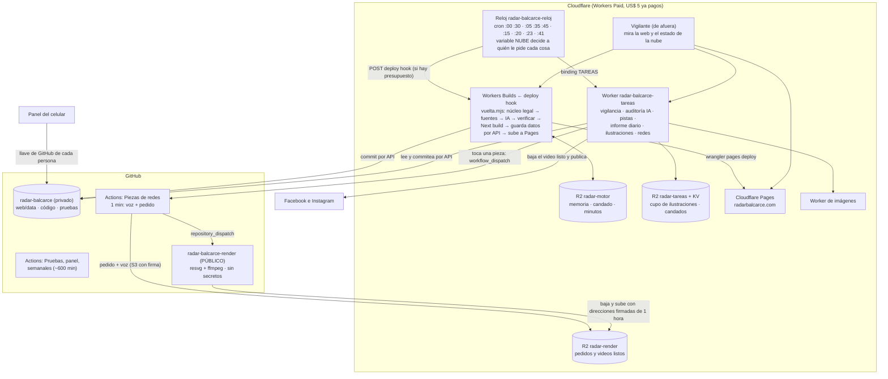

# La mudanza del robot a Cloudflare: qué se eligió, con qué números y qué quedó afuera

*18/10/2026. Hernán ordenó: "que se haga todo el cambio de una vez en cuanto a cloud o GitHub o lo que sea; terminá de una vez el trabajo" y, antes, "para eso pagamos los 5 dólares de Cloudflare; no sumes nada que sume costo". La meta: que el repositorio principal entre en los **2.000 minutos gratis de un repositorio privado** (hoy gasta unos 14.400 facturables por mes, unos 11.000 reales), sin que la web ni las redes dejen de salir y con vuelta atrás fácil. El cómo se hace, paso por paso y con lo que pega una persona: `PLAN-DE-CAMBIO.md`. Parte de `DISENO-MOTOR.md` y `ANALISIS.md` de esta carpeta, y de `docs/08-INFRAESTRUCTURA.md` ("Los minutos de GitHub").*

**Cómo leer las marcas.** **[LEÍDO 18/10]** es una cifra que sale de la documentación oficial de Cloudflare que se abrió hoy (las direcciones están en la sección 1). **[MEDIDO]** es un dato real del proyecto. **[ESTIMADO]** es una cuenta mía con esos datos. **[SIN PROBAR EN WORKERD]** es algo que anda en Node con pruebas pero que esta máquina no pudo correr dentro del motor de Workers (`workerd` no arranca en esta PC: "access violation" de Windows), y se ensaya con el modo simulacro del paso 6 del plan antes de apostar.

---

## 0. En diez líneas

1. **"Actualizar la web" (8.100 min) pasa a Workers Builds**, la máquina de compilación de Cloudflare: **6.000 minutos por mes incluidos en el plan que ya se paga**, 4 vCPU, 8 GB, hasta 20 minutos por compilación **[LEÍDO]**. La vuelta de siempre (leer fuentes, juntar, decidir, escribir con IA, verificar, compilar Next, subir a Pages) corre como UN programa de Node (`infra/motor-cloudflare/vuelta.mjs`) y la despierta el reloj de Cloudflare con un *deploy hook*.
2. **El motor guarda sus datos con la API de GitHub, no con `git push`**: sin minutos de Actions, sin tocar el panel del celular ni los workflows que leen `web/data/`. La memoria entre vueltas (el cruce de medios), el candado y el contador de minutos viven en R2.
3. **Un presupuesto automático de minutos** (`presupuesto.mjs`) hace que el motor nunca pase de lo incluido: con una vuelta de ~5 minutos corre ~38 veces por día en vez de 48. Si se quiere 48 siempre, cuesta unos US$ 6 por mes (decisión de Hernán, una variable).
4. **Las tareas chicas (vigilancia, auditoría IA, pistas, informe diario, ilustraciones y la parte de "Redes" que no necesita ffmpeg) pasan a UN Worker de Cloudflare** (`radar-balcarce-tareas`): el mismo código, que no importa nada de afuera de Node, corre con `nodejs_compat` sobre un sistema de archivos en memoria. Cuestan 0 (Workers Paid incluye 10 millones de pedidos).
5. **El video se arma en el repositorio público `radar-balcarce-render`** (minutos ilimitados, **sin ningún secreto**): el principal le manda un pedido con direcciones firmadas de una hora de R2 y el resultado vuelve por R2.
6. **Un solo interruptor, `NUBE`, en el reloj**: la lista de workflows que corren en Cloudflare. Vacía = todo en GitHub, igual que ayer. Se mudan de a uno y se vuelve atrás en minutos.
7. **Costo nuevo: US$ 0.** R2 (depósitos chicos), KV, Workers y Builds quedan dentro del plan de US$ 5. **Minutos de GitHub que quedan: ~1.600 a 1.800 por mes [ESTIMADO]**: entra en los 2.000, con poco margen (sección 5).
8. **Lo que NO entra**: reescribir el motor para Workflows/D1 (el diseño de `DISENO-MOTOR.md`), compilar Next dentro de un Worker, armar video en un Worker o en un Container (costaría ~US$ 2 por mes), y mover los datos de git a R2 (obligaría a rehacer el panel del celular). Cada uno con su motivo en la sección 7.
9. **Lo que no pude comprobar**: nada de lo que corre en el motor de Workers (`workerd`), ni el cobro real de Workers Builds. El código está probado en Node con un GitHub y un R2 de mentira (**117 pruebas nuevas**, más las 2.590 de siempre, todas en verde), el empaquetado de los Workers se verificó con `wrangler deploy --dry-run`, y el plan tiene un ensayo en seco por cada pieza antes de prender nada.
10. **Preguntas para Hernán** (sección 9): las dos que cambian plata o calidad son si se acepta que la web se arme cada ~38 minutos o se paga US$ 6, y si el repositorio de render público está bien con que cualquiera pueda ver los guiones y las placas (ya son públicos al salir al aire).

---

## 1. Lo que dice la documentación oficial (leída el 18/10/2026)

| Tema | Lo que dice | Página |
|---|---|---|
| **Workers Builds, minutos y límites** | Paid: **6.000 minutos de compilación por mes**, **+US$ 0,005 por minuto de más**; tiempo máximo **20 minutos**; **4 vCPU** (Free: 2) y **8 GB** de memoria; **6 compilaciones a la vez** (Free: 1); disco 20 GB; 64 variables de 5 KB por Worker | developers.cloudflare.com/workers/ci-cd/builds/limits-and-pricing/ |
| **Cómo se dispara** | Con un `git push` a la rama conectada **o con un *deploy hook***: `POST https://api.cloudflare.com/client/v4/workers/builds/deploy_hooks/<ID>`, **sin llave** (el ID de la dirección es la credencial), una rama por *hook*, **10 por minuto por Worker**; si se repite el POST mientras el anterior está en cola, devuelve el mismo build. **No pide un commit nuevo.** El ejemplo oficial es justamente un Worker con Cron Trigger que le hace POST al *hook* | .../builds/deploy-hooks/ |
| **Qué se puede configurar** | Directorio raíz, **comando de compilación**, **comando de despliegue** (por defecto `npx wrangler deploy`, **se puede cambiar**), **variables y secretos que sólo ve la compilación**, rama. Las compilaciones corren con el Worker conectado a un repositorio de GitHub o GitLab | .../builds/configuration/ |
| **La máquina** | Ubuntu 24.04, **Node 24.18.0** (también 22.23.2), git, build-essential, libvips, Python, Bun… **`ffmpeg` no figura**. Se cambia la versión de Node con `NODE_VERSION` o `.nvmrc` | .../builds/build-image/ |
| **Workers (cron y pedidos)** | Paid: CPU por pedido HTTP hasta **5 minutos** (30 s por defecto, se sube con `limits.cpu_ms`); por *Cron Trigger*: **30 s** si corre más seguido que cada hora, **15 min** si corre cada hora o menos; duración (reloj de pared) de un cron: **15 min**; subpedidos por ejecución **10.000**; **6 conexiones abiertas a la vez**; memoria **128 MB**; tamaño del Worker 64 MiB sin comprimir; **250 crons por cuenta** | .../workers/platform/limits/ |
| **Workflows** | Paid: CPU por paso 30 s (hasta 5 min), **tiempo de pared por paso ilimitado**, 10.000 pasos (hasta 25.000), 1 GB de estado por instancia, 50.000 instancias a la vez | .../workflows/reference/limits/ |
| **Containers** | Con Workers Paid: **25 GiB-hora de memoria, 375 vCPU-minutos, 200 GB-hora de disco por mes incluidos**; de más: US$ 0,0000025 por GiB-s, US$ 0,00002 por vCPU-s; tipos desde "lite" (1/16 vCPU, 256 MiB) hasta "standard-4" (4 vCPU, 12 GiB) | .../containers/pricing/ |
| **R2** | 10 GB-mes, 1 millón de operaciones de escritura y 10 millones de lectura **gratis por mes**; salida a Internet gratis | .../r2/pricing/ |
| **`node:fs` en Workers** | Con `nodejs_compat` y fecha de compatibilidad ≥ 2025-09-01 está disponible: un sistema de archivos **en memoria**; `/tmp` **escribible, por pedido** (no se comparte entre pedidos); `/bundle` de sólo lectura; hasta 128 MB por archivo; `fs.rm` sin la opción `force`; fechas siempre "época" | .../nodejs/fs/ |
| **Módulos de Node** | `crypto`, `fs`, `path`, `url`, `util`, `process`: soportados. **`child_process` y `worker_threads`: stubs que se pueden importar pero no hacen nada** (fecha ≥ 2026-03-17) | .../nodejs/ |
| **`process`** | `process.env` se llena con las variables y secretos del Worker (`nodejs_compat_populate_process_env`, por defecto desde 2025-04-01); `process.cwd()` es `/bundle`; no dice nada de `argv`, `exit` ni `import.meta.dirname` | .../nodejs/process/ |

**Lo que la documentación no dice** (por eso los *[SIN PROBAR EN WORKERD]*): si Workers Builds acepta repositorios **privados** (la página de configuración no lo aclara; la integración con GitHub funciona con la aplicación de Cloudflare, que se autoriza por repositorio), si cuenta como minuto el tiempo en cola y la instalación de dependencias, si hay caché de `node_modules`, y si `process.env` ya está lleno **al importar** los módulos (en el ámbito global del Worker).

## 2. Las opciones, con números

La meta es sacar de GitHub Actions ~12.800 minutos por mes sin gastar. Se miraron cinco caminos para el motor ("Actualizar la web", 8.100 min) y tres para el video:

| Opción | Costo nuevo | Cabe | Esfuerzo | Veredicto |
|---|---|---|---|---|
| **A. Motor en Workers Builds** (elegida) | US$ 0 hasta 6.000 min/mes; ~38 vueltas por día en vez de 48 | La vuelta de hoy tarda ~4,5 min en Actions [MEDIDO: media 249 s + 30 s de subida]; 20 min de tope y 8 GB sobran | Un programa de Node que reemplaza al YAML; 21 pruebas | **Sí** |
| B. Motor en Workflows + D1 + Worker web (`DISENO-MOTOR.md`) | ~US$ 5 a 8 | Next no compila en un Worker (128 MB, 5 min de CPU, sin disco real); hay que servir las páginas desde un Worker y reescribir ~70 módulos | 6 a 10 semanas | **No ahora** (sección 7) |
| C. Motor en Containers | ~US$ 3 (48 vueltas × 5 min × 1 vCPU = 12.000 vCPU-min; 375 incluidos) | Sí, con Node completo | Medio; Containers es nuevo, y suma un costo | **No** (rompe "no sumes costo") |
| D. Motor en un *runner* propio (PC, VM gratis) | US$ 0 | Sí | Hay que mantener una máquina prendida 24/7 fuera de Cloudflare | Plan C si algo de A no anda |
| E. Dejar el repositorio público | US$ 0 | Sí | Nada | Es la vuelta atrás de todo el plan |
| **Video V1. Repositorio público de render** (elegida) | US$ 0 (minutos ilimitados) | Sí | Un paquete (`infra/render-publico/`) + el pedido | **Sí** |
| Video V2. Container de Cloudflare | ~US$ 2 por mes (14 piezas × ~3 min × 1 vCPU: 1.260 vCPU-min, 375 incluidos → ~885 de más × 60 s × US$ 0,00002 = US$ 1,06; memoria: ~100 GiB-hora de más = US$ 0,9) | Sí | Medio | Para después, si hace falta (suma costo) |
| Video V3. ffmpeg y resvg dentro de un Worker | US$ 0 | **No**: son programas nativos; el Worker tiene 128 MB y sin `child_process` | — | Imposible |

**Tareas chicas**: Workers con *Cron* (30 s de CPU si corren más seguido que cada hora, 15 min si no) o pedido HTTP (hasta 5 min de CPU). Las seis tareas pasan de lejos: lo que tardan es **esperar** a una IA o a Meta, y esa espera **no cuenta como CPU**. Se eligió el pedido HTTP desde el reloj (por *binding* de servicio) porque da 5 minutos de CPU y deja un solo lugar que decide qué corre dónde.

### Por qué el motor sigue guardando en git (por API) y no en R2

El pedido era mover el estado a R2/KV "en vez de commits a git". El estado **de la memoria entre vueltas, el candado y los minutos** sí está en R2. Los **datos** (`web/data/*.json`, las fotos) **no**, y es a propósito:

- **Los lee y los escribe más gente que el motor**: el panel del celular (con la llave de GitHub de quien lo usa), "Panel del celular" (`panel.yml`), la Auditoría, "Piezas", "Reintentar pieza", el respaldo, y ahora el Worker de tareas. Mover la verdad a R2 obliga a rehacer el panel, que `DISENO-MOTOR.md` ubica en la etapa 8 (2 a 3 semanas) y que Hernán dijo que se rehace de cero aparte.
- **Borrados y fotos**: el sitio se compila de `web/public/fotos-notas/` (942 archivos, 67 MB) y de `web/data/` (7 MB). Con la verdad en R2 hay que restaurar todo encima del clon *y borrar* lo que el clon trae de más (las fotos podadas), si no el sitio publica lo que ya se sacó. Es un riesgo de publicar algo retirado (menores, víctimas), no una comodidad.
- **No ahorra un minuto**: lo que cuesta minutos es **correr** el trabajo, no guardar su resultado. Guardar por la API de GitHub no gasta Actions.
- **Vuelta atrás**: con los datos en git, volver a GitHub es cambiar una variable. Con los datos en R2 hay que exportarlos antes.

Lo que el motor aprendió de esa idea: **todo lo que guarda pasa por `infra/compartido/github.mjs`** (una sola puerta, con la lista exacta de archivos de `archivos.mjs`), así que el día que la verdad se mude a D1/R2 (etapa del diseño grande) hay UN lugar que cambiar.

## 3. La arquitectura

**Lo que se cuida en cada flecha:**

- **Reloj → motor**: el POST no lleva llave (el ID del *hook* es el secreto, un secreto del Worker, nunca en el código). Antes de pedir, consulta el presupuesto en R2 (`motor/minutos/AAAA-MM.json`) y se saltea la vuelta si se pasó de lo que corresponde, salvo que lleve 3 horas sin una buena.
- **Motor → GitHub**: un commit por API sobre la cabeza actual de `main`, con el mensaje y el autor de siempre (`Datos de la portada · 18/10 10:07`, `balcar-dev` noreply). Los archivos propios ganan en un choque (como el `--theirs` del workflow). Si mientras se armaba entró algo que el sitio lee (una retirada del celular), se trae y se vuelve a compilar antes de subir (regla 189 de siempre).
- **Tareas → GitHub**: el corredor (`corredor.mjs`) baja **sólo** los archivos que la tarea declara, corre el programa de siempre sobre una carpeta de `/tmp`, y guarda lo que cambió **aunque el programa haya fallado a mitad** (el libro de redes no puede perder un posteo que ya salió). Las pistas se unen cambio por cambio con lo que escribió una persona (`panel/unir-conflictos.mjs`).
- **Pedido de video**: el pedido (`pedido.json`) lleva el guion, las placas, la escena y la huella de la voz; el render rechaza lo que no cumple (nombre con barras, texto que no coincide con el guion, escena desconocida, voz distinta, direcciones que no son de R2). El manifiesto se sube **último**: el Worker sólo publica cuando lo ve.

## 4. Qué hace cada pieza (y de dónde sale)

| Pieza | Archivos | Qué reemplaza |
|---|---|---|
| Firma S3 y cliente de R2 sin dependencias (probado con los dos ejemplos oficiales de Amazon) | `infra/compartido/r2-s3.mjs` | `wrangler r2 object …` y las claves en el render |
| Guardar/leer en GitHub por API (commit de varios archivos con reintento y unión) | `infra/compartido/github.mjs` | `git pull --rebase` + `git push` de seis workflows |
| La vuelta del motor | `infra/motor-cloudflare/{vuelta,archivos,estado-r2,presupuesto,listo,worker}.mjs` | `actualizar.yml` (queda para la vuelta atrás) |
| El reloj con el interruptor | `infra/reloj-cloudflare/{nube.mjs,nube.toml.parte}` y `worker.mjs` | el `despertar` a GitHub |
| El Worker de tareas | `infra/tareas-cloudflare/{entrada,arranque,worker,corredor,tareas,redes}.mjs` | `vigilancia.yml`, `auditoria-ia.yml`, `pistas.yml`, `informe-diario.yml`, `ilustrar-notas.yml`, la mitad de `redes.yml` |
| El pedido de video y su envío | `reels/{pedido,render-remoto}.mjs`, `reels/escenas/registro.mjs`, `.github/workflows/redes-piezas.yml` | la otra mitad de `redes.yml` (armar el video) |
| El render público | `infra/render-publico/` (copiado con `scripts/sincronizar-render-publico.mjs`) | `reels/reel.mjs` corriendo en Actions |
| El vigilante que mira la nube | `infra/vigilante-cloudflare/worker.mjs` (`revisarLaNube`, `problemasDeLaNube`) | las alarmas "el reloj no corre" de `redes/vigilar.mjs` |
| Subir todo | `.github/workflows/desplegar-nube.yml`, `infra/compartido/secretos-para-wrangler.mjs` | los workflows sueltos de cada Worker |

Los programas de las tareas **se adaptaron lo mínimo** para correr sin `process.exit`, sin `process.argv` y con la carpeta del proyecto por parámetro (`redes/raiz.mjs`): `redes/vigilar.mjs`, `redes/auditar-notas.mjs`, `panel/revisar-pistas.mjs`, `redes/informe-diario.mjs`, `redes/publicar.mjs` ahora exportan `main({ argv, env, raiz })`. Desde la terminal y desde GitHub se comportan igual (las pruebas viejas lo controlan).

## 5. Cuánto cuesta y cuántos minutos quedan

### Plata por mes

| Concepto | Antes | Después |
|---|---|---|
| Workers Paid (incluye Workers, Cron, Builds, R2/KV chicos) | US$ 5 | US$ 5 |
| Workers Builds (6.000 incluidos; con el presupuesto, ~5.880) | — | US$ 0 |
| R2: 3 depósitos nuevos, < 1 GB y pocas operaciones por vuelta (<< 1 millón de escrituras) | — | US$ 0 |
| KV y pedidos de los Workers (10 millones de pedidos incluidos; el sistema hace unos cientos por día) | — | US$ 0 |
| GitHub: repositorio privado dentro de los 2.000 minutos | US$ 0 (público) | US$ 0 si se cumple la estimación; **US$ 0,008 por minuto de más** |
| Repositorio público de render | — | US$ 0 |
| **Total nuevo** | | **US$ 0** (riesgo: unos US$ 2 si GitHub pasa de 2.000 en 250 minutos; US$ 6 si se elige correr siempre 48 vueltas) |

### Minutos de GitHub por mes (facturables, redondeando cada corrida al minuto) [ESTIMADO]

| Workflow | Antes (desde el 17/10) | Después | Dónde queda |
|---|---|---|---|
| Actualizar la web | 8.100 | **0** | Workers Builds (~5.880 de 6.000) |
| Cloudflare Pages | 0 | 0 | a mano |
| Redes | 3.200 | **~850** (sólo «Piezas de redes»: ~12 pedidos por día × ~1,5 min, redondeado a 2) | el reloj, Facebook y publicar, en el Worker; el video, en el render público |
| Vigilancia | 330 | **0** | Worker |
| Auditoría IA | 1.000 | **0** | Worker |
| Pistas | 240 | **0** | Worker |
| Ilustrar notas sin foto | 810 | **0** | Worker |
| Informe diario | 90 | **0** (con `INFORME_RESPALDO_EN_GITHUB=No`) | Worker |
| Panel del celular (`panel.yml`, pedidos a la IA desde el celular) | ~170 | ~170 | sigue en Actions (el celular lo despierta con su llave) |
| Pruebas (con `cancel-in-progress`), armado con datos vacíos, semanales (auditoría, respaldo, pruebas con otra hora) y lo que se corre a mano | ~600 | ~600 a 800 | sigue en Actions |
| **Total** | **~14.400** | **~1.620 a 1.820** | |

**Margen: 180 a 380 minutos (9 a 19 %).** Es poco. Qué lo mueve: los pedidos de video (si el reloj pide piezas más veces que las 12 por día que se supusieron, o si el render falla y se reintenta: hay un tope de 4 pedidos por pieza y por día), cuántos cambios de código se suben (cada uno corre las pruebas, ~3 minutos) y si "Panel del celular" se usa más. **Palancas, de la más barata a la más cara:** (1) `INFORME_RESPALDO_EN_GITHUB=No` (ya está contado); (2) que `pruebas.yml` no corra en cambios de sólo documentos (`paths-ignore: docs/**, *.md`) — ahorra ~100; (3) pasar "Panel del celular" al Worker (cuando el celular se rehaga); (4) si igual se pasa: US$ 0,008 por minuto (250 de más son US$ 2).

### Minutos de Workers Builds por mes [ESTIMADO, hay que medir la primera semana]

La vuelta de hoy tarda **4,5 minutos** en Actions (p50 226 s, media 249 s, + 30 s de subida) [MEDIDO]. En Workers Builds se le suma el clon y la cola (el programa se anota 0,5 min de más por vuelta). Simulación del mes entero con el presupuesto (`pruebas/motor-cloudflare.test.mjs`, cada media hora):

| Duración de la vuelta (+0,5 de cola) | Vueltas por mes | Por día | Minutos gastados | Máx. sin vuelta |
|---|---|---|---|---|
| 3,5 min | 1.471 | 47,5 | 5.884 | 0,4 h |
| 4 min | 1.307 | 42,2 | 5.882 | 0,4 h |
| **4,5 min (lo esperado)** | **1.177** | **38,0** | **5.885** | **0,4 h** |
| 5 min | 1.070 | 34,5 | 5.885 | 0,4 h |
| 6 min | 905 | 29,2 | 5.883 | 0,4 h |

O sea: **nunca pasa de ~5.900 de los 6.000** y nunca deja la web más de ~35 minutos de más sin armarse; a cambio, con vueltas de 5 minutos la web se arma cada ~42 minutos en promedio en vez de cada 30. **Para volver a 48 por día** hay que bajar la vuelta a ~3 minutos (la caché de `node_modules` de Workers Builds, si existe, ahorra ~1 minuto) o aceptar pagar: `MOTOR_SIN_TOPE=Si` en el reloj = 48 vueltas × 5 min = 7.200 → **1.200 de más × US$ 0,005 = US$ 6 por mes**.

## 6. Los límites que mandaron

- **El motor cabe**: 20 min de tope (la vuelta tarda ~5; el 95 % de las de Actions tarda menos de 8; la peor que se midió, 20 minutos, se cortaría y la vuelta siguiente la retoma), 8 GB de memoria y 4 vCPU de sobra para Next. `vuelta.mjs` se rinde a los 18 minutos y lo dice.
- **Los Workers no tienen disco, ni `git`, ni `ffmpeg`**: por eso el motor corre en la compilación (Node completo) y las tareas usan el sistema de archivos en memoria de `nodejs_compat` (y `child_process` es un stub: nada de lo que corre en el Worker lo llama; lo comprobó el empaquetado).
- **128 MB de memoria por Worker**: `archivo.json` pesa 3,2 MB y todo `web/data` 7 MB; un video de redes pesa 5 a 20 MB y se baja y se borra de a uno. Las ilustraciones piden las fotos de a una.
- **6 conexiones a la vez**: el corredor baja los archivos de a 5.
- **Los criterios se leen del disco al importar**: `CRITERIO-EDITORIAL.md` y `CRITERIO-REDES.md` (si faltan, la IA no escribe: regla de siempre). En un Worker no hay disco, así que viajan **adentro del paquete como texto** (`arranque.mjs`, se carga antes que cualquier programa del proyecto) y `fs.readFileSync` los devuelve cuando alguien los pide por su nombre. Una prueba controla que, con eso instalado, **nada más se lee del disco al importar**.
- **GitHub**: `repository_dispatch` admite 10 propiedades y 65.535 caracteres de aviso (el nuestro lleva 5 y ~5.000); una llave personal de GitHub da 5.000 pedidos por hora (se usan unos 300).
- **Minutos del vigilante de afuera**: el vigilante de Cloudflare ya no puede mirar corridas de GitHub de lo que se mudó; ahora le pregunta su estado (`GET /estado`) a los Workers del motor y de las tareas, y avisa si una tarea lleva más del doble de su ritmo sin salir bien.

## 7. Lo que NO entra, y por qué

| Cosa | Por qué no |
|---|---|
| **El motor nuevo con Workflows + D1 + sitio servido desde un Worker** (`DISENO-MOTOR.md`) | Es el destino de largo plazo, pero son 6 a 10 semanas y reescribir ~70 módulos que leen archivos. No hace falta para entrar en los 2.000 minutos. Sigue siendo la etapa 2027: lo hecho acá la prepara (una sola puerta de guardado, tareas declaradas, estado de la vuelta en R2). |
| **Compilar Next dentro de un Worker o un Workflow** | Imposible hoy: 128 MB de memoria, 5 minutos de CPU como máximo, sin disco real, y Next 15 necesita Node y más de 1 GB. |
| **Armar el video con ffmpeg/resvg en un Worker** | Son programas nativos; el Worker tiene 128 MB y `child_process` es un stub. |
| **Armar el video en un Container de Cloudflare** | Anda, pero suma ~US$ 2 por mes y está en beta. Queda como "Fase 2" si el render público algún día molesta (por ejemplo, si no se quiere que los guiones estén en un repositorio público). |
| **Los datos en R2 en vez de en git** | Ver la sección 2. Obliga a rehacer el panel y mete el riesgo de publicar fotos ya retiradas. |
| **Workers Builds como máquina de TODAS las tareas** | Los 6.000 minutos son una sola bolsa: las tareas sumarían ~2.000 minutos más por mes (US$ 10 de más). |
| **Un *runner* propio gratis (Oracle, PC)** | Una máquina más que mantener, fuera de Cloudflare. Es el plan C si algo de Workers Builds no anda. |
| **Pasar "Panel del celular" al Worker** | El celular lo despierta con la llave de GitHub de cada persona (`workflow_dispatch`); cambiarlo es rehacer el panel. Cuesta ~170 minutos y está dentro de la cuenta. |
| **"Reintentar pieza" con los videos de la nube** | `reintentar.yml` baja el adjunto de una corrida vieja de «Redes»; los videos nuevos no son adjuntos sino objetos de R2. Mientras dura la mudanza el botón sólo sirve para piezas armadas por el «Redes» viejo; en la nube el reloj reintenta solo (hasta 4 pedidos por pieza y por día). |
| **Cloudflare Access para el panel, contador propio de lectores, UTM…** | Son de otras etapas del diseño grande y no cambian minutos. |

## 8. Cómo se probó, y qué falta probar

**Probado en Node (con un GitHub y un R2 de mentira, sin red):** la firma de R2 contra los dos ejemplos oficiales de Amazon; el commit por API (varios archivos, borrados, el choque con otro que sube en el medio, la unión de pistas, la rama que no deja de avanzar); la vuelta entera paso por paso (en el orden del workflow, con el núcleo legal que corta todo, sin subir si no compila o no se pudo guardar, con el candado, el simulacro y la recompilación cuando entra algo que el sitio lee); el presupuesto de un mes entero; el reloj con y sin `NUBE`; **cada tarea con los datos reales del repositorio, controlando que no lea ni escriba nada sin declararlo** (esa prueba ya encontró dos cosas: los datos de efemérides y feriados que lee el cronograma, y los dos criterios al importar); el video de punta a punta (plan real del día → pedido → render del repositorio público → subida con el manifiesto último → el Worker de tareas lo deja listo para publicar), con un video de verdad armado con ffmpeg y resvg.

**Verificado con `wrangler deploy --dry-run`:** que el Worker de tareas empaqueta (881 KiB, 256 KiB comprimido; el tope de Paid es 10 MB), que los criterios entran como texto y se cargan antes que el resto, y que no queda ningún `import.meta` sin reemplazar.

**NO probado en el motor de Workers (`workerd`)** — se ensaya con el simulacro (`POST /correr` con `"simular": true`, o `MOTOR_SIMULAR=Si`), en el paso 6 del plan, antes de prender nada:

1. Que `process.env` ya tenga las variables **al importar** (si no, `REDES_ACTIVAS` se leería vacío): `publicar.mjs` las vuelve a leer en cada `main`, pero `reels/claves.mjs` etc. leen al llamar, no al importar (bien).
2. Que `fs.readFileSync` se pueda reemplazar (el truco de `arranque.mjs` asigna una propiedad del objeto `fs`): si el módulo estuviera congelado, el Worker no arranca y `GET /` lo dice enseguida.
3. Que `fs.rmSync`/`readdirSync`/`statSync` del sistema en memoria se comporten como en Node (la documentación sólo lista unas pocas diferencias).
4. Que Workers Builds acepte el repositorio privado, el comando de despliegue cambiado y el *deploy hook*; y cuántos minutos cobra de verdad (la primera semana se compara el contador del panel con el registro de la vuelta, `motor/minutos/`).
5. Que `wrangler pages deploy` ande desde esa máquina con el token propio (variable de compilación `CLOUDFLARE_API_TOKEN`).
6. Que subir un video de 5 a 20 MB desde un Worker a Meta (`fetch` con `Uint8Array`) ande dentro de los 15 minutos del pedido.

Cada una tiene **su vuelta atrás de un clic** (sacar el workflow de `NUBE`).

## 9. Decisiones para Hernán

1. **¿Web cada ~38 minutos (gratis) o cada 30 (US$ 6 por mes)?** Es `MOTOR_SIN_TOPE`. Mi recomendación: gratis, y mirar la primera semana cuánto tarda de verdad la vuelta (si baja de 3,5 minutos, vuelven las 48 solas).
2. **El repositorio de render es público**: cualquiera puede ver los guiones, las placas y las direcciones de video *de lo que ya salió al aire* (nunca de lo que espera a una persona: Política y Policiales no llegan al render hasta que se aprueban). Si no se quiere, la alternativa es el Container (US$ 2).
3. **El repositorio principal privado**: lo hace una persona al final, cuando el plan lleve 3 días sin errores (paso 12).
4. **Las llaves nuevas** (`RADAR_GITHUB_TOKEN`, `RENDER_GITHUB_TOKEN`, las de R2) las crea y las pega una persona (nunca en un chat): están en la tabla del plan.
